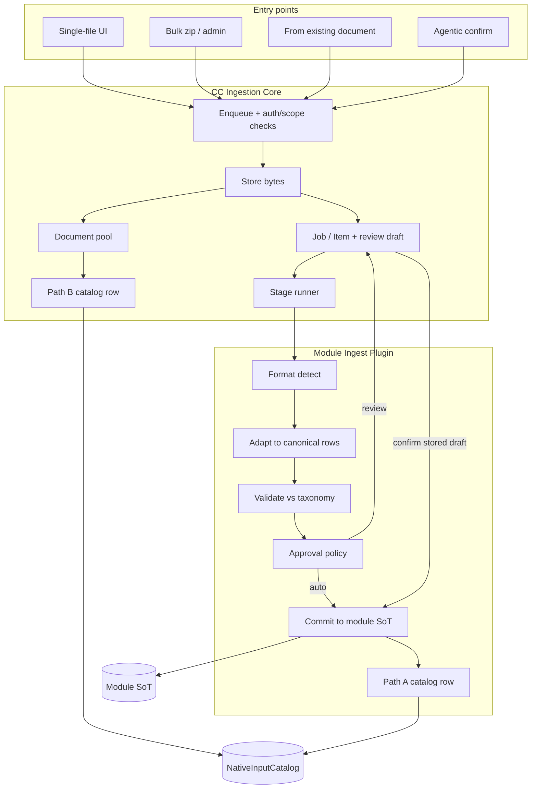
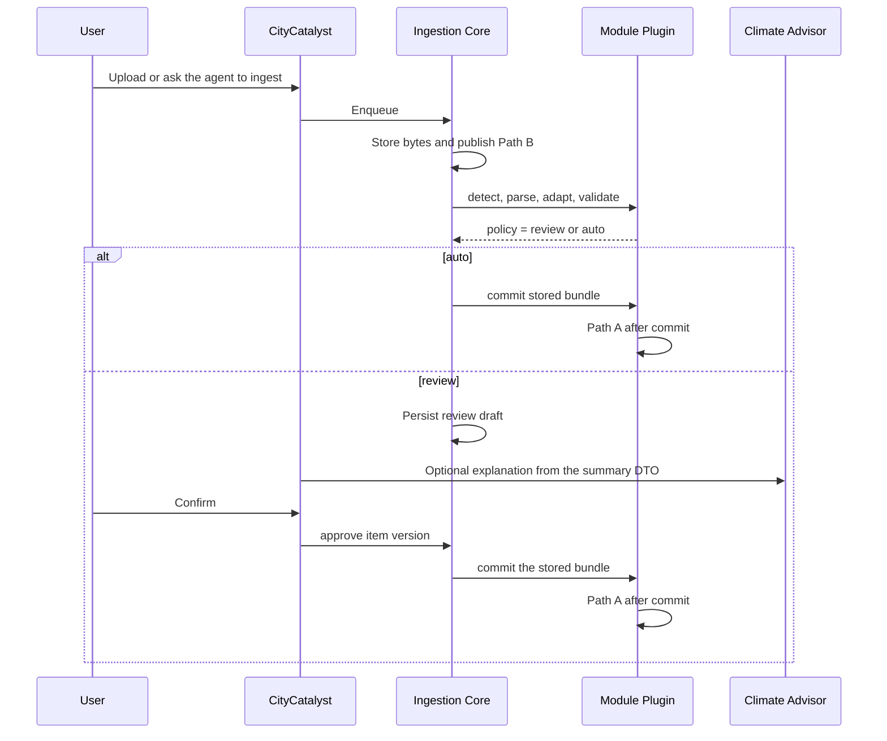

# Generic File Ingestion Architecture

> **Status:** living doc on the ingest spine. Drafted on [PR #3171](https://github.com/Open-Earth-Foundation/CityCatalyst/pull/3171); first runner code on [PR #3344](https://github.com/Open-Earth-Foundation/CityCatalyst/pull/3344) ([CC-989](https://linear.app/openearth/issue/CC-989/add-ingestion-jobitem-model-stage-runner-and-plugin-contract)). Product closed D7 / D9 / review locks on 2026-10-26.
> **Companion docs:** NativeDocumentStorageArchitecture · AgenticModuleScope · ConceptNoteBuilderArchitecture · CCRAModuleArchitecture (sibling drafts; not all are in this tree yet)
> **Implementation slices:** [CC-953](https://linear.app/openearth/issue/CC-953/implement-generic-file-ingestion-spine) and the child tickets named in [Migration](#migration-plan)

## One-line intent

CityCatalyst gets a **shared file ingestion spine** — upload, store, detect, parse, map, validate, review/auto-approve, commit — that **modules plug into** with their own formats and taxonomies, so GHGI, CCRA, CNB, and future modules do not each reinvent ingestion.

A stored file is a **city asset** when it was uploaded in a city's context. The person who uploaded it is the author, not the owner. Module extracts are separate catalog entries that point at that document. They are written only after the module validates them and a Decide step allows the commit.

Every imported value stays traceable to its source document. GPC asks for transparency on data sources and methods, so dropping that link is a trust failure, not only a missing foreign key.

---

## Problem

File upload today is **module-shaped glue**, not a platform capability:

| Surface | What exists | Limitation |
| --- | --- | --- |
| GHGI single-city wizard | Validate → parse → Path A eCRF / Adapter D / AI Path B → human approve → `InventoryImportService` | Inventory-scoped only; interactive |
| GHGI bulk (CC-878) | Zip → match city/year → classify → auto-approve eCRF/near-eCRF → worker | GHGI-only job tables; rejects non-eCRF |
| CNB / agentic | Upload → OCR / Markdown → native pointer → agent workflow → user-gated commit | Document Path B, not structured domain rows |
| CCRA | Dashboard + Global API sync proposal | No city-file ingest story yet |
| NativeInputCatalog | Discovery pointers after a file is durable enough to reuse | Not an ingest pipeline |

The same PDF can be rejected, sit in review, or later feed GHGI and CNB. Today that file does not have one access-controlled identity across those states, and a restart can lose the mapping the reviewer confirmed.

As more modules accept city-provided files (risk workbooks, resilience scorecards, CAP PDFs, etc.), repeating this stack per module will diverge on status models, S3 keys, approval rules, and “what is valid CityCatalyst data?”

---

## Goal

Define an architecture where:

1. **CC Core** owns the shared ingestion lifecycle (bytes, jobs, stages, errors, auth/tenancy hooks).
2. **Modules** own format detectors, adapters, target taxonomies, and writers into their **system of record (SoT)**.
3. Output of a successful ingest is always data that **matches the module’s CityCatalyst schema/taxonomy** — never raw vendor spreadsheets as product state.
4. The same spine serves **UI upload**, **admin/bulk zip**, and **agentic** flows (draft → confirm → commit).
5. The **source file** is registered in `NativeInputCatalog` when its bytes are durable (**Path B**). Each **module extract** is registered only after that module commits (**Path A**).
6. Review state is durable. Approve replays the bundle the reviewer saw.

### Non-goals

- One mega-table that stores every module’s domain rows. The catalog holds pointers only.
- Replacing module SoTs (GHGI activities, CCRA scores, CNB chapters, etc.).
- Forcing every format through LLM interpretation.
- Giving Climate Advisor S3 keys or file SoT ownership.
- A second CNB upload record. Climate Advisor keeps `concept_note_uploads` and the immutable `upload_id`.
- Rewriting GHGI bulk from scratch in v1 of this architecture (see Migration).
- One zip that dispatches to several module plugins (see D3).

---

## What is already running

These behaviors exist on `develop` as of 2026-10-26. The job/item runner in this tree is [PR #3344](https://github.com/Open-Earth-Foundation/CityCatalyst/pull/3344); GHGI wizard and Chile bulk still use the services below until [CC-991](https://linear.app/openearth/issue/CC-991/add-ghgiingestplugin-over-the-existing-ghgi-import-services).

| Behavior on `develop` | Where |
| --- | --- |
| GHGI validate / adapt | `FileValidatorService`, `FormatAdapterService`, `ECRFImportService` |
| GHGI commit | `InventoryImportService.importECRFData` |
| Single-file and bulk share classify → adapt → commit | `InventoryFileAutoImportService` |
| Bulk job, items, city/year match | `BulkInventoryImport*` services, models, and `BulkInventoryImportMatcher` |
| Catalog register, withdraw, supersede | `NativeInputCatalog`, `NativeInputCatalogService` |
| GHGI source file and inventory pointers | `GHGINativeInputCatalogService` |
| CNB / HIAP / MEED catalog pointers | module catalog services next to the GHGI one |

GHGI today registers the **source file** at the start of approve (`syncGHGIImportedInventorySource`) and the **inventory extract** after commit (`syncGHGIInventory`). The target below moves the source-file registration earlier, to durable store, and leaves the extract registration after commit.

On [PR #3344](https://github.com/Open-Earth-Foundation/CityCatalyst/pull/3344): `IngestJob` / `IngestItem`, the stage runner, the plugin contract, and a test plugin that does not write a module SoT. Core `detectCoarseFileKind` ([CC-959](https://linear.app/openearth/issue/CC-959/split-coarse-file-detect-core-from-format-detect-plugin)) maps files to `pdf | xlsx | csv | md | zip | unknown` and passes that into `plugin.detect`. Plugins do not MIME-allowlist. The GHGI wizard still uses `FileValidatorService` (`xlsx` / `csv` / `pdf`) until the GHGI plugin wraps it. Not running yet: document pool, Path B at store, GHGI plugin façade, from-document, withdraw/supersede. Those are the remaining children under [CC-953](https://linear.app/openearth/issue/CC-953/implement-generic-file-ingestion-spine).

### Shared lessons from GHGI

```text
bytes → FileValidatorService → FileParserService
      → (Path A ECRF | FormatAdapter D near-ecrf | AI interpret)
      → review / auto-approve policy
      → InventoryImportService.importECRFData (canonical commit)
      → NativeInputCatalog registration of the extract
```

Bulk (CC-878) proved:

- **Batch is orchestration**, not a second importer. `InventoryFileAutoImportService` reuses the same classify → adapt → commit path as the wizard’s happy path.
- **Deterministic formats auto-approve.** Formats that need OpenAI fail bulk items (`not_ecrf`) instead of inventing mappings silently.
- **Negative / edge semantics** belong in the shared parser/writer, not in a bulk-only fork.

### Lessons from NativeInputCatalog + CNB

- **Owner = module** of upload/commit. The catalog is a **lookup**, not the SoT.
- **Path A** = structured JSON from a module SoT. **Path B** = the file, and its OCR/Markdown, read via CC core.
- Agentic workflows prepare drafts and **wait for explicit confirmation** before product writes ([AgenticModuleScope](./AgenticModuleScope.md)).

---

## Durable source lifecycle

A PDF can be rejected, wait for review, or feed more than one module. In every one of those states it still has a discoverable, access-controlled identity. Unapproved structured rows do not enter a module SoT.

Three records stay distinct:

| Record | What it is | When it exists | Catalog |
| --- | --- | --- | --- |
| **Source document** | Bytes in the document pool. Content hash, city/org scope, uploader as audit | After a non-dry-run store. Remains if later review rejects the extract | **Path B**, as soon as the bytes are durable. Kind is document-oriented (`ingest` pool, or the uploading module — see D7). `markdownReady` is false until OCR finishes |
| **OCR / Markdown** | CC OCR job and result object for that same document | When OCR completes. Updates the Path B row; does not create a module extract | Same Path B row, `markdownReady` set. Source type stays the OCR job (`pdf_ocr_job` today) |
| **Module extract** | Canonical rows in that module’s SoT (GHGI activities, CCRA scores, …) | Only after taxonomy validation and Decide = commit | **Path A**, one row per committing module, after that commit. Points at the same content hash |

Eligibility:

"Visible" below means visible to the readers named in [Document ownership](#document-ownership). A concept-note working attachment is visible to that note's collaborators, not to every city user, until someone marks it as a city document.

| Document state | Path B visible to those readers | Module SoT rows |
| --- | --- | --- |
| Stored, not yet reviewed | Yes | None |
| `awaiting_review` | Yes | None |
| Rejected (`unknown_format`, policy reject, user reject) | Yes. The file remains in its visibility class | None |
| Committed for one module | Yes | That module’s Path A only |
| Dry-run | No catalog row | None |
| `withdrawn` | The row stays so values can name it. Availability is `withdrawn`. It is not offered for a new ingest | Imported values stay. Their source info says the document was withdrawn. They are removed only when the user confirms "delete including data" |
| `superseded` | The old row points at the replacement via `supersededById` | Unchanged. The user is asked whether to re-import |

Owner, scope, and identity for each record are in [Document ownership](#document-ownership). Delete and replace are in [Delete, replace, and versioning](#delete-replace-and-versioning).

---

## Desired end state

### Stack

1. **Ingestion Core** — document pool, job/item model, S3 storage helpers, stage runner, error taxonomy, dry-run, review-draft store.
2. **Module Ingest Plugins** — registered per product module (`ghgi`, `ccra`, `cnb`, …).
3. **Entry points** — single-file API, bulk zip API, from-document API, internal capability for agents. All call the same runner.
4. **Commit** — plugin writer persists to the module SoT, then registers the Path A pointer.
5. **Consumers** — UI status, agent status/report, and dashboards read the SoT. Discovery reads the catalog.



Path B is published at store time. Path A is published at commit time. A second module does not re-upload: it starts at [from-document](#cross-module-reuse) and adds its own Path A row beside the same Path B row.

---

## Core vs module ownership

| Concern | Owner | Notes |
| --- | --- | --- |
| Multipart / zip limits, path traversal, `__MACOSX` skip | Core | Same limits family as bulk GHGI |
| Document pool and S3 key layout `ingest/{module}/{jobId}/…` | Core | Modules do not invent bucket layouts. CNB bytes stay on the existing OCR key layout; see [CC and Climate Advisor](#cc-and-climate-advisor) |
| Job + item status, counts, dry-run, cancel | Core | Generalized from `BulkInventoryImportJob` / `Item` |
| Review draft, its digest, and approve/retry checks | Core | Plugin supplies the payload. Core stores and replays it |
| Auth, org freeze, module access, city/project scope | Core + existing Permission/Module services | Plugin declares the required scope shape |
| Coarse file kind (pdf, xlsx, csv, md, zip) | **Core** | Passed into the plugin. Plugins do not re-implement MIME allowlisting |
| Format detection / adapters | **Module plugin** | eCRF, near-eCRF, CCRA template, unknown |
| Canonical intermediate type | **Module plugin** | Typed per module. Not one global row type |
| Taxonomy / schema validation | **Module plugin** | Against CC form-schema / CCRA models / CNB contracts |
| Source reconciliation (value provenance, row accounting) | Core check, plugin supplies the pointer back to the file | [CC-990](https://linear.app/openearth/issue/CC-990/verify-imported-values-against-the-source-file-and-record-row). Failed accounting blocks commit |
| Approval policy | **Module plugin** | Auto vs review vs reject |
| Commit / replace / versioning of **module rows** | **Module plugin** | Writes the module SoT only |
| Path B registration | **Core** | After durable store. Not after module commit |
| Path A registration | **Module plugin**, via existing catalog services | After that module’s commit |
| UI copy, wizards, mapping screens | Module product UI | May share generic progress components |

**Hard rule:** Core never interprets domain columns. A preview is a sanitized summary DTO from the plugin. Core stores that DTO so the review screen and the agent read the same object.

---

## Document ownership

Product proposal for [CC-954](https://linear.app/openearth/issue/CC-954/spike-document-ownership-hierarchy-sot). The city owns documents uploaded in its context. The user who uploaded a document is recorded as its **author**, not its owner. Inventories are team work and outlive individual users. If the user were the owner, documents would be orphaned when someone leaves. Cross-module reuse only works if the document belongs to the city.

| Case | Owner | Who can see it | Other modules and Clima |
| --- | --- | --- | --- |
| Inventory file (Excel, PDF) uploaded in GHGI | City | Users with access to the city | Yes |
| City document uploaded in CNB (action plan, report) | City | Users with access to the city | Yes |
| Working attachment of a concept note (draft, internal note) | City, visible only inside that concept note | Collaborators of that concept note | No, until a user marks it as a city document |
| Document not tied to a city (org or project) | Organization or project | Members with access to that org or project | Yes, inside that scope |

`userId` stores the author. It is not an ACL. `NativeInputCatalog` already has `userId`, `cityId`, `projectId`, `organizationId`, and `inventoryId`. The pool uses those columns and adds a visibility class: `city`, `concept_note`, or `org_or_project`. It does not invent a second scope model.

A concept-note attachment keeps the CA `upload_id` as its run binding. That binding limits discovery. It does not make the user the owner. Promoting it to a city document is an explicit user action. After that, GHGI, CCRA, and Clima may use it like any other city file. See [CC and Climate Advisor](#cc-and-climate-advisor).

### Year coverage

Each document stores the year or years it covers. When Clima uses a Path B or Path A row for an inventory of a different year, the answer says so. Example: "this value is from 2019, your inventory is 2022." That matters for multi-year historical files, such as the GCoM samples. The mismatch is disclosed. It does not hide the document and it does not rewrite the inventory year.

### Engineering notes (2026-10-26)

- **CNB.** Uploads today are all run-scoped (`/concept-notes/{runId}/uploads`). Treat them as concept-note attachments until CNB adds an explicit “city document” mark. Catalog has `cnb_upload` but the app does not register Path B for them yet.
- **Roles.** There is no city-admin role. `CityUser` is membership. **Read/reuse** = `canAccessCity`. **Withdraw / delete including data** = Org Admin, Project Admin, or author. Do not invent a city-admin role unless product asks.
- **Confidentiality.** No per-document ACL. v1 = city collaborators see city documents; attachments stay on the concept note. Anything narrower is out of v1 until leadership says otherwise.

---

## Pipeline stages

Every item runs the same ordered stages. A stage no-ops when the entry point or the plugin says so. From-document skips store and Path B publish. A known format skips the mapping stage.

| Stage | Core responsibility | Plugin responsibility |
| --- | --- | --- |
| 1. **Receive** | Auth, scope, size/ext allowlist from plugin metadata | Declare allowed extensions / max size |
| 2. **Store** | Persist the object. Record content hash on the pool row | — |
| 2b. **Publish Path B** | Register the source document. Skip on dry-run and on from-document | — |
| 3. **Match** (batch only) | Invoke the plugin matcher. Record unmatched items | Filename / manifest → entity ids |
| 4a. **Coarse detect** | `CoarseFileKind`: pdf, xlsx, csv, md, zip, or unknown | — |
| 4b. **Format detect** | Call the plugin with the coarse kind | Format id (`ecrf`, `near-ecrf`, `ccra-hazard-v1`, `unknown`) |
| 5. **Parse** | Call the plugin, or shared binary helpers | Sheets, rows, pages |
| 6. **Adapt** | Call the plugin | Map to the **canonical intermediate** |
| 7. **Validate** | Call the plugin. Attach issues to the item. Run source reconciliation | Taxonomy conformance. How a row points back at sheet/page/row/column |
| 7b. **Map** (only if the plugin asks) | Hold the proposed column map on the review draft. Do not commit | Ask for the shared mapping stage. [CC-992](https://linear.app/openearth/issue/CC-992/add-a-shared-column-mapping-stage-with-user-confirmation) |
| 8. **Decide** | Apply plugin policy and job flags (`dryRun`, `autoApprove`) | `auto` \| `review` \| `reject` |
| 9. **Commit** | Replay the **stored** bundle inside a transaction. Idempotent approve | Write the module SoT |
| 10. **Publish Path A** | — | Register the extract. One Path A row per module commit |

### Canonical intermediate (module-defined)

| Module | Example intermediate | Target SoT |
| --- | --- | --- |
| GHGI | `ExtractedRow[]` / `ECRFImportResult` | `InventoryValue` / `ActivityValue` / `GasValue` + `ImportedInventoryFile` |
| CCRA | Normalized risk/hazard rows | `CcraAssessment` / `CcraRiskScore` / … ([CCRAModuleArchitecture](./CCRAModuleArchitecture.md)) |
| CNB | File identity + OCR/markdown readiness. Not chapter text as inventory rows | Existing CA upload metadata + CC bytes. Path B only, unless a later chapter commit registers its own Path A |

Unknown formats either **reject** the item or enter the mapping stage. Mapping never writes a SoT until Decide says commit.

---

## Review drafts

While an item is `awaiting_review`, the canonical payload and the validation report live on the `IngestItem`, not in memory. Approve after a restart must commit the same bytes the reviewer saw.

Stored with the draft:

| Field | Why |
| --- | --- |
| `reviewDraft` | Plugin payload: canonical bundle, validation report, proposed column map, summary DTO. Opaque to core |
| `reviewDraftVersion` | Incremented on each user save |
| `bundleDigest` | Hash of the canonical bundle. Commit refuses a different digest |
| `sourceContentHash` | Hash of the pool bytes this draft was built from |
| `targetBinding` | City, and the inventory / assessment / CNB run the reviewer confirmed |
| `expiresAt` | After expiry, confirm returns `stale_review_draft` and the user re-opens the draft |
| `decision` | `pending`, `confirmed`, or `rejected`, plus user id and time |
| `editorUserId`, `lockExpiresAt` | The one collaborator who may edit. Others see the draft read-only until the lock expires |

Approve and retry:

- Commit loads the stored draft. It does not re-parse the file and it does not accept a fresh in-memory bundle.
- The same `reviewDraftVersion` confirmed twice is a no-op success when the item is already `completed`. It does not write the SoT again.
- A confirm whose version, `sourceContentHash`, `bundleDigest`, or `targetBinding` does not match the stored draft returns `stale_review_draft` and does not commit.
- A process restart reads the row. The item stays `awaiting_review` with the same digest.

Acceptance cases for the implementation ([CC-956](https://linear.app/openearth/issue/CC-956/persist-multi-session-ingest-review-drafts-in-core)):

- Reload mid-review and the map is still there.
- Restart the worker, then confirm, and the committed rows match the stored bundle.
- Change the file bytes or the target inventory and confirm fails closed.
- Confirm the same version twice and the second call does not insert a second set of activity rows.

Any city collaborator can resume a saved review ([CC-956](https://linear.app/openearth/issue/CC-956/persist-multi-session-ingest-review-drafts-in-core)). Only one person edits at a time. A collaborator who opens a draft someone else is editing sees it read-only, with "X is editing this review."

The lock is a row on the item: `editorUserId` and `lockExpiresAt`. It is released when that person leaves the review, or after a period of inactivity. Real-time co-editing is out of scope. Last-write-wins is out of scope, because two people would overwrite each other's mapping without knowing it.

The lock is cheap: `reviewLockedByUserId` and `reviewLockedAt` on `IngestItem` (columns already in the CC-989 migration). Heartbeat on poll/save; expire after ~5 minutes idle; steal on expire. No websockets. Ship it with the draft payload ([CC-956](https://linear.app/openearth/issue/CC-956/persist-multi-session-ingest-review-drafts-in-core)).

---

## Delete, replace, and versioning

Product proposal for [CC-958](https://linear.app/openearth/issue/CC-958/deletesupersede-ingest-documents-and-sync-nativeinputcatalog). Deleting or replacing a document does not delete or change the inventory data imported from it. The link between them is never lost. After an import, the inventory is often edited. A cascade delete would destroy that work. Re-importing a new version automatically would change emission values without review.

| Action | Document | Imported inventory data | What the user sees |
| --- | --- | --- | --- |
| Replace with a corrected version | Marked `superseded`, `supersededById` points at the new version | Not changed | "A newer version of the source is available. Re-import?" |
| Delete (default) | Marked `withdrawn`. Bytes kept for a retention period | Not changed | On the value's source info: "Source document withdrawn" |
| Delete including data (exception, for example a wrong file) | Marked `withdrawn` | Imported values removed, only after explicit confirmation, and recorded in version history | Confirmation that shows how many values will be removed |

A new ingest from a withdrawn or superseded document id is refused (`document_withdrawn` / `document_superseded`). An active catalog pointer must not outlive the pool row it names: the Path B row stays, with `withdrawn` or `superseded`, so the value can still name its source.

Open with legal / product:

- **Retention.** GDPR cron today covers accounts, invites, and tokens only (defaults 1095 / 180 / 365 days). Lean for withdrawn document **bytes**: 365 days, then drop S3. Keep the catalog row so values can still say “source withdrawn.”
- **Who can delete.** Map “city admins and the uploader” to Org Admin, Project Admin, and author. Collaborators should not get “delete including data.”

---

## Cross-module reuse

v1 does **not** accept one zip that several plugins consume (D3). Reuse is explicit:

`POST …/modules/{module}/ingest/from-document/{documentId}`

- No new multipart body. The runner resolves the pool object and starts at coarse detect.
- The document must be a city document, or an org/project document inside that scope. A concept-note working attachment is refused until a user marks it as a city document.
- Auth is access to the city, org, or project that owns the document.
- The committing module owns the conversion. A CAP stored as a city document in CNB can later be ingested by GHGI. GHGI’s plugin writes GHGI rows and GHGI’s Path A pointer.
- The Path B row stays the one created at first store. The second module adds a Path A row with the same content hash.
- If the document's covered years differ from the target inventory year, the review summary says so. Clima does the same when it cites the row. See [Year coverage](#year-coverage).

---

## CC and Climate Advisor

Concept-note uploads already have an identity. The spine must not replace it. The city still owns the file. Climate Advisor owns the upload record. A working attachment stays inside the concept note until a user marks it as a city document. A city document uploaded in CNB, such as an action plan or a report, is discoverable by other modules immediately. Whether today's CNB uploads can already be split that way is still open. See [Document ownership](#document-ownership).

| Record | Authoritative owner | Identity |
| --- | --- | --- |
| `concept_note_uploads` row, immutable `upload_id`, run binding, authenticated read of that upload | **Climate Advisor** | `upload_id` |
| Bytes, OCR job, S3 objects (`pdf-ocr/sources/concept_note_upload/{upload_id}/…` and the result key) | **CityCatalyst** | OCR job id, content hash. `sourceType = concept_note_upload`, `sourceId = upload_id` |
| Path B catalog pointer for that file | **CityCatalyst** | `kind = cnb_upload` (existing). `sourceId` is the CA `upload_id`, not a new ingest id |
| Chapter text and other CNB product rows | **Climate Advisor** workflow, after user confirm | Out of the ingest spine |

`IngestJob` / `IngestItem` may **reference** `upload_id`. They are not a second upload table and they do not mint a replacement id. Agent and UI reads of a concept-note file keep using the authenticated `upload_id` path.

Partial failure:

| What succeeded | What failed | Recovery |
| --- | --- | --- |
| CC stored bytes and OCR | CA metadata write | CC keeps the object keyed by the `upload_id` CA already minted. Retry updates CA. No second object, no catalog row until CA acknowledges the id |
| CA `concept_note_uploads` row | CC store or OCR | CA row stays pending. No Path B row. Retry uses the same `upload_id` |
| Path B registered | Module commit fails or the user rejects | Path B stays. No Path A row. SoT is unchanged |

[CC-993](https://linear.app/openearth/issue/CC-993/add-agentic-ingest-start-status-and-confirm-on-the-shared-runner) adds `ingest.start` / `ingest.status` / `ingest.confirm` on this runner. Confirm is the only agent path to commit, and only when policy is `review`. The agent receives the stored summary and issues. It does not receive S3 keys and it does not write CA upload rows.

---

## Module ingest plugin contract

Illustrative shape. Not a shipped API yet. [CC-989](https://linear.app/openearth/issue/CC-989/add-ingestion-jobitem-model-stage-runner-and-plugin-contract) introduces it.

```typescript
type IngestModuleId = "ghgi" | "ccra" | "cnb" | string;
type CoarseFileKind = "pdf" | "xlsx" | "csv" | "md" | "zip" | "unknown";

interface IngestPlugin {
  moduleId: IngestModuleId;
  scopeSchema: /* Zod */ unknown;
  allowedExtensions: string[];
  maxFileBytes: number;

  parseManifest?(csv: string): ManifestRow[];
  matchFile?(input: MatchInput): MatchResult;

  detect(ctx: FileContext, coarse: CoarseFileKind): FormatDetection;
  parse(ctx: FileContext, detection: FormatDetection): ParsedPayload;
  adapt(parsed: ParsedPayload, ctx: ScopeContext): CanonicalBundle;
  /** How each canonical value points at sheet/page, row, and column. */
  provenance(bundle: CanonicalBundle): ProvenanceReport;
  validate(bundle: CanonicalBundle, ctx: ScopeContext): ValidationReport;

  approvalPolicy(
    detection: FormatDetection,
    report: ValidationReport,
    flags: JobFlags,
  ): "auto" | "review" | "reject";

  /** Optional. Core calls the shared mapper only when this returns true. */
  needsColumnMapping?(detection: FormatDetection): boolean;

  serializeReviewDraft(bundle: CanonicalBundle, report: ValidationReport): unknown;
  hydrateReviewDraft(draft: unknown): CanonicalBundle;

  commit(bundle: CanonicalBundle, ctx: ScopeContext): Promise<CommitResult>;
  /** Path A only. Core already published Path B. */
  registerExtract?(result: CommitResult, ctx: ScopeContext): Promise<void>;
}
```

Plugins register in a core registry, same idea as the agentic registries under `app/src/backend/agentic/`.

---

## Job / batch model

Generalize the CC-878 pattern without forcing every upload through a zip. New tables versus a `moduleId` column on the bulk tables is D1. The lean is to extend or dual-write first, and avoid a big-bang rename. [CC-989](https://linear.app/openearth/issue/CC-989/add-ingestion-jobitem-model-stage-runner-and-plugin-contract) is the slice that introduces the model the later tickets depend on.

```text
IngestJob
  id, moduleId, scope (JSONB), userId, status
  documentId?          // set for from-document; null when this job stored the bytes
  externalUploadId?    // CA upload_id when the caller is CNB. Not an alternate primary key
  options: dryRun, createMissingTargets?, replaceExisting?, autoApproveOverride?
  counts: total, pending, completed, failed, unmatched, skipped

IngestItem
  id, jobId
  originalFileName, contentHash, s3Key
  status: pending | unmatched | validating | awaiting_review | importing | completed | failed | skipped
  formatId?, coarseKind?, errorCode?, errorLog?, warnings[]
  targetIds
  reviewDraft, reviewDraftVersion, bundleDigest, sourceContentHash, targetBinding, expiresAt, decision
  resultPointer?
```

A single-file upload is a job with one item. A bulk zip is many items plus an optional manifest. Status polling can share one progress shape parameterized by `moduleId`.

---

## Approval policies

| Mode | When | Used by |
| --- | --- | --- |
| **Auto** | Format is deterministic and validation is clean, including source reconciliation | GHGI bulk eCRF / near-eCRF. Future CCRA known templates |
| **Review** | Mapping is uncertain, or the product requires a human gate | GHGI wizard for non-deterministic files. First CCRA city uploads |
| **Reject** | Unsupported format, or policy deny | GHGI bulk CIRIS / BIOMATEC / PDF today (`not_ecrf`) |

`dryRun` runs through Validate and Decide, skips Commit, skips Path A, and **does not register Path B**.

An agent draft is not a fourth writer. It is the review policy, with `ingest.confirm` as the confirm call. Auto formats still commit inside the runner.

---

## Entry points (API sketch)

Keep module-facing URLs. Implement them as thin wrappers over the core runner.

| Entry | Example | Notes |
| --- | --- | --- |
| Module single | existing GHGI `…/import`, or `…/modules/{module}/ingest` | Wrapper. Does not grow a second importer |
| Module bulk | existing GHGI bulk, or `…/admin/bulk-ingest` | Zip + job |
| From document | `…/modules/{module}/ingest/from-document/{documentId}` | [CC-957](https://linear.app/openearth/issue/CC-957/ingest-from-existing-document-cross-module-reuse) |
| Status | `…/ingest/jobs/{jobId}` | Shared shape |
| Review draft | `…/ingest/items/{itemId}/review-draft` | GET/PATCH the stored draft |
| Approve | `…/ingest/items/{itemId}/approve` | Replays the stored draft |
| Agentic | `ingest.start` / `ingest.status` / `ingest.confirm` | [CC-993](https://linear.app/openearth/issue/CC-993/add-agentic-ingest-start-status-and-confirm-on-the-shared-runner). No new MCP tool bag |

---

## First plugins

### GHGI (reference — wrap, do not rewrite)

| Piece | On `develop` today | On the spine |
| --- | --- | --- |
| Coarse kind | extension checks inside validation | Core `CoarseFileKind` ([CC-959](https://linear.app/openearth/issue/CC-959/split-coarse-file-detect-core-from-format-detect-plugin)) |
| Format detect | `FileValidatorService` + `FormatAdapterService` | Plugin `detect` |
| Adapt | `ECRFImportService` / `FormatAdapterService` | Plugin `adapt` |
| Commit | `InventoryImportService.importECRFData` | Plugin `commit` |
| Bulk match | `BulkInventoryImportMatcher` | Plugin `matchFile` |
| Auto policy | eCRF + near-eCRF only. Other formats `not_ecrf` on bulk | `approvalPolicy` |
| Path B | Source file registered at approve | Core registers it at store. The plugin does not wait until commit to publish the file |
| Path A | Inventory extract registered after commit | Plugin `registerExtract` after commit. Unchanged timing |

[CC-991](https://linear.app/openearth/issue/CC-991/add-ghgiingestplugin-over-the-existing-ghgi-import-services) is this façade. Existing routes become wrappers. Signed CO2e stays. There is no bulk-only writer. Chile bulk ([CC-878](https://linear.app/openearth/issue/CC-878/bulk-import-inventory-files-for-380-chilean-cities)) is not blocked on the rename.

### CCRA (greenfield consumer)

No CCRA plugin ticket yet. The slot is reserved so the runner does not grow a GHGI-only row type.

| Piece | Direction |
| --- | --- |
| Scope | City, plus optional assessment year / scenario |
| Inputs | Hazard/risk workbooks and known CSV templates. Formats still TBD with product/data (D5) |
| Canonical | Rows aligned to the proposed CCRA tables |
| Policy | Review, or auto for an agreed template. No silent LLM invent |
| Catalog | Path B at store. Path A when the assessment commit succeeds |

City-file ingest complements Global API sync. It does not replace the geospatial pipeline.

### CNB (Path B–heavy)

| Piece | Direction |
| --- | --- |
| Scope | City / org, plus CA `upload_id` as the run binding |
| Inputs | PDF, native Markdown |
| Canonical | File identity + OCR/markdown readiness. Not GHGI rows |
| Commit | CC store and OCR. CA remains the upload SoT. Spine stops at Path B plus markdown readiness |
| Agent | Evidence mapped into chapters stays in the CA workflow |

---

## Agentic integration



- Agents cannot bypass Decide or Commit.
- Agents read the stored summary and validation issues. They do not hold S3 keys.
- Confirm checks `reviewDraftVersion`, `bundleDigest`, `sourceContentHash`, and `targetBinding` before commit.
- For CNB, CA keeps `upload_id`. CC does not create a competing upload row.

---

## Error taxonomy

Core codes, stable for UI and i18n:

- `unsupported_extension`, `file_too_large`, `empty_file`
- `unmatched_target`, `ambiguous_match`
- `unknown_format`, `validation_failed`, `reconciliation_failed`
- `needs_review`, `stale_review_draft`, `dry_run`, `commit_failed`
- `document_withdrawn`, `document_superseded`

Plugins may append detail (`not_ecrf:ciris`, `ccra:unknown_hazard_code`) on `errorLog` / `issues[]`.

---

## Migration plan

1. **Keep this document current** with product closes (D7/D9/locks) and implementation PRs.
2. **D7 is closed** in [Document ownership](#document-ownership). [CC-954](https://linear.app/openearth/issue/CC-954/spike-document-ownership-hierarchy-sot) can finish as the spike write-up.
3. **Introduce `IngestJob` / `IngestItem`** — done on [PR #3344](https://github.com/Open-Earth-Foundation/CityCatalyst/pull/3344) / [CC-989](https://linear.app/openearth/issue/CC-989/add-ingestion-jobitem-model-stage-runner-and-plugin-contract). Chile bulk tables are unchanged.
4. **Extract `GhgiIngestPlugin`** over the services that already run on `develop` ([CC-991](https://linear.app/openearth/issue/CC-991/add-ghgiingestplugin-over-the-existing-ghgi-import-services)). Behavior of eCRF and near-eCRF bulk stays the same, including a negative CO2e row. Non-eCRF bulk still does not call OpenAI.
5. **Publish Path B at store** ([CC-955](https://linear.app/openearth/issue/CC-955/document-pool-early-path-b-nativeinputcatalog-registration)) and **persist review drafts** ([CC-956](https://linear.app/openearth/issue/CC-956/persist-multi-session-ingest-review-drafts-in-core)).
6. **From-document, withdraw/supersede, coarse detect, column mapping, source reconciliation, agent confirm** are the remaining children of CC-953. Each one is a slice. None of them is a second importer.
7. **Ship a CCRA plugin** for the first agreed template after the CCRA SoT migrations exist.
8. **Point CNB uploads** at the same store and Path B publish, without a new upload SoT.

Do not block Chile/GHGI bulk delivery on the generic rename.

---

## Open decisions

| # | Question | Lean |
| --- | --- | --- |
| D1 | New `Ingest*` tables, or `moduleId` on the bulk GHGI tables? | **Closed in CC-989.** New `IngestJob` / `IngestItem`. Chile bulk tables stay until GHGI plugin parity |
| D2 | Where does column mapping live? | Shared stage, invoked only when the plugin asks. [CC-992](https://linear.app/openearth/issue/CC-992/add-a-shared-column-mapping-stage-with-user-confirmation) |
| D3 | One zip for several modules? | Reject. Reuse is from-document |
| D4 | Create missing targets outside GHGI? | Opt-in per plugin. Default off |
| D5 | First CCRA city-file formats? | Agreed template + review before auto |
| D6 | Agent confirm API | Internal capabilities + the existing session approve route. No new MCP surface |
| D7 | Who owns a document? | **Closed.** City owns; uploader is author. CNB working attachments stay run-scoped until marked as a city document. Delete = org/project admin or author. Confidentiality class is out of v1. [CC-954](https://linear.app/openearth/issue/CC-954/spike-document-ownership-hierarchy-sot) |
| D8 | Does dry-run register Path B? | No |
| D9 | Does deleting a document delete imported values? | **Closed.** No. The link stays. Removing imported values is a separate confirmed action, written to version history. [CC-958](https://linear.app/openearth/issue/CC-958/delete-supersede-ingest-documents-and-sync-nativeinputcatalog) |

---

## Success criteria

- City ownership, concept-note attachments, and org/project documents follow the table in [Document ownership](#document-ownership).
- Replacing or withdrawing a source does not change imported values unless the user confirms a delete that includes data.
- A review draft has one editor at a time. Other city collaborators can open it read-only.
- One ownership table and one diagram that show Path B at store time and Path A after commit.
- The source file, its OCR/Markdown, and each module extract have separate identity, scope, and eligibility.
- A review confirm after restart commits the stored bundle, or fails with `stale_review_draft`.
- GHGI wizard and GHGI bulk are the same plugin with different entry points and policies.
- CCRA and CNB have plugin slots without one global row type.
- A module SoT write happens only after taxonomy validation, source reconciliation, and Decide.
- Climate Advisor remains the system of record for `concept_note_uploads` and `upload_id`.
- Chile/GHGI bulk is not blocked on a generic rename.

---

## Related anchors

Running on `develop` (not on this documentation branch):

| Area | Location |
| --- | --- |
| GHGI validate / adapt | `app/src/backend/FileValidatorService.ts`, `FormatAdapterService.ts`, `ECRFImportService.ts` |
| GHGI commit | `app/src/backend/InventoryImportService.ts` |
| Auto-import façade | `app/src/backend/InventoryFileAutoImportService.ts` |
| GHGI bulk | `BulkInventoryImport*` services and models, `BulkInventoryImportMatcher` |
| Catalog | `app/src/models/NativeInputCatalog.ts`, `app/src/backend/NativeInputCatalogService.ts` |
| GHGI catalog sync | `app/src/backend/GHGINativeInputCatalogService.ts` |
| CNB OCR identity | `sourceType = concept_note_upload`, `sourceId = upload_id` |
| Agentic registries | `app/src/backend/agentic/**/registry.ts` |

Proposed (child tickets of CC-953). CC-989 has code on PR #3344; the rest is still ahead:

| Slice | Ticket |
| --- | --- |
| Ownership spike | CC-954 |
| Document pool + early Path B | CC-955 |
| Review drafts | CC-956 |
| From-document | CC-957 |
| Withdraw / supersede | CC-958 |
| Coarse vs format detect | CC-959 |
| Job, runner, plugin contract | CC-989 |
| Source reconciliation | CC-990 |
| GHGI plugin façade | CC-991 |
| Shared column mapping | CC-992 |
| Agent start / status / confirm | CC-993 |

---

## Document history

| Date | Change |
| --- | --- |
| 2026-09-21 | Initial draft from GHGI (including bulk), NativeInputCatalog, and CNB/agentic patterns |
| 2026-10-13 | Review revision. Source lifecycle separate from module extracts. Path B at durable store, Path A after commit. Durable review drafts. Coarse detect in core. From-document reuse. Withdraw/supersede. Climate Advisor keeps CNB upload identity. Anchors split into what runs on `develop` and what is still proposed |
| 2026-10-13 | Product definitions. City owns documents and the uploader is the author. Concept-note working attachments stay inside the note until marked as a city document. Delete and replace keep imported values and the source link. One editor at a time on a review draft |
| 2026-10-26 | Landed in `app/docs` on the CC-989 implementation PR. Recorded engineering notes: no city-admin role; CNB uploads are run-scoped; review lock columns shipped with the job migration; D7/D9 closed |
| 2026-10-27 | CC-959: Core `detectCoarseFileKind` owns MIME/extension mapping; `plugin.detect` receives the coarse kind |
