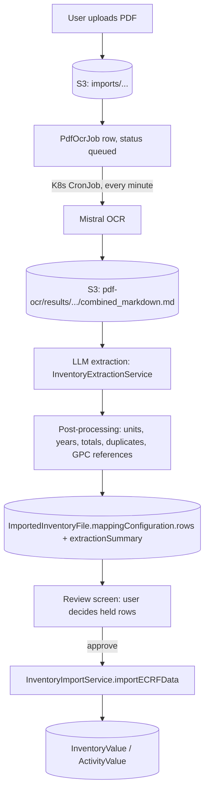
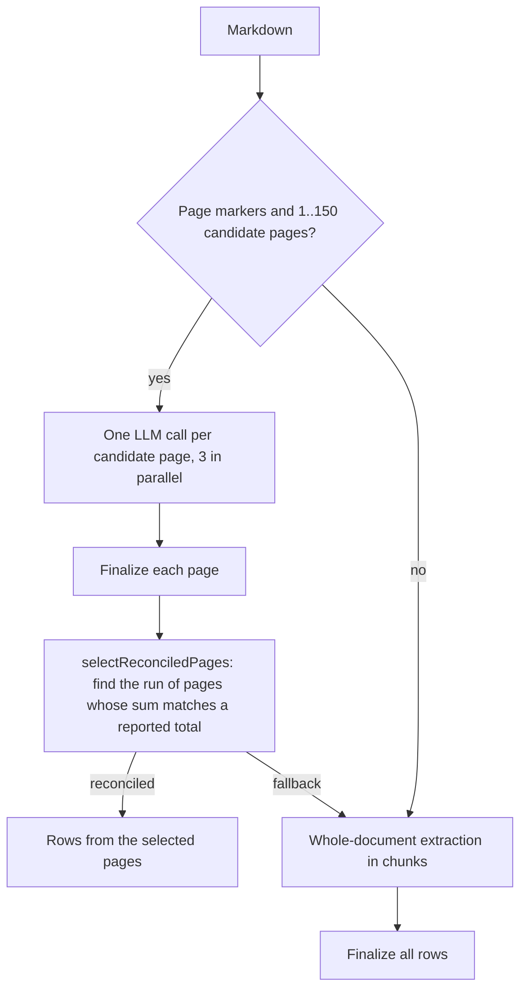

# GHGI PDF import pipeline

## One-line intent

Turn a city's GHG inventory report (PDF) into reviewed `InventoryValue` rows: Mistral OCR makes Markdown, an LLM extracts table rows, deterministic code checks and reconciles them, and the user approves them.

## Scope

This document covers the PDF path of the GHGI import wizard: upload, OCR, LLM extraction, post-processing, review and commit. It does not cover:

- eCRF and near-eCRF spreadsheets (Path A and Adapter D). They commit through the ingest runner, see [IngestSpineModuleInteraction.md](./IngestSpineModuleInteraction.md).
- Tabular files that need AI column mapping (Path B, `AIInterpretationService`).
- Concept Note Builder PDFs. They share the OCR queue but not the extraction.

## Pipeline at a glance



Status of `ImportedInventoryFile.importStatus` from the extract request on: `extracting` (OCR and extraction) → `waiting_for_approval` or `failed` → `importing` (after approval) → `completed` or `failed`.

## Stage 1: upload and OCR queue

| Step                                                                                                                                                                                                                                      | Where                                                                                      |
| ----------------------------------------------------------------------------------------------------------------------------------------------------------------------------------------------------------------------------------------- | ------------------------------------------------------------------------------------------ |
| Upload. PDF requires S3. Max 20 MiB (`INVENTORY_IMPORT_MAX_FILE_SIZE_MB`).                                                                                                                                                                | `POST /api/v1/city/{city}/inventory/{inventory}/import`, `InventoryFileStorageService`     |
| Queue OCR. Creates a `PdfOcrJob` (`sourceType = inventory_import`, `annotationMode = none`). Status becomes `extracting`.                                                                                                                 | `POST .../import/{importedFileId}/extract`, `enqueueInventoryPdfOcr` in `PdfOcrService.ts` |
| Worker. A Kubernetes CronJob calls the cron route every minute with `CC_CRON_JOB_API_KEY`. Postgres is the queue (no SQS). Jobs are claimed with `SELECT ... FOR UPDATE SKIP LOCKED` and a lease, so two pods never process the same job. | `k8s/cc-process-pdf-ocr-jobs.yml`, `/api/v1/cron/process-pdf-ocr-jobs`, `PdfOcrService.ts` |

## Stage 2: OCR (PDF to Markdown)

- `MistralOcrService.convertPdfUrlToMarkdown` sends a presigned S3 URL to Mistral OCR (`MISTRAL_OCR_MODEL`, default `mistral-ocr-latest`) with `table_format: "markdown"`.
- Tables come back as separate Markdown blocks. The service puts each table back into its page.
- Every page starts with `<!-- page: N -->`. Extraction uses these markers to work page by page.
- The Markdown is stored in the same bucket at `pdf-ocr/results/{source_type}/{source_id}/{attempt}/combined_markdown.md`.
- Retries: up to `PDF_OCR_MAX_ATTEMPTS` (default 3), delays of 1 and 5 minutes.
- Scanned PDFs work because Mistral OCR reads images. There is no separate pdftotext step for inventory imports.

## Stage 3: LLM extraction

Entry point: `extractInventoryRowsFromStoredMarkdown` in `PdfOcrService.ts` loads the Markdown and the inventory year, then calls `extractInventoryFromDocument` in `InventoryExtractionService.ts`. The inventory year is passed as `targetYear`.

### Model and call settings

- Model role `pdf_extraction` in `app/llm_config.yaml` (currently `gpt-5.6-luna`). A weaker model (`gpt-4o-mini`) dropped columns of dense GPC tables (CC-1008).
- Provider through `app/src/backend/llm` (OpenAI adapter; `OPENAI_API_KEY`, optional `LLM_PROVIDER`, `LLM_BASE_URL`). Timeout 180 s, 3 transport retries.
- Structured output: strict JSON schema (`extraction-response-schema.ts`). If the provider rejects the schema, the whole extraction switches to JSON mode once.
- `maxTokens: 16000`. A response cut off at the token limit (`finishReason === "length"`) is treated as unusable and retried once. It is never imported in part.

### Prompt

`SYSTEM_PROMPT` in `InventoryExtractionService.ts` is generated from the GPC taxonomy at startup:

- the sector → sub-sector hierarchy (`gpc-reference-table.json`);
- every valid GPC reference with its scope, waste direction (III.x.1/2/3) and, for AFOLU, the activities;
- a dictionary of report terms → canonical names (`gpc-name-mappings.json`).

The prompt asks for one row per line item, at the most granular level the document gives. Main rules:

- Every row gets a `rowType`: `line_item`, `subtotal` or `total`. Only line items are imported. Subtotals and totals are kept to check the sum.
- Scope 1/2/3 columns give one row each. BASIC, BASIC+, Total and Net columns are never line items.
- Notation keys (NO, NE, IE, C) become rows with `totalCO2e = null`.
- Convert to tonnes when the document states the unit, and report the unit.
- Copy the GPC reference when the document prints it (`refSource = "document"`), else choose one (`refSource = "inferred"`).
- `activityClass` says what the row measures (`fuel_combustion`, `grid_energy`, `td_losses`, `grid_supply`, `industrial_process`, `product_use`, `other`). Code derives scope and reference from it later.
- For III.x.3 (waste from outside the city), a verbatim quote in `directionEvidence`.
- Skip duplicate tables, tables of other years, comparisons with earlier inventories, per-capita and per-gas tables.
- The user message adds a year instruction when `targetYear` is set.

A simple guard rejects documents that start with instruction-like text (prompt injection).

### Extraction strategy: pages first, chunks as fallback



**Page path** (default for OCR output):

1. Split on `<!-- page: N -->`. A page is a candidate when it has at least 8 numbers of 3+ digits.
2. One LLM call per candidate page (`LLM_CHUNK_CONCURRENCY`, default 3, max 8). A failed page is skipped and listed in `summary.failedPages`. The import fails only when every page fails.
3. When a page has GPC rows (scope and reference), prints its own grand total, and its rows miss that total by more than 1%, the page is extracted once more and the closer answer is kept.
4. `selectPages` looks for runs of 1 to 6 consecutive pages whose line items add up to a reported grand total (or a net total, gross minus forestry removals) within 10%. A page joins a run only when it brings the sum closer. Pages with notation keys only can join without changing the sum.
5. Ranking: runs with GPC rows (scope and reference) that reconcile within 1% first, then more GPC rows, then the closer sum. A run that reaches the net total beats one that reaches only the gross total.
6. If the best run is only within 10% but the whole document is within 1%, all pages are used.
7. If no run is found (`pageSelection = "fallback"`), the per-page rows are discarded and the document is extracted again in chunks. Per-page rows without reconciliation were noisier than chunk results in CC-1008 runs.

**Chunk path** (no page markers, more than 150 candidate pages, or page fallback):

- Up to 50,000 characters: one call. Above: chunks of 40,000 characters with 4,000 overlap, merged and de-duplicated.

### Year handling

- With a target year: when any line item names a year, rows of other years (`other_year`) and rows without a year (`missing_year`) are dropped.
- When no line item names a year, the target year is assumed (`summary.yearAssumed = true`). On the page path, a run must then reconcile within 1%, because the wrong table cannot be told apart by year.
- When every line item was dropped for its year, the import fails with "Inventory not found for the target year".

## Stage 4: post-processing (deterministic)

All in `InventoryExtractionService.ts` unless noted.

| Step                   | Function                                                         | What it does                                                                                                                                                                                                                                                                                                                           |
| ---------------------- | ---------------------------------------------------------------- | -------------------------------------------------------------------------------------------------------------------------------------------------------------------------------------------------------------------------------------------------------------------------------------------------------------------------------------- |
| Parse and normalize    | `parseExtractionResponse`, `normalizeRows`                       | Reads the JSON, parses numbers ("48,000" → 48000), normalizes scope ("Scope 1" → "1"), keeps only known notation keys and valid activity classes.                                                                                                                                                                                      |
| Canonical reference    | `canonicalGpcRefNo`                                              | Keeps a reference only when it exists in the taxonomy. "I.1" with scope 2 becomes I.1.2. Placeholders like "III.X.1" are dropped.                                                                                                                                                                                                      |
| Fill missing reference | `fillMissingGpcRefNo`, `util/GHGI/gpc-ref-resolver.ts`           | Resolves a reference from sector, sub-sector, category and scope.                                                                                                                                                                                                                                                                      |
| Units                  | `tonnesMultiplier`                                               | kt and Gg × 1,000; Mt × 1,000,000. "MT" in capitals is ambiguous and dropped (`unsupported_unit`), as are kg, lb, %, per-capita.                                                                                                                                                                                                       |
| Totals out of the rows | `finalizeExtractedRows`, `sumLabelLevel`                         | Rows typed or labelled as totals go to `summary.reportedTotals`. A "Total" column read as a line item (no scope, equal to the scoped rows of its sub-sector) is moved there too (`findHiddenRowTotals`). A "total" equal to one sector's line items is demoted to subtotal (`isSectorTotal`).                                          |
| Duplicates             | `repeatKey`                                                      | Same year, reference or sub-sector, scope, activity, category and notation key: kept once.                                                                                                                                                                                                                                             |
| Provenance check       | `verifyRowProvenance`                                            | `refSource = "document"` stands only when the reference is printed on the row's own line, next to its value or notation key. Otherwise it becomes `inferred`. The III.x.3 quote is checked against the text (`directionEvidenceFound`). Neither check confirms a row by itself.                                                        |
| Activity-class rules   | `applyActivityClassRules` in `util/GHGI/activity-class-rules.ts` | For rows whose reference is not printed: `grid_energy` → scope 2 of its own sub-sector (else I.6.2); `td_losses` → scope 3 (stationary energy only, else I.6.3); `industrial_process` → IV.1 and `product_use` → IV.2, scope 1; `grid_supply` → I.4.4 when on energy industries. A changed scope is marked `scopeSource = "inferred"`. |
| Removals check         | `withOrphanRemovals`                                             | When the document reports forestry removals but no V.2 line item was extracted, `summary.orphanRemovals` lets the review warn that the sum leaves them out.                                                                                                                                                                            |
| Sum                    | `sumImported`                                                    | Sum of line items in tonnes, without references left out of BASIC totals (I.4.4, III.x.3, VI.1, see `util/GHGI/reported-totals.ts`).                                                                                                                                                                                                   |

The result is stored on `ImportedInventoryFile.mappingConfiguration`:

- `rows`: `ExtractedRow[]` (type in `InventoryExtractionService.ts`);
- `extractionSummary`: `ExtractionSummary` (type in `util/GHGI/extraction-summary.ts`): reported totals, dropped-row counts per reason, imported sum, year assumption, page selection, failed pages, orphan removals.

If no row is left, the import is `failed` with a reason key from `zeroRowReason`, and the summary is kept for diagnosis.

## Stage 5: review and approval

UI: `components/steps/GHGI/import/` (`review-confirm-step.tsx`, `import-review-rows.tsx`, `import-row-issues.tsx`).

- The review screen compares `importedSum` with the reported totals (`RECONCILIATION_TOLERANCE` = 1%) and shows dropped rows, failed pages and orphan removals.
- Some rows are held until the user decides (`reviewIssue` in `ImportRowPreviewService.ts`):
  - `reference-conflict`: the reference's taxonomy scope differs from the row's scope.
  - `excluded-reference-unconfirmed`: a valued row the model placed on I.4.4 (left out of totals) without the document printing that reference, unless it is genuine grid supply.
  - `direction-unconfirmed`: an inferred III.x.3 (waste from outside the city).
- Decisions per row: `keep`, `reclassify`, `correct-scope` or `skip`. They are bound to the file and the original row with a token (`applyReviewedRows` in `ImportResultBuilder.ts`), so a stale decision is ignored.
- `POST .../import/approve` rebuilds the result on the server (`buildImportResult`). It returns 409 `import-rows-pending` when a held row has no valid decision, and 409 `inventory-has-data` when the inventory has data and replace was not confirmed.
- Approval runs in the background: `ECRFImportService.fromExtractedRows` maps the rows to the eCRF shape, then `InventoryImportService.importECRFData` writes `InventoryValue` and `ActivityValue` in one transaction with the status change. The decisions go to `reviewHistory`.

## Configuration

| Setting                           | Where                                                                                        | Default                     |
| --------------------------------- | -------------------------------------------------------------------------------------------- | --------------------------- |
| Extraction model                  | `app/llm_config.yaml` → `models.pdf_extraction`                                              | `gpt-5.6-luna`              |
| LLM key, provider, base URL       | `OPENAI_API_KEY`, `LLM_PROVIDER`, `LLM_BASE_URL`                                             | provider `openai`           |
| Parallel LLM calls per extraction | `LLM_CHUNK_CONCURRENCY`                                                                      | 3 (max 8)                   |
| OCR model and timeout             | `MISTRAL_OCR_MODEL`, `MISTRAL_OCR_TIMEOUT_MS`                                                | `mistral-ocr-latest`, 180 s |
| OCR queue                         | `PDF_OCR_BATCH_SIZE`, `PDF_OCR_CONCURRENCY`, `PDF_OCR_MAX_ATTEMPTS`, `PDF_OCR_LEASE_SECONDS` | 2, 2, 3, 600                |
| Storage                           | `AWS_FILE_UPLOAD_S3_BUCKET_ID`, `AWS_FILE_UPLOAD_REGION`                                     | required for PDF            |

Fixed constants in `InventoryExtractionService.ts`: candidate page ≥ 8 numbers, ≤ 150 candidate pages, ≤ 6 pages per table, page selection tolerance 10%, chunk threshold 50,000 characters, chunk size 40,000, overlap 4,000.

## Tests and accuracy measurement

- Unit tests: `app/tests/backend/inventory-extraction-*.jest.ts`, `gpc-row-provenance.jest.ts`, `gpc-waste-direction.jest.ts`. Several use stored LLM answers for real reports (Auckland, Masterton).
- Benchmark harness: CC-1124 (PRs #3416 and #3424, in review at the time of writing) runs the real pipeline on the answer-key set and reports row recall per case, with results in a run folder and MLflow.
- Measured on 31 Oct 2026 (CC-1124, before the activity-class changes): row recall 68% on the validated set, 28% on the held-out set. Internal target: 90% row recall.

## Example payloads

Real payloads, so a reviewer can see what each stage receives and returns. Sources:

- OCR Markdown: `app/tests/fixtures/auckland-2021-ocr-excerpt.md` (Mistral OCR of the Auckland 2021 inventory).
- LLM answers: `app/tests/fixtures/masterton-2021-22-page-responses.json`, one real run on the Masterton 2021/22 report (42 pages, target year 2022, recorded 2026-11-05, before the `activityClass` field existed).
- Everything after the LLM answers was produced by replaying those answers through the current code on `develop` (the same replay as `tests/backend/inventory-extraction-masterton.jest.ts`).

Long arrays are cut with `...`.

### 1. Mistral OCR request

Built by `buildMistralOcrRequest` for an inventory import (`annotationMode = "none"`):

```json
{
  "model": "mistral-ocr-latest",
  "document": {
    "type": "document_url",
    "document_url": "https://<bucket>.s3.amazonaws.com/imports/<cityId>/<inventoryId>/<file>.pdf?X-Amz-..."
  },
  "include_blocks": true,
  "confidence_scores_granularity": "block",
  "extract_header": true,
  "extract_footer": true,
  "table_format": "markdown",
  "include_image_base64": false
}
```

### 2. OCR Markdown (input to extraction)

Part of one page of the Auckland report as stored in `combined_markdown.md`. It shows the cases the prompt and the post-processing must handle: a summary table and a detailed GPC table of the same inventory, scope columns next to BASIC and Total columns, references written once for all scopes (`I.1`), a combined reference (`I.4.1/2/3`) and notation keys (`NO`).

```markdown
Table 3-1 Emissions summary for 2021

| GHG Emission Source (By Sector) |                                         | Scope 1   | Scope 2   | Scope 3 | BASIC     | BASIC+    | BASIC+ S3 |
| ------------------------------- | --------------------------------------- | --------- | --------- | ------- | --------- | --------- | --------- |
| Stationary Energy               | Energy use (all emissions except I.4.4) | 1,956,185 | 1,121,835 | 82,214  | 3,078,020 | 3,160,234 | 3,160,234 |
| ...                             |                                         |           |           |         |           |           |           |
| TOTAL                           |                                         | 7,890,074 | 1,127,651 | 541,222 | 7,453,238 | 9,559,215 | 9,559,215 |

Table A-1 GHG emissions by sector and sub-sector for 2021 in the GPC format

| GPC ref No. | GHG Emissions Source (By Sector and Sub-sector)       | Scope 1 | Scope 2 | Scope 3 | Total   |
| ----------- | ----------------------------------------------------- | ------- | ------- | ------- | ------- |
| I.1         | Residential buildings                                 | 196,407 | 450,523 | 33,017  | 679,947 |
| I.2         | Commercial and institutional buildings and facilities | 462,976 | 116,488 | 8,537   | 588,000 |
| I.4.1/2/3   | Energy industries                                     | NO      | NO      | NO      |         |
| I.4.4       | Energy generation supplied to the grid                | 32      |         |         |         |
```

### 3. LLM request (one page)

What `extractSegment` sends for one candidate page (Masterton page 12). The page text is the Markdown of that page only.

```json
{
  "use": "pdf_extraction",
  "messages": [
    { "role": "system", "content": "<SYSTEM_PROMPT, 25,847 characters>" },
    {
      "role": "user",
      "content": "Extract only emissions data for the year 2022. Do not output rows from tables or columns of other years. Set year to the year each value belongs to (2022); use null only when the document gives no year.\n\nDocument text:\n\n<Markdown of page 12>"
    }
  ],
  "jsonSchema": "<EXTRACTION_RESPONSE_SCHEMA>",
  "maxTokens": 16000
}
```

The system prompt is the same on every call and holds the full GPC taxonomy. Masterton has 31 candidate pages, so one import made 32 calls (page 16 was retried because its rows did not reach its own total).

### 4. LLM answer (one page)

Recorded answer for Masterton page 12, an agriculture table:

```json
{
  "rows": [
    {
      "year": 2022,
      "sector": "Agriculture Forestry And Other Land Use Afolu",
      "subsector": "Emissions From Livestock Within The City Boundary",
      "category": "Enteric Fermentation",
      "totalCO2e": 488422,
      "unit": "t",
      "rowType": "line_item",
      "scope": "1",
      "gpcRefNo": "V.1",
      "source": "Table 1"
    },
    {
      "year": 2022,
      "sector": "Agriculture Forestry And Other Land Use Afolu",
      "subsector": "Emissions From Aggregate Sources And Non Co2 Emission Sources On Land Within The City Boundary",
      "category": "Unmanaged Manure on Pasture",
      "totalCO2e": 73102,
      "unit": "t",
      "rowType": "line_item",
      "scope": "1",
      "gpcRefNo": "V.3",
      "source": "Table 1"
    },
    "... 3 more line items (49,543 + 14,665 + 10,042) ...",
    {
      "year": 2022,
      "sector": "Agriculture Forestry And Other Land Use Afolu",
      "subsector": "Emissions From Livestock Within The City Boundary",
      "category": "Subtotal",
      "totalCO2e": 635774,
      "rowType": "subtotal",
      "...": "..."
    }
  ]
}
```

### 5. One page after finalizing

`finalizeExtractedRows` on that answer: 5 line items stay, the subtotal moves to `reportedTotals`.

```json
{
  "rows": [
    {
      "year": 2022,
      "sector": "Agriculture Forestry And Other Land Use Afolu",
      "subsector": "Emissions From Livestock Within The City Boundary",
      "category": "Enteric Fermentation",
      "totalCO2e": 488422,
      "unit": "t",
      "rowType": "line_item",
      "scope": "1",
      "gpcRefNo": "V.1",
      "source": "Table 1",
      "page": 12,
      "activityType": "Enteric Fermentation"
    },
    "... 4 more ..."
  ],
  "summary": {
    "reportedTotals": [
      {
        "label": "Subtotal",
        "value": 635774,
        "year": 2022,
        "scope": null,
        "sector": "Agriculture Forestry And Other Land Use Afolu",
        "subsector": "Emissions From Livestock Within The City Boundary",
        "level": "subtotal"
      }
    ],
    "droppedRows": { "subtotal_or_total": 1 },
    "importedSum": 635774,
    "yearAssumed": false,
    "targetYear": 2022
  }
}
```

### 6. Stored rows and summary (what the review screen reads)

`ImportedInventoryFile.mappingConfiguration` after the whole document. One stored row:

```json
{
  "year": 2022,
  "sector": "Transportation",
  "subsector": "On Road Transportation",
  "category": "Diesel - On-Road",
  "totalCO2e": 38736,
  "activityClass": null,
  "gpcRefNo": "II.1.1",
  "rowType": "line_item",
  "unit": "t",
  "source": "Table 4",
  "activityType": "Diesel",
  "page": 13,
  "refSource": "inferred",
  "directionEvidenceFound": null
}
```

`refSource` is `inferred` although the model wrote the reference: the report does not print `II.1.1` on that line.

The summary (`extractionSummary`), with 18 reported totals cut to the ones that matter:

```json
{
  "reportedTotals": [
    {
      "label": "Net Forestry Emissions",
      "value": -811512,
      "level": "subtotal",
      "...": "..."
    },
    {
      "label": "Total Gross Emissions (excluding Forestry)",
      "value": 785873,
      "level": "subtotal",
      "...": "..."
    },
    {
      "label": "Total Net Emissions (including Forestry)",
      "value": -25639,
      "level": "total",
      "...": "..."
    },
    {
      "label": "Total Gross Emissions",
      "value": 785873,
      "level": "total",
      "...": "..."
    },
    "... 14 more sector subtotals ..."
  ],
  "targetYear": 2022,
  "droppedRows": { "subtotal_or_total": 18, "other_page": 39 },
  "importedSum": 777928,
  "yearAssumed": false,
  "pageSelection": "reconciled",
  "selectedPages": [12, 13, 14],
  "orphanRemovals": [-811512]
}
```

And the notes the review screen derives from it (`extractionReviewNotes`):

```json
{
  "reconciliation": {
    "importedSum": 777928,
    "reportedTotal": 785873,
    "deviation": 0.0101,
    "mismatch": true
  },
  "removalsWarning": { "kind": "orphan", "removals": -811512, "net": -25639 },
  "reconciledPages": [],
  "failedPages": [],
  "droppedReasons": ["other_page"]
}
```

### 7. What this example shows

The report's inventory is gross 785,873 and net -25,639 tCO2e (forestry -811,512). The import keeps pages 12 to 14 only and imports 777,928 (25 rows):

- **IPPU is lost.** Page 15 repeats the waste rows of page 14, now with a scope and printed GPC references (`III.1.1`, `III.4.1`). The duplicate check does not catch them, because its key includes the scope and the page 14 rows had none. The repeat pushes the sum away from every total, so the run stops at page 14 and the IPPU rows on page 15 (7,947) never join. That is the 7,945 (1.01%) gap, within rounding.
- **Forestry is lost.** The V.2 rows are on page 16, after the stop, so the net total is never reached. The review warns about orphan removals instead.
- **The same table appears several times.** Agriculture is on pages 11, 12 and 25, transport on 13 and 26, forestry on 6, 16 and 29 (summary, chapter, appendix). 39 rows from other pages are dropped. Page selection must pick one copy per sector, and only consecutive pages can form a run.
- **Answers vary on a retry.** Page 16's second answer drops the scope on all its rows and relabels its subtotal "Total".
- **Cost.** 32 calls, each with a 25,847-character system prompt, for one report.

### 8. Approve request with a row decision

`POST .../import/approve`. Row decisions are keyed by row index and must match what the user saw, or the server ignores them:

```json
{
  "importedFileId": "<uuid>",
  "replaceExisting": true,
  "mappingOverrides": {
    "columnMappings": {},
    "rowDecisions": {
      "7": {
        "reviewDecision": "reclassify",
        "gpcRefNo": "I.6.3",
        "scope": "3",
        "decisionFileId": "<uuid of the imported file>",
        "decisionToken": "<token from the review row>",
        "decisionRef": "I.4.4",
        "decisionScope": null,
        "decisionValue": 1710
      }
    }
  }
}
```

The decision type is `ImportRowDecision` in `components/steps/GHGI/import/import-row-decisions.ts`. This payload is illustrative (the values are not from the Masterton run).

## Where accuracy is lost (known weak points)

These follow from the design above. They are starting points for improvement work, not decisions.

- **Table choice.** Page selection depends on the document printing a grand total that the rows can match. Reports without one, or with totals on a different page from the table, fall back to chunk extraction. A page that repeats rows of the previous page under other labels can end a run early (Masterton, see the example above).
- **Fallback quality.** The chunk path has no reconciliation-based table choice. It relies on the prompt alone to skip summary, comparison and per-gas tables.
- **Rules tuned on few reports.** Many rules (hidden totals, sector-total demotion, removals, AFOLU V.1 vs V.3) came from specific reports (Auckland, Masterton). Held-out reports with other layouts are not covered by them. This matches the gap between the validated and held-out recall.
- **Model variance.** The same page can give different rows on different runs. The benchmark runs each file several times to measure this.
- **OCR quality.** Split or merged table cells in the Markdown cannot be fixed later. OCR errors are not measured apart from extraction errors yet.
- **Units and years.** Rows with an ambiguous unit ("MT") or without a year when other rows have one are dropped, not asked about.

## Key files

| Concern                            | File                                                                                                                                                                              |
| ---------------------------------- | --------------------------------------------------------------------------------------------------------------------------------------------------------------------------------- |
| Upload, storage                    | `app/src/backend/InventoryFileStorageService.ts`                                                                                                                                  |
| OCR queue, worker, extraction step | `app/src/backend/PdfOcrService.ts`, `app/src/backend/pdf-ocr-config.ts`, `app/src/app/api/v1/cron/process-pdf-ocr-jobs/route.ts`                                                  |
| Mistral OCR                        | `app/src/backend/MistralOcrService.ts`                                                                                                                                            |
| LLM extraction and post-processing | `app/src/backend/InventoryExtractionService.ts`, `app/src/backend/extraction-response-schema.ts`                                                                                  |
| LLM client and config              | `app/src/backend/llm/`, `app/llm_config.yaml`                                                                                                                                     |
| GPC rules                          | `app/src/util/GHGI/activity-class-rules.ts`, `gpc-ref-resolver.ts`, `reported-totals.ts`, `extraction-summary.ts`, `data/gpc-reference-table.json`, `data/gpc-name-mappings.json` |
| Review and approval                | `app/src/backend/ImportRowPreviewService.ts`, `app/src/backend/ImportResultBuilder.ts`, `app/src/app/api/v1/city/[city]/inventory/[inventory]/import/approve/route.ts`            |
| Commit                             | `app/src/backend/ECRFImportService.ts` (`fromExtractedRows`), `app/src/backend/InventoryImportService.ts` (`importECRFData`)                                                      |
| Review UI                          | `app/src/components/steps/GHGI/import/`                                                                                                                                           |

## Related documents

- [GenericFileIngestionArchitecture.md](./GenericFileIngestionArchitecture.md): the shared ingest spine and where GHGI fits.
- [IngestSpineModuleInteraction.md](./IngestSpineModuleInteraction.md): how eCRF uploads commit through the ingest runner.
- [ghgi-path-a-backtest.md](../scripts/ghgi-path-a-backtest.md): backtest for the eCRF path (CC-950).
- [import-stuck-importing-runbook.md](../../docs/import-stuck-importing-runbook.md): recovery for imports stuck in `importing`.
