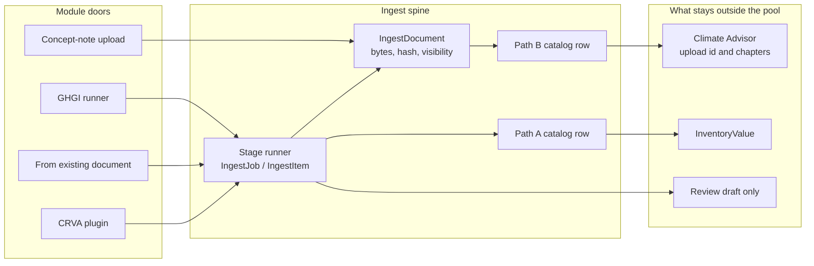
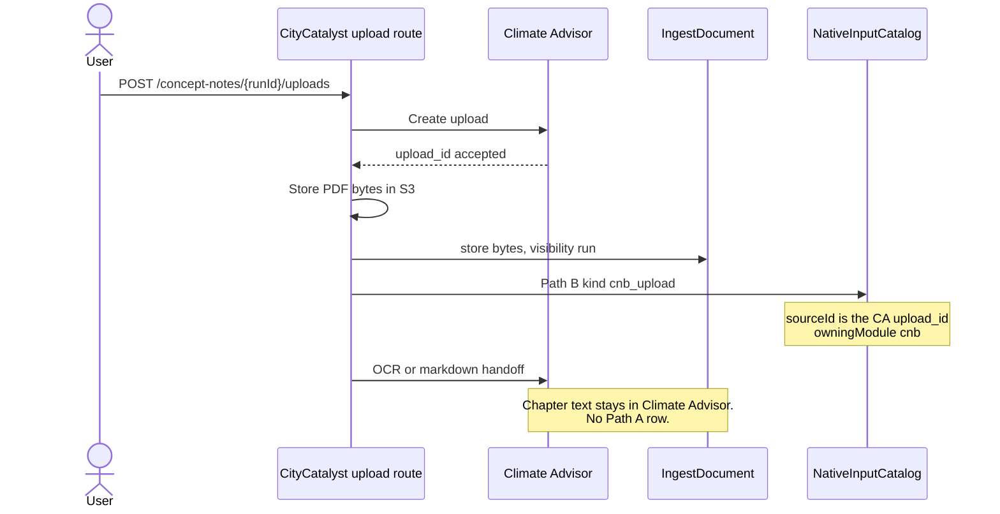
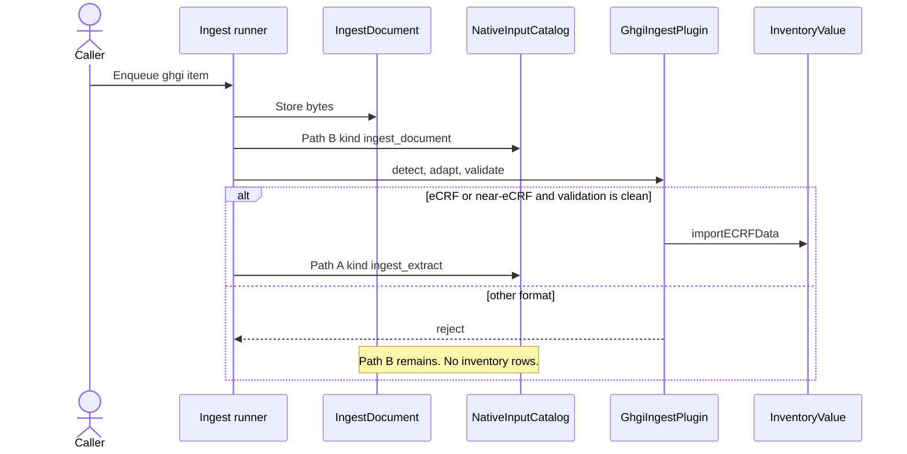
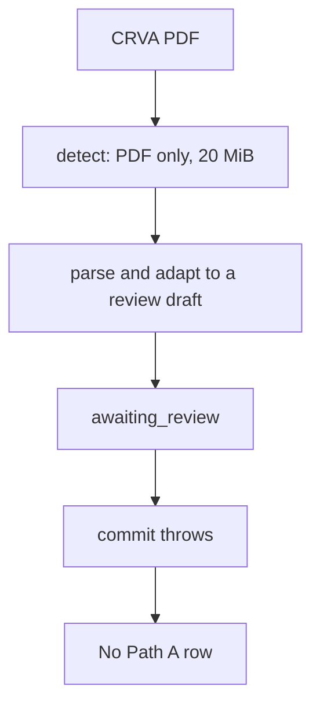
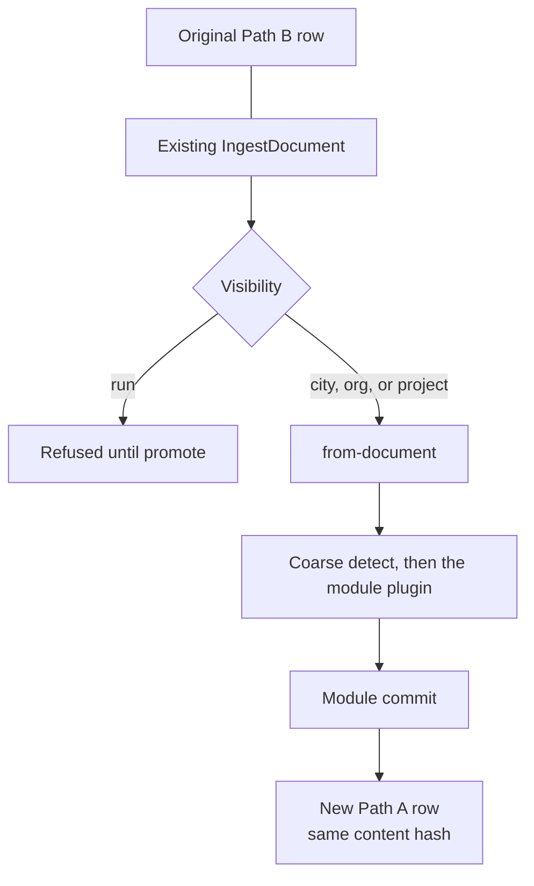
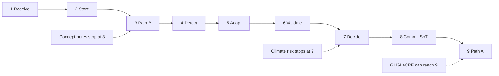

# How modules interact with the ingest spine

Companion to [GenericFileIngestionArchitecture.md](./GenericFileIngestionArchitecture.md).

The spine is the shared document pool (`IngestDocument`) and the catalog (`NativeInputCatalog`). Modules do not share a system of record. Each module enters through its own door, and Core publishes catalog rows at two moments:

- **Path B** when the file bytes are durable. One row for the file.
- **Path A** when that module commits its own rows. One row per committing module.

Visibility on the pool row is `city`, `run`, `org`, or `project`. A concept-note working file is `run` until `POST /api/v1/ingest/documents/{id}/promote` sets it to `city`.

## Concept notes

Concept notes do not enter the runner. `POST /api/v1/concept-notes/{runId}/uploads` writes the pool after Climate Advisor has accepted the upload id.

A later upload of the same bytes reuses the pool row by content hash. The new catalog row still uses its own `upload_id`. `catalogId` on the pool row is set only when it is empty, so a second catalog row does not replace the first link.

`markdownReady` is stored with the file at registration. For a PDF that flag is false. Finishing OCR does not update it.

## Greenhouse gas inventory

`GhgiIngestPlugin` is the registered runner plugin (`createIngestPlugin("ghgi")`). It accepts eCRF and near-eCRF, commits through `InventoryImportService.importECRFData`, and tags new `InventoryValue` rows with `sourceDocumentId`. Core then publishes Path A `ingest_extract`.

Wizard eCRF and near-eCRF approval, and Chile bulk, commit through `ingestGhgiBuffer`. The `/import` upload still stores `ImportedInventoryFile` and waits for approval. A PDF stores Path B, then the GHGI plugin rejects it as an unknown format.

## Climate risk

`CcraIngestPlugin` implements the plugin contract for a CRVA PDF. `approvalPolicy` is `review`. `commit` throws because there is no CRVA system of record. `createIngestPlugin` does not return this plugin, so a runner job cannot select `ccra` yet.

## Second module, same file

`POST /api/v1/modules/{module}/ingest/from-document/{documentId}` does not upload bytes again and does not publish another Path B row. The runner starts at coarse detect. The committing module adds its own Path A row.

Withdraw keeps the catalog row and the imported values. `DELETE` with `{ "deleteImportedData": true }` also removes inventory rows tagged with that document. A `run` attachment is not offered to another module until promote.

## Where each module stops

HIAP and MEED catalog rows (`hiap_ranking`, `hiap_meed_artifact`, and the related kinds) are lookup pointers. They are not files in this pool and they do not use the runner.
