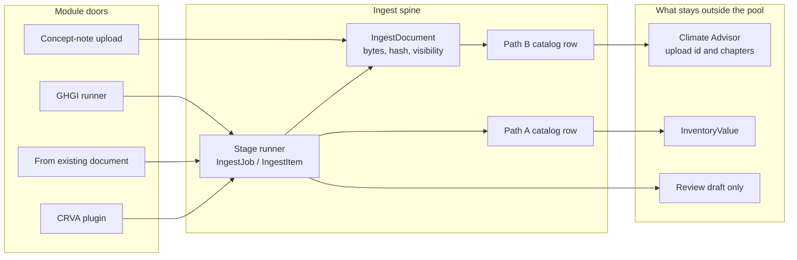
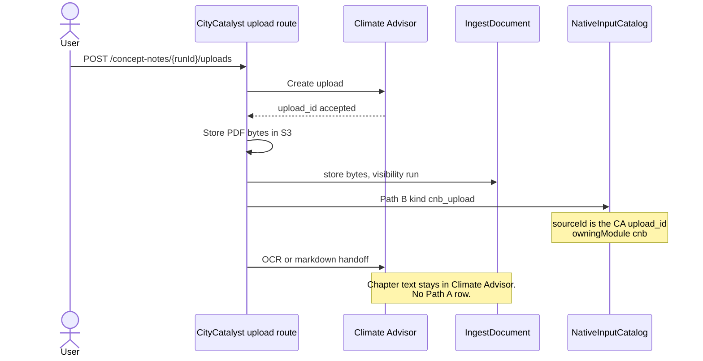
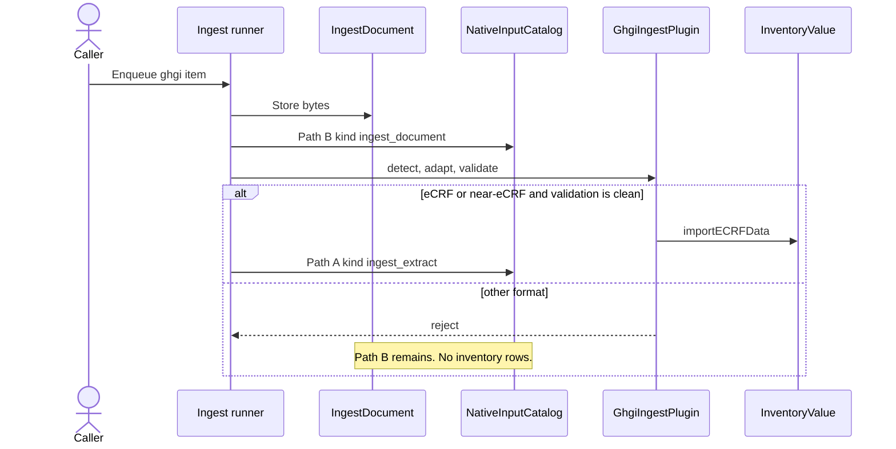
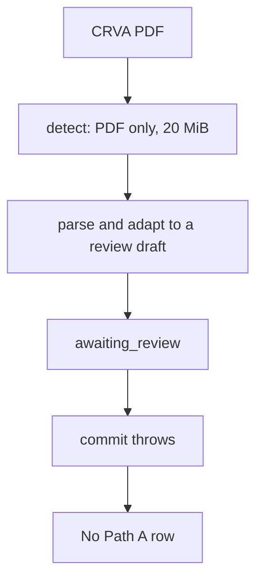
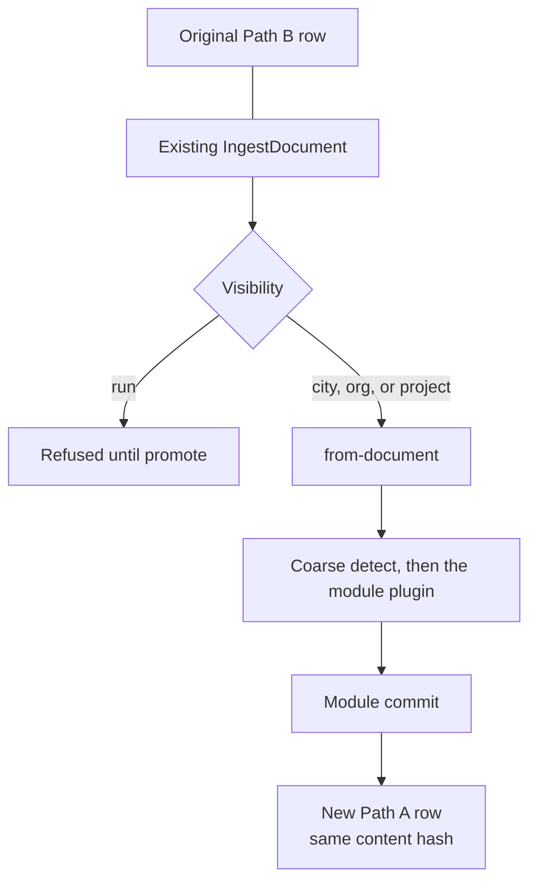
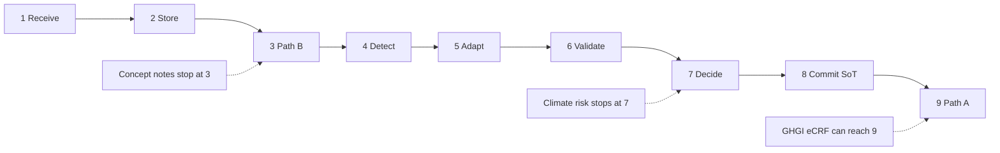

# How modules interact with the ingest spine

Companion to [GenericFileIngestionArchitecture.md](./GenericFileIngestionArchitecture.md).

The spine is the shared document pool (`IngestDocument`) and the catalog (`NativeInputCatalog`). Modules do not share a system of record. Each module enters through its own door, and Core publishes catalog rows at two moments:

- **Path B** when the file bytes are durable. One row for the file.
- **Path A** when that module commits its own rows. One row per committing module.

Visibility on the pool row is `city`, `run`, `org`, or `project`. A concept-note working file is `run` until `POST /api/v1/ingest/documents/{id}/promote` sets it to `city`.

## Concept notes

Concept notes do not enter the runner. `POST /api/v1/concept-notes/{runId}/uploads` writes the pool after Climate Advisor has accepted the upload id.

A later upload can reuse a city-visible pool row with the same content hash and scope. Run-private origins are deduplicated within their actual uploader's immutable `privateOwnerId`, so identical private uploads by different actors retain independent filenames, sharing and withdrawal. The origin key stays unchanged on city promotion; separately published private origins remain distinct, while new public uploads can reuse either authorized city document. The upload association records the current authorized actor, independently of the pooled file's audit author. An upload replay retains its active existing document link. `catalogId` on the pool row is set only when empty, so another upload does not replace its primary link.

Migration `20261115150000-isolate-private-ingest-documents.cjs` backfills existing run-private origins from their uploader and extends the active hash/scope unique index with `private_owner_id`, retaining PostgreSQL `NULLS NOT DISTINCT` for public origins. Apply it before deploying code that reads the new field. Downgrade refuses transactionally if restoring the previous uniqueness would merge independent active origins; it never deletes source rows to force rollback.

Upload creation and status responses expose the stable `documentId` and current `visibility`, so an authorized author or administrator can explicitly share a working attachment through the existing promote endpoint. Sharing retains the pool identity and file bytes.

`markdownReady` starts false for PDFs and becomes true only after the leased OCR result and its immutable artifacts are persisted successfully. Successful delivery also repairs the flag when OCR completed before the upload's Path B association was registered. Native Markdown enters the existing artifact pipeline directly.

Artifact reads and source-availability checks enforce lifecycle, digest, scope and current city access for every catalog-backed CNB source, including original uploads whose catalog labels have no reuse `runId`. A run-private original remains available only to its original actor; reused sources also require an authorized target upload and city-visible original. Withdrawal, supersession or byte purge blocks later consumption in either path. Only uploads with no catalog association retain the legacy read path; deleting an original note's processing artifacts also makes availability fail when its OCR job is gone.

## Greenhouse gas inventory

`GhgiIngestPlugin` is the registered runner plugin (`createIngestPlugin("ghgi")`). It accepts eCRF and near-eCRF, commits through `InventoryImportService.importECRFData`, and tags new `InventoryValue` rows with `sourceDocumentId`. Core then publishes Path A `ingest_extract`.

Wizard eCRF and near-eCRF approval, and Chile bulk, commit through `ingestGhgiBuffer`. The `/import` upload still stores `ImportedInventoryFile` and waits for approval. A PDF stores Path B, then the GHGI plugin rejects it as an unknown format.

## Climate risk

`CcraIngestPlugin` implements the plugin contract for a CRVA PDF. `approvalPolicy` is `review`. `commit` throws because there is no CRVA system of record. `createIngestPlugin` does not return this plugin, so a runner job cannot select `ccra` yet.

## Second module, same file

`POST /api/v1/modules/{module}/ingest/from-document/{documentId}` does not upload bytes again and does not publish another Path B row. The runner starts at coarse detect. The committing module adds its own Path A row.

Withdraw keeps the catalog row and the imported values. `DELETE` with `{ "deleteImportedData": true }` also removes inventory rows tagged with that document. A `run` attachment is not offered to another module until promote.

## Where each module stops

HIAP and MEED catalog rows (`hiap_ranking`, `hiap_meed_artifact`, and the related kinds) are lookup pointers. They are not files in this pool and they do not use the runner.
