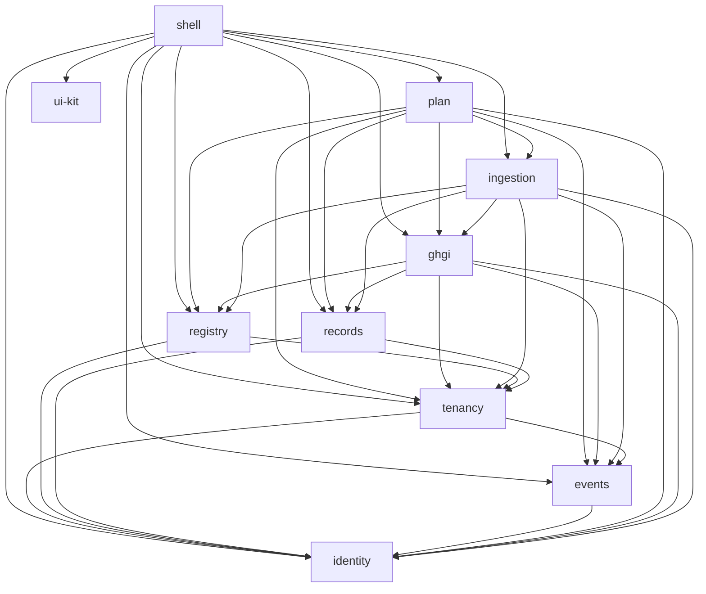

# Modular monolith: package map for `app/`

Design for [CC-1183](https://linear.app/openearth/issue/CC-1183). It sets the internal package boundaries inside `app/` so that later extractions into separate services are mechanical. [CC-1184](https://linear.app/openearth/issue/CC-1184) executes it. Nothing here changes runtime behavior.

```
CC-1183  this document: packages, rules, database ownership
   │ blocks
CC-1184  move code and tables along these seams (same deploy, same URLs)
   │ feeds
core-identity-service  the login half of "identity" leaves app/ for its own repo
```

This document follows the decisions in `core-identity-service`
([extraction plan](https://github.com/Open-Earth-Foundation/core-identity-service/blob/main/docs/core-identity-v0-extraction-plan.md),
[architecture](https://github.com/Open-Earth-Foundation/core-identity-service/blob/main/docs/architecture.md)).
Where they overlap, those documents win.

## Contents

1. [Packages](#1-packages)
2. [Rules](#2-rules)
3. [Where code goes](#3-where-code-goes)
4. [Seams to cut first](#4-seams-to-cut-first)
5. [Database ownership](#5-database-ownership)
6. [Lint enforcement](#6-lint-enforcement)
7. [Execution order](#7-execution-order)
8. [Decisions](#8-decisions)

## 1. Packages

Packages live in `app/src/modules/<package>/` and are imported as `@/modules/<package>`.

| Package     | Owns                                                                                                                                                                                                                                                                                          | Future                                                                                                       |
| ----------- | --------------------------------------------------------------------------------------------------------------------------------------------------------------------------------------------------------------------------------------------------------------------------------------------- | ------------------------------------------------------------------------------------------------------------ |
| `identity`  | Login only: credentials, password reset, sign-up, email verification, 2FA, the OAuth/OIDC authorization server (authorize, token, client registry, consent), and the CC side of session reading.                                                                                              | Provider half moves to `core-identity-service`. The session-reading half stays as CC's relying-party client. |
| `tenancy`   | Organizations, projects, cities, membership (`OrganizationAdmin`, `ProjectAdmin`, `CityUser`), invites, `PermissionService` and every access check, `User.role`, the CC `User` profile row, project modules, personal access tokens, Climate Advisor user tokens, GDPR consent and retention. | Stays in CC. Membership may move once the hierarchy schema (CC-1063) is frozen.                              |
| `registry`  | `NativeInputCatalog`: pointers to durable city inputs and generated artifacts, and its internal endpoints.                                                                                                                                                                                    | Candidate service. Already has no FKs on its scope columns.                                                  |
| `records`   | Edit and version history: `VersionHistoryService`, `Version`, restore.                                                                                                                                                                                                                        | Candidate shared service.                                                                                    |
| `events`    | Webhook subscriptions and delivery, and the in-process event bus. Event names and payloads follow `platform-contracts/events/v1`.                                                                                                                                                             | Candidate service.                                                                                           |
| `ingestion` | File, PDF, OCR, archive and bulk imports, column mapping, the ingest spine (`backend/ingest`).                                                                                                                                                                                                | Candidate service.                                                                                           |
| `ghgi`      | Inventories, activities, emissions calculation, GPC hierarchy, data sources and emission factors, ECRF, results, city reference data (population, GDP, boundaries).                                                                                                                           | Stays with the GHGI product.                                                                                 |
| `plan`      | HIAP, MEED, CCRA, concept notes, action plans, Climate Advisor chat.                                                                                                                                                                                                                          | Stays with the planning products.                                                                            |
| `shell`     | Root and city layouts, navigation, home and dashboards, public pages, middleware (`proxy.ts`), health checks.                                                                                                                                                                                 | Becomes the host app that composes the others.                                                               |
| `ui-kit`    | `components/ui`, `components/package`, generic inputs and skeletons, theme. The adapter to the GDS design system.                                                                                                                                                                             | Replaced by GDS packages over time.                                                                          |
| `shared`    | Kernel used by everyone: `apiHandler` and error handling, logger, LLM client, mailer, feature flags, runtime env, i18n, generic utilities, the RTK Query base API.                                                                                                                            | Kept small. Anything domain-specific moves out.                                                              |

## 2. Rules

1. **One front door.** Each package exposes `src/modules/<package>/index.ts`. Everything else in the package is internal. Inside a package, use relative imports.
2. **Contract-shaped interfaces.** Functions exported from `index.ts` take and return the shapes in `platform-contracts` v1: the OpenAPI v1 schemas for synchronous calls and the `events/v1` envelope and payloads for asynchronous ones. A function that has no contract counterpart yet is still exported with an explicit type, and a contract addition is proposed in `platform-contracts`.
3. **No foreign models.** A package never imports another package's Sequelize models. It calls the owner's front door or reacts to the owner's events.
4. **Allowed dependencies.** Arrows point from the importer to the package it may import. Anything not drawn is forbidden.



`shared` may be imported by every package and imports none of them. `ui-kit` may be imported by every package except `shared`, and itself imports only `shared`.

| Package               | May import                                                                 |
| --------------------- | -------------------------------------------------------------------------- |
| `shared`              | nothing                                                                    |
| `ui-kit`              | `shared`                                                                   |
| `identity`            | `ui-kit`, `shared`                                                         |
| `events`              | `identity`, `ui-kit`, `shared`                                             |
| `tenancy`             | `identity`, `events`, `ui-kit`, `shared`                                   |
| `registry`, `records` | `identity`, `tenancy`, `ui-kit`, `shared`                                  |
| `ghgi`                | `identity`, `tenancy`, `registry`, `records`, `events`, `ui-kit`, `shared` |
| `ingestion`           | `ghgi` + everything `ghgi` may import                                      |
| `plan`                | `ghgi`, `ingestion` + everything `ghgi` may import                         |
| `shell`               | every package                                                              |

Key consequences:

- `identity` never imports `tenancy`. Tokens identify the user (`sub`). They do not grant rights. Authorization is `tenancy`'s job.
- `ghgi` never imports `plan` or `ingestion`. Plan reacts to `inventory.published`, and ingestion pushes into GHGI through GHGI's front door.
- Next.js route files (`src/app/**`) stay where Next.js needs them. Each one becomes a thin adapter that calls exactly one package's front door.

## 3. Where code goes

Every top-level entry under `src/backend`, `src/models`, `src/app/api/v1`, `src/app/[lng]`, `src/components`, `src/lib`, `src/util`, `src/hooks`, `src/features`, `src/services` and `src/data` is assigned to exactly one package (510 entries). Folders that mix packages (`api/v1/city/[city]`, `api/v1/user`, `api/v1/admin`, `api/v1/cron`, `api/v1/internal/ca`, `components/Modals`) are split one level down.

<details>
<summary><strong>identity</strong> (26)</summary>

- **Models:** `OAuthClient.ts`, `OAuthClientAuthz.ts`, `OAuthClientI18N.ts`, `UsedAuthorizationCode.ts`
- **API routes:** `auth/2fa`, `auth/code`, `auth/delete`, `auth/forgot`, `auth/password`, `auth/register`, `auth/update-password`, `auth/verify`, `client`, `oauth`, `token`, `user/clients`
- **Pages:** `[lng]/auth`, `[lng]/authorize`, `.well-known`
- **Components:** `Modals/disable-2fa-modal.tsx`, `password-input.tsx`
- **lib:** `2fa.ts`, `auth`, `auth.ts`
- **Hooks:** `useLogin.ts`
- **Other:** `api/auth`

</details>

<details>
<summary><strong>tenancy</strong> (95)</summary>

- **Backend:** `AdminService.ts`, `ModuleAccessService.ts`, `ModuleService.ts`, `ProjectsService.ts`, `RoleBasedAccessService.ts`, `UserService.ts`, `climate-advisor-token.ts`, `gdpr`, `permissions`
- **Models:** `City.ts`, `CityInvite.ts`, `CityUser.ts`, `ConsentRecord.ts`, `Module.ts`, `Organization.ts`, `OrganizationAdmin.ts`, `OrganizationInvite.ts`, `PersonalAccessToken.ts`, `Project.ts`, `ProjectAdmin.ts`, `ProjectInvite.ts`, `ProjectModules.ts`, `RetentionActionLog.ts`, `Theme.ts`, `User.ts`
- **API routes:** `admin/all-cities`, `admin/mark-cities-public`, `admin/modules`, `admin/users`, `auth/role`, `city/[city]/modules/[module]`, `city/[city]/organization`, `city/[city]/route.ts`, `city/[city]/user`, `city/invite`, `city/route.ts`, `city/transfer`, `consent`, `cron/enforce-retention`, `internal/ca/auth`, `internal/ca/capabilities/allowed-capabilities`, `internal/ca/user-token`, `modules`, `organizations/[organization]/active-status`, `organizations/[organization]/branding`, `organizations/[organization]/invitations`, `organizations/[organization]/projects`, `organizations/[organization]/role`, `organizations/[organization]/route.ts`, `organizations/[organization]/users`, `organizations/route.ts`, `organizations/themes`, `projects`, `user/[userId]`, `user/access-status`, `user/cities`, `user/consent`, `user/data-download`, `user/inventories`, `user/invites`, `user/organizations`, `user/permissions`, `user/projects`, `user/route.ts`, `user/tokens`, `user/whoami`
- **Pages:** `[lng]/admin`, `[lng]/cities/onboarding`, `[lng]/organization`, `[lng]/settings`, `[lng]/user`
- **Components:** `CookieConsent`, `InviteAcceptance`, `Modals/account-frozen-warning-modal.tsx`, `Modals/delete-city-modal.tsx`, `Modals/delete-user-modal.tsx`, `Modals/update-user-modal.tsx`, `NoAccess`, `Organization`, `Project`, `admin`, `email-input.tsx`, `project-limit.tsx`
- **util:** `check-user-session.ts`, `copy-invite-urls.ts`, `gdpr`, `module-visibility.ts`, `permission-errors.ts`
- **Hooks:** `organization-context-provider`, `use-inventory-organization.ts`, `useModuleAccess.ts`, `useModuleAccessLayout.tsx`, `useResourceValidation.ts`, `useUserPermissions.ts`
- **Other:** `features/organization`

</details>

<details>
<summary><strong>registry</strong> (8)</summary>

- **Backend:** `NativeInputCatalogCapabilityService.ts`, `NativeInputCatalogReconciliationService.ts`, `NativeInputCatalogScopeBackfill.ts`, `NativeInputCatalogService.ts`, `agentic/native-input-catalog`
- **Models:** `NativeInputCatalog.ts`
- **API routes:** `internal/ca/capabilities/native-inputs`, `internal/native-input-catalog`

</details>

<details>
<summary><strong>records</strong> (2)</summary>

- **Backend:** `VersionHistoryService.ts`
- **Models:** `Version.ts`

</details>

<details>
<summary><strong>events</strong> (7)</summary>

- **Backend:** `webhooks`
- **Models:** `WebhookDelivery.ts`, `WebhookSubscription.ts`
- **API routes:** `cron/process-webhook-deliveries`, `organizations/[organization]/webhooks`
- **util:** `webhook-crypto.ts`, `webhook-signature.ts`

</details>

<details>
<summary><strong>ingestion</strong> (53)</summary>

- **Backend:** `AIInterpretationService.ts`, `BulkInventoryImportEnqueueService.ts`, `BulkInventoryImportJobService.ts`, `BulkInventoryImportMatcher.ts`, `BulkInventoryImportWorkerService.ts`, `BulkInventoryImportZip.ts`, `FileParserService.ts`, `FileUploadService.ts`, `FileValidatorService.ts`, `FormatAdapterService.ts`, `ImportMappingService.ts`, `ImportResultBuilder.ts`, `ImportRowPreviewService.ts`, `InventoryExtractionService.ts`, `InventoryFileAutoImportService.ts`, `InventoryFileStorageService.ts`, `InventoryImportService.ts`, `MistralOcrService.ts`, `MistralVisualAnnotation.ts`, `PdfOcrDeliveryService.ts`, `PdfOcrService.ts`, `S3FileUploadService.ts`, `StructuredDocumentArtifact.ts`, `ciris-workbook.ts`, `extraction-response-schema.ts`, `extraction-system-prompt.ts`, `ingest`, `ingestion-benchmark`, `inventory-import-file-limits.ts`, `pdf-ocr-config.ts`, `tableShapeChunking.ts`
- **Models:** `BulkInventoryImportItem.ts`, `BulkInventoryImportJob.ts`, `ImportMappingFeedback.ts`, `ImportedInventoryFile.ts`, `IngestDocument.ts`, `IngestItem.ts`, `IngestJob.ts`, `PdfOcrJob.ts`, `UserFile.ts`
- **API routes:** `admin/bulk-inventory-import`, `bulk-locations`, `cron/process-bulk-inventory-import`, `cron/process-pdf-ocr-jobs`, `ingest`
- **Components:** `Files`, `file-input.tsx`
- **util:** `example-values-from-source-row.ts`, `excel-row-number.ts`, `import-chunk-progress.ts`, `infer-inventory-year.ts`, `parse-numeric-cell.ts`, `translate-review-import-warning.ts`

</details>

<details>
<summary><strong>ghgi</strong> (109)</summary>

- **Backend:** `ActivityService.ts`, `CDPService.ts`, `CSVDownloadService.ts`, `CalculationService.ts`, `CityBoundaryService.ts`, `CountryEmissionsService.ts`, `DataSourceConnectService.ts`, `DataSourceService.ts`, `ECRFDownloadService.ts`, `ECRFImportService.ts`, `GHGINativeInputCatalogService.ts`, `GPCService.ts`, `InventoryDownloadService.ts`, `InventoryProgressService.ts`, `InventoryReplaceService.ts`, `InventoryService.ts`, `ManualnputValidationService.ts`, `OpenClimateService.ts`, `PopulationService.ts`, `ResultsService.ts`, `UnitConversionService.ts`, `agentic/ghgi`, `formulas.ts`, `global-api-city-population.ts`, `openclimate-city-search.ts`
- **Models:** `ActivityData.ts`, `ActivityValue.ts`, `Catalogue.ts`, `DataSource.ts`, `DataSourceActivityData.ts`, `DataSourceEmissionsFactor.ts`, `DataSourceFormulaInput.ts`, `DataSourceGHGs.ts`, `DataSourceI18n.ts`, `DataSourceMethodology.ts`, `DataSourceReportingLevel.ts`, `DataSourceScope.ts`, `EmissionsFactor.ts`, `FormulaInput.ts`, `GDP.ts`, `GHGs.ts`, `GasToCO2Eq.ts`, `GasValue.ts`, `Inventory.ts`, `InventoryValue.ts`, `Methodology.ts`, `Population.ts`, `Publisher.ts`, `ReportingLevel.ts`, `Scope.ts`, `Sector.ts`, `SubCategory.ts`, `SubSector.ts`, `SubSectorReportingLevel.ts`
- **API routes:** `admin/bulk`, `admin/connect-sources`, `admin/update-inventories`, `city/[city]/boundary`, `city/[city]/file`, `city/[city]/ghgi`, `city/[city]/inventory`, `city/[city]/modules/ghgi`, `city/[city]/population`, `city/[city]/years`, `datasource`, `emissions-factor`, `internal/ca/capabilities/ghgi`, `inventory`, `sector`, `stationary-energy-drafts`, `subsector`, `waste-composition`
- **Pages:** `[lng]/GHGI`, `[lng]/cities/[cityId]/GHGI`, `[lng]/methodologies`
- **Components:** `GHGI`, `GHGIHomePage`, `InventorySelect.tsx`, `Modals/activity-modal`, `Modals/add-file-data-dialog.tsx`, `Modals/change-methodology.tsx`, `Modals/data-loss-warning-modal.tsx`, `Modals/delete-activity-modal.tsx`, `Modals/delete-all-activities-modal.tsx`, `Modals/delete-file-modal.tsx`, `Modals/delete-inventory-modal.tsx`, `Modals/replace-inventory-confirm-modal.tsx`, `StationaryEnergyDraft`, `Tabs`, `steps`
- **util:** `GHGI`, `activity-description-sample.ts`, `authorityScopeClassification.ts`, `cdp-emissions-crosswalk.ts`, `data-providers.ts`, `datasource-url.ts`, `empty-emission-rows.ts`, `form-schema`, `ghgi-routes.ts`, `methodologies`, `notation-keys.ts`, `population.ts`
- **Hooks:** `activity-value-form`, `use-latest-inventory.ts`
- **Other:** `features/city`, `services/PDFExportService.ts`, `data/inventory-structure.json`, `data/transport-test-sample-data.json`, `data/transport-test-types.ts`

</details>

<details>
<summary><strong>plan</strong> (74)</summary>

- **Backend:** `ActionPlanEmailService.ts`, `ConceptNoteDeletionService.ts`, `ConceptNoteSourceProcessingService.ts`, `ConceptNoteUploadService.ts`, `ConceptNoteUploadStatusService.ts`, `ConceptNoteWorkspaceObserver.ts`, `MeedApiService.ts`, `agentic/hiap`, `agentic/hiap-meed`, `ccra`, `chat`, `chile-meed-city-catalog.ts`, `climate-advisor-connection.ts`, `concept-note-edits.ts`, `concept-note-page-guard.ts`, `concept-note-run-proxy.ts`, `concept-notes.ts`, `hiap`, `meed`
- **Models:** `ActionPlan.ts`, `HighImpactActionRanked.ts`, `HighImpactActionRanking.ts`, `MeedActionRanked.ts`, `MeedActionRemoved.ts`, `MeedActionReport.ts`, `MeedRankSnapshot.ts`, `MeedRanking.ts`, `MeedState.ts`, `UnrankedActionSelection.ts`
- **API routes:** `admin/bulk-hiap-prioritization`, `admin/project`, `chat`, `city/[city]/hiap`, `city/[city]/meed`, `city/[city]/modules/ccra`, `city/[city]/modules/hiap`, `city/[city]/modules/meed`, `concept-notes`, `cron/check-hiap-jobs`, `internal/ca/capabilities/hiap`, `internal/ca/concept-note-sources`, `internal/ca/concept-note-uploads`
- **Pages:** `[lng]/cities/[cityId]/HIAP`, `[lng]/cities/[cityId]/MEED`, `[lng]/cities/[cityId]/concept-notes`
- **Components:** `ActionDrawer.tsx`, `ChatBot`, `ChatWrapper.tsx`, `ClimateActionCard.tsx`, `ConceptNoteDashboard`, `ConceptNoteWiringHarness`, `ConceptNoteWorkspace`, `HIAP`, `PlanBadge.tsx`, `PlanDetailsBox.tsx`, `RiskCard.tsx`, `RiskLevelIndicator.tsx`, `RiskLevelTag.tsx`
- **util:** `ccra-constants.ts`, `concept-note-edit-types.ts`, `concept-note-funder.ts`, `concept-note-initial-uploads.ts`, `concept-note-structure.ts`, `hiap-routes.ts`, `plan-details.ts`, `types`
- **Hooks:** `use-action-plan.ts`, `useAIButtonPosition.ts`, `useChat.ts`
- **Other:** `services/chatService.ts`, `services/concept-note-edit-api.ts`, `services/concept-note-structure-api.ts`, `data/chile-meed-cities.ts`, `utils`

</details>

<details>
<summary><strong>shell</strong> (49)</summary>

- **Backend:** `ModuleDashboardService.ts`, `PublicDashboardService.ts`
- **API routes:** `check`, `city/[city]/dashboard`, `mock`, `public`, `route.ts`
- **Pages:** `[lng]/[inventory]`, `[lng]/cities/[cityId]/dashboard`, `[lng]/cities/[cityId]/layout.tsx`, `[lng]/cities/[cityId]/loading.tsx`, `[lng]/cities/[cityId]/page.tsx`, `[lng]/cities/layout.tsx`, `[lng]/cities/page.tsx`, `[lng]/error.tsx`, `[lng]/layout.tsx`, `[lng]/page.tsx`, `[lng]/public`, `[...not_found]`, `docs`, `favicon.ico`, `fonts`, `fonts.ts`, `globals.css`, `providers.tsx`
- **Components:** `CityDashboard`, `CityMap.tsx`, `ClientRootLayout`, `HighlightIo`, `HomePage`, `HomePageJN`, `ModuleWidgets`, `Navigation`, `ProjectMap`, `PublicDashboard`, `Sections`, `missing-city-dashboard.tsx`, `navigation-bar.tsx`, `not-found-page.tsx`, `wrapper.tsx`
- **util:** `iframe-routes.ts`, `legacy-inventory-middleware.ts`, `module-navigation.ts`, `routes.ts`
- **Hooks:** `useCitySwitchNavigation.ts`, `useRouteParams.ts`
- **Other:** `proxy.ts`, `instrumentation-client.ts`, `config`

</details>

<details>
<summary><strong>ui-kit</strong> (42)</summary>

- **Components:** `BarVisualization.tsx`, `Cards`, `ColoredCircle`, `FormattedThousandsNumberInput.tsx`, `InfoTooltip.tsx`, `LatexEquation.tsx`, `LevelBadge.tsx`, `MultiSelectInput.tsx`, `NotAvailable.tsx`, `ProgressLoader.tsx`, `README.md`, `SearchInput.tsx`, `SegmentedProgress.tsx`, `SegmentedProgressWithNames.tsx`, `Skeletons`, `building-select-input.tsx`, `button-group-toggle.tsx`, `custom-selectable-buttons.tsx`, `dependent-select-input.tsx`, `dropdown-select-input.tsx`, `form-input.tsx`, `form-select-input.tsx`, `formatted-number-input.tsx`, `heading-text.tsx`, `icons.tsx`, `index.ts`, `loading-state.tsx`, `missing-inventory.tsx`, `package`, `percentage-breakdown-input.tsx`, `recent-searches.tsx`, `selector.tsx`, `shared`, `tsconfig.build.json`, `tsconfig.json`, `ui`
- **lib:** `theme`
- **Hooks:** `Toasts.tsx`, `use-copy-to-clipboard.tsx`, `useEnterSubmit.ts`, `useFuzzySearch.ts`, `useScrollSpy.jsx`

</details>

<details>
<summary><strong>shared</strong> (45)</summary>

- **Backend:** `EmailService.ts`, `GlobalAPIService.ts`, `NotificationService.ts`, `asyncPool.ts`, `llm`
- **Models:** `index.ts`, `init-models.ts`
- **API routes:** `mcp`, `.well-known`
- **lib:** `analytics-constants.ts`, `analytics-server.ts`, `analytics.ts`, `custom-errors`, `email.ts`, `emails`, `highlight.ts`, `hooks.ts`, `mcp`, `runtime-env`, `store.ts`, `swagger.ts`, `use-outside-click.ts`
- **util:** `api.ts`, `array.ts`, `big_int.ts`, `big_int_json.ts`, `constants.ts`, `csv.ts`, `enums.ts`, `feature-flags.ts`, `geojson.ts`, `helpers.ts`, `openai.ts`, `rate-limiter.ts`, `series.ts`, `translate.ts`, `types.ts`, `validation.ts`
- **Hooks:** `usePollUntil.ts`, `useSSEStream.ts`
- **Other:** `services/api.ts`, `services/logger.ts`, `i18n`, `types`, `api/openapi`

</details>

Mixed entries that CC-1184 has to split rather than move:

- `lib/auth.ts`: the credentials `authorize()` is identity-provider code. `Auth.getServerSession()` and the NextAuth config are CC's session client. Both are `identity`, but only the first leaves CC.
- `util/api.ts`: `apiHandler` and `errorHandler` are `shared`. `makeOAuthUserSession`, `getBearerToken` and the PAT and service-credential checks are `identity` (OAuth) and `tenancy` (PAT, service keys).
- `util/types.ts` (1,650 lines) and `models/init-models.ts`: each package takes its own types and its own model registration and associations.
- `services/api.ts`: the RTK Query base stays in `shared`. Endpoints move to each package with `injectEndpoints`.
- `features/city`: `citySlice` is `tenancy`. `inventoryDataSlice` is `ghgi`.

## 4. Seams to cut first

These numbers come from a read-only scan of `src/` that applied the map above to every import. Treat them as approximate.

- **No package has a front door yet,** so every import across packages reaches into internals. Leaving out imports of `shared` and `ui-kit`, about **690** imports go from one package into another's internals.
- **About 400 imports go in a direction the table in section 2 forbids.** The largest groups:

  | From → to                                     | Imports | Main source                                                                                                                        |
  | --------------------------------------------- | ------- | ---------------------------------------------------------------------------------------------------------------------------------- |
  | shared → ghgi/tenancy/plan/ingestion/identity | ~195    | `models/init-models.ts` and `util/types.ts`, which hold every package's models and types, plus `lib/mcp/tools` and `lib/store.ts`  |
  | ghgi → ingestion                              | ~48     | Import and upload routes mounted under `city/[city]/inventory/...`, and `ECRFImportService`. Their adapters belong to `ingestion`. |
  | tenancy → ghgi                                | ~36     | City and user routes and `AdminService` that load inventories directly                                                             |
  | tenancy → ingestion                           | ~17     |                                                                                                                                    |

- **Most-imported internals:** `PermissionService` (54), `UserService` (35), `models/Inventory` (30), `models/City` (28), `models/User` (27), `lib/auth` (25). A `tenancy` front door with `canAccess…` checks and city/project lookups removes the largest group.
- **The identity coupling to cut:** `makeOAuthUserSession` in `util/api.ts` loads a CC `User` row to "validate" an OAuth token. The core-identity plan replaces this with signature checks against JWKS, plus `sub` for authorization. Until that happens the authorization server cannot leave the process.
- **Small, isolated packages:** `registry` (8 entries) and `records` (2 entries, 11 imports of `VersionHistoryService`) can move early and prove the pattern.

## 5. Database ownership

### Schemas

Each package owns one Postgres schema and one role. A package's role can write only its own schema.

| Schema          | Owner     | Tables                                                                                                                                                                                                                                                                                                       |
| --------------- | --------- | ------------------------------------------------------------------------------------------------------------------------------------------------------------------------------------------------------------------------------------------------------------------------------------------------------------ |
| `sys_identity`  | identity  | `OAuthClient`, `OAuthClientI18N`, `OAuthClientAuthz`, `UsedAuthorizationCode`, the credential columns of `User` (password hash, 2FA). These move to the identity database with core-identity.                                                                                                                |
| `sys_tenancy`   | tenancy   | `User` (profile and role), `Organization`, `OrganizationAdmin`, `OrganizationInvite`, `Project`, `ProjectAdmin`, `ProjectInvite`, `ProjectModules`, `Module`, `City`, `CityUser`, `CityInvite`, `Theme`, `PersonalAccessToken`, `ConsentRecord`, `RetentionActionLog`                                        |
| `sys_registry`  | registry  | `NativeInputCatalog`                                                                                                                                                                                                                                                                                         |
| `sys_records`   | records   | `Version`                                                                                                                                                                                                                                                                                                    |
| `sys_events`    | events    | `WebhookSubscription`, `WebhookDelivery`                                                                                                                                                                                                                                                                     |
| `app_ingestion` | ingestion | `IngestJob`, `IngestItem`, `IngestDocument`, `BulkInventoryImportJob`, `BulkInventoryImportItem`, `ImportedInventoryFile`, `ImportMappingFeedback`, `PdfOcrJob`, `UserFile`                                                                                                                                  |
| `app_ghgi`      | ghgi      | `Inventory`, `InventoryValue`, `ActivityValue`, `ActivityData`, `GasValue`, `DataSource*`, `EmissionsFactor`, `FormulaInput`, `Methodology`, `Catalogue`, `GHGs`, `GasToCO2Eq`, `Sector`, `SubSector`, `SubCategory`, `Scope`, `ReportingLevel`, `SubSectorReportingLevel`, `Population`, `GDP`, `Publisher` |
| `app_plan`      | plan      | `ActionPlan`, `HighImpactActionRanking`, `HighImpactActionRanked`, `UnrankedActionSelection`, `MeedRanking`, `MeedActionRanked`, `MeedActionRemoved`, `MeedActionReport`, `MeedRankSnapshot`, `MeedState`                                                                                                    |

### Cross-package foreign keys

These 40 FKs cross a schema boundary. The list combines the model files and the migrations: three of them (`OAuthClientAuthz.user_id`, `UnrankedActionSelection.inventory_id`, `HighImpactActionRanking.user_id`) exist only in migrations. Where the two disagree, the migrations are the source of truth.

**Default rule: keep the ID column and drop the constraint.** `NativeInputCatalog` already works this way. Whatever the constraint did on delete is replaced by the owner's event or front door, as the strategy column says.

| From (schema) | Column                                                                                                                                                                       | To                        | Strategy                                                                                                      |
| ------------- | ---------------------------------------------------------------------------------------------------------------------------------------------------------------------------- | ------------------------- | ------------------------------------------------------------------------------------------------------------- |
| identity      | `OAuthClientAuthz.user_id`                                                                                                                                                   | `User`                    | Leaves with identity. Joined by `sub` only.                                                                   |
| ghgi          | `Inventory.city_id`, `Population.city_id`, `GDP.city_id`                                                                                                                     | `City`                    | Tenancy key. Drop FK. Clean up on `city.deleted` (decision 7, events v1.1).                                   |
| ingestion     | `city_id` / `target_city_id` on `IngestJob`, `IngestItem`, `IngestDocument`, `BulkInventoryImportItem`, `ImportedInventoryFile`, `ImportMappingFeedback`, `UserFile`         | `City`                    | Tenancy key. Drop FK. Clean up on `city.deleted`.                                                             |
| ingestion     | `organization_id`, `project_id` on `IngestJob`, `IngestDocument`, `BulkInventoryImportJob`                                                                                   | `Organization`, `Project` | Tenancy keys. Drop FK. Clean up on `organization.deleted`.                                                    |
| ingestion     | `user_id` / `uploaded_by_user_id` / `review_locked_by_user_id` on `IngestJob`, `IngestItem`, `IngestDocument`, `BulkInventoryImportJob`, `ImportedInventoryFile`, `UserFile` | `User`                    | User key. Drop FK. Nulled on user deletion (identity architecture §8.7).                                      |
| ingestion     | `inventory_id` / `target_inventory_id` on `IngestItem`, `BulkInventoryImportItem`, `ImportedInventoryFile`                                                                   | `Inventory`               | Drop FK. Clean up on `inventory.deleted` (reserved in events v1).                                             |
| ingestion     | `IngestDocument.catalog_id`                                                                                                                                                  | `NativeInputCatalog`      | Drop FK. Withdraw through the registry front door.                                                            |
| plan          | `inventory_id` on `MeedRanking`, `MeedActionRanked`, `MeedActionRemoved`, `MeedActionReport`, `MeedRankSnapshot`, `MeedState`, `UnrankedActionSelection`                     | `Inventory`               | Drop FK. Clean up on `inventory.deleted`.                                                                     |
| plan          | `MeedRanking.user_id`, `HighImpactActionRanking.user_id`                                                                                                                     | `User`                    | User key. Drop FK. Nulled on user deletion.                                                                   |
| records       | `Version.inventory_id`, `Version.author_id`                                                                                                                                  | `Inventory`, `User`       | Drop FK. History outlives its subject: keep `inventory_id`. `author_id` is nulled on user deletion (CC-1284). |
| events        | `WebhookSubscription.organization_id`, `WebhookSubscription.created_by`                                                                                                      | `Organization`, `User`    | Drop FK. Clean up on `organization.deleted`. `created_by` is nulled on user deletion (CC-1284).               |
| tenancy       | `User.default_inventory_id`                                                                                                                                                  | `Inventory`               | Drop FK. Clear on `inventory.deleted`.                                                                        |

Notes:

- The many FKs to `User` are cheap. `User.user_id` equals the identity `sub` and CC keeps the `User` row, so the IDs stay valid.
- **Transitional read-only views** are allowed only between schemas in CC's own database, while a package still reads another package's table during a move. A view cannot reach the identity database. Anything core-identity needs from CC, such as `org_ids` at token issue, goes through a CC API call (identity architecture, decision 8).
- `inventory.deleted`, `city.created` and `organization.updated` are reserved in `events/v1/catalog.json`. `city.deleted` and `organization.deleted` are proposed as an additive events v1.1 in `platform-contracts` ([decision 7](#8-decisions)). The FKs whose cleanup depends on them are dropped only after v1.1 is released.
- User deletion follows [CC-1284](https://linear.app/openearth/issue/CC-1284): user-owned rows are deleted, and rows that must outlive the user keep a null user.

## 6. Lint enforcement

`app/eslint.config.mjs` adds a `no-restricted-imports` rule, at `warn` severity, built from the dependency table in section 2:

- **Everywhere in `src/`:** no deep imports into a package (`@/modules/<package>/…`). Only `@/modules/<package>` is allowed.
- **Inside `src/modules/<package>/`:** imports of packages that the table does not allow are reported.

Code outside `src/modules/` is not checked against the dependency table, because it hasn't been moved yet. Each CC-1184 ticket moves one package into `src/modules/` and brings its warnings to zero. The last ticket switches the rule to `error`.

## 7. Execution order

Sub-issues of [CC-1184](https://linear.app/openearth/issue/CC-1184), in order. Each one lists the paths it moves, ends with zero boundary warnings for its package, and keeps tests green. The "blocked by" links in Linear give the exact dependencies.

| #   | Ticket                                                | What                                                                                                                                    | Blocked by                                    |
| --- | ----------------------------------------------------- | --------------------------------------------------------------------------------------------------------------------------------------- | --------------------------------------------- |
| 1   | [CC-1312](https://linear.app/openearth/issue/CC-1312) | **shared:** split `util/types.ts` and `models/init-models.ts` per package, and move the kernel into `src/modules/shared`                | —                                             |
| 2   | [CC-1313](https://linear.app/openearth/issue/CC-1313) | **identity:** front door for login and session reading, and replace `makeOAuthUserSession` with token verification. Related to CC-1185. | 1                                             |
| 3   | [CC-1314](https://linear.app/openearth/issue/CC-1314) | **tenancy:** front door for `PermissionService`, membership, and city, project and organization lookups                                 | 1, 2                                          |
| 4   | [CC-1315](https://linear.app/openearth/issue/CC-1315) | **events:** in-process bus with the v1 envelope, and webhook emission routed through it                                                 | 1                                             |
| 5   | [CC-1316](https://linear.app/openearth/issue/CC-1316) | **registry:** move NativeInputCatalog. Producer adapters move to their producers.                                                       | 1, 3                                          |
| 6   | [CC-1317](https://linear.app/openearth/issue/CC-1317) | **records:** version history behind `recordChange(...)`, and migrate its 6 writers                                                      | 1, 3                                          |
| 7   | [CC-1318](https://linear.app/openearth/issue/CC-1318) | **ingestion:** the ingest spine, imports, and the import routes under `city/[city]/inventory/...`                                       | 1, 3                                          |
| 8   | [CC-1319](https://linear.app/openearth/issue/CC-1319) | **ghgi**, including its RTK Query endpoints                                                                                             | 5, 6, 7                                       |
| 9   | [CC-1320](https://linear.app/openearth/issue/CC-1320) | **plan**                                                                                                                                | 8                                             |
| 10  | [CC-1321](https://linear.app/openearth/issue/CC-1321) | **shell** and **ui-kit**                                                                                                                | 9                                             |
| 11  | [CC-1322](https://linear.app/openearth/issue/CC-1322) | **Enforce:** switch the lint rule to `error`                                                                                            | 2–10                                          |
| 12  | [CC-1323](https://linear.app/openearth/issue/CC-1323) | **DB groundwork:** per-schema roles, the `SET SCHEMA` migration pattern, and `sys_identity`                                             | 2                                             |
| 13  | [CC-1324](https://linear.app/openearth/issue/CC-1324) | **DB:** the `sys_tenancy`, `sys_registry`, `sys_records` and `sys_events` schemas                                                       | 3, 4, 5, 6, 12                                |
| 14  | [CC-1325](https://linear.app/openearth/issue/CC-1325) | **DB:** the `app_ingestion`, `app_ghgi` and `app_plan` schemas, and drop the 40 cross-package FKs                                       | 7, 8, 9, 13, `platform-contracts` events v1.1 |

## 8. Decisions

All eight were ratified from the architecture side in the review of [PR #3441](https://github.com/Open-Earth-Foundation/CityCatalyst/pull/3441).

| #   | Question                                                                                       | Decision                                                                                                                                                                                                                                                                                                                                 |
| --- | ---------------------------------------------------------------------------------------------- | ---------------------------------------------------------------------------------------------------------------------------------------------------------------------------------------------------------------------------------------------------------------------------------------------------------------------------------------- |
| 1   | Name of the package for orgs, projects, cities, membership and permissions                     | `tenancy`. It matches the `sys_tenancy` schema and the future platform-core service naming.                                                                                                                                                                                                                                              |
| 2   | Is `registry` = NativeInputCatalog and `records` = version history?                            | Yes, both.                                                                                                                                                                                                                                                                                                                               |
| 3   | Data sources, emission factors and GPC catalogue: `ghgi` or a separate reference-data package? | `ghgi` for now, because they serve the GHGI engine today. If a second consumer appears, they move toward the climate-data side. Because they sit behind ghgi's front door, that extraction stays mechanical.                                                                                                                             |
| 4   | Concept-note edit proposals: `records` or `plan`?                                              | `plan`. They are a Plan workflow. `records` stays generic version history until a generic proposal model is designed.                                                                                                                                                                                                                    |
| 5   | Invites and GDPR                                                                               | `tenancy` for both. GDPR orchestration (consent, retention, `RetentionActionLog`, DSAR export) lives in `tenancy`. Anything that touches credentials goes through the identity service API, with no views into the identity database. [CC-1284](https://linear.app/openearth/issue/CC-1284) covers the cross-service user deletion flow. |
| 6   | Climate Advisor capability routes (`internal/ca/capabilities/*`)                               | Each capability goes to the package whose data it serves. `allowed-capabilities` goes to `tenancy`.                                                                                                                                                                                                                                      |
| 7   | Events for city and organization deletion, so dropped FKs keep their cleanup                   | Propose `city.deleted` and `organization.deleted` as an additive events v1.1 in `platform-contracts`. CC-1325 drops the affected FKs only after v1.1 is released.                                                                                                                                                                        |
| 8   | MCP server (`lib/mcp`, `api/v1/mcp`)                                                           | `shared` for now, and each tool calls one package's front door only. Long term the MCP server becomes its own platform-core service, so it must not accumulate internal imports.                                                                                                                                                         |
