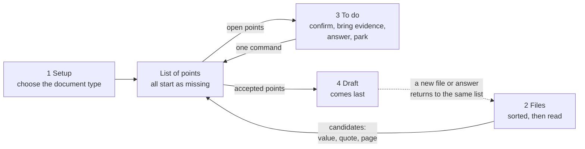
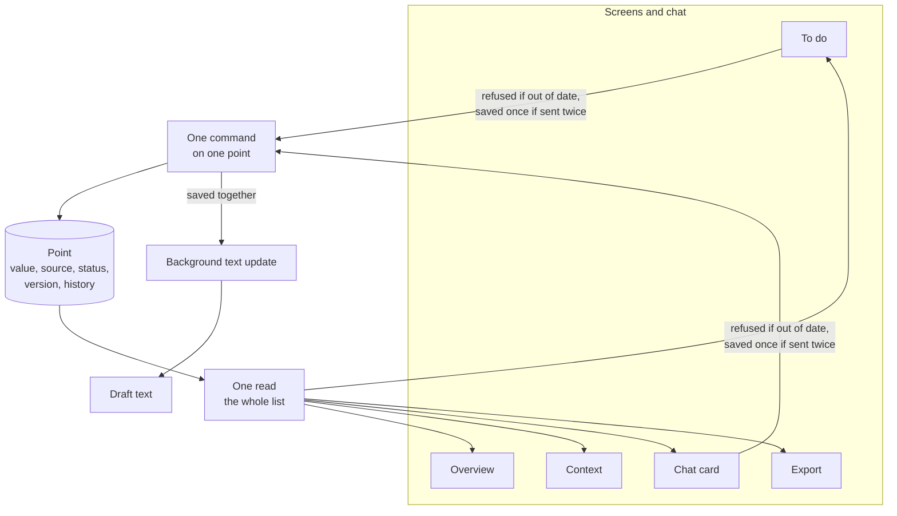
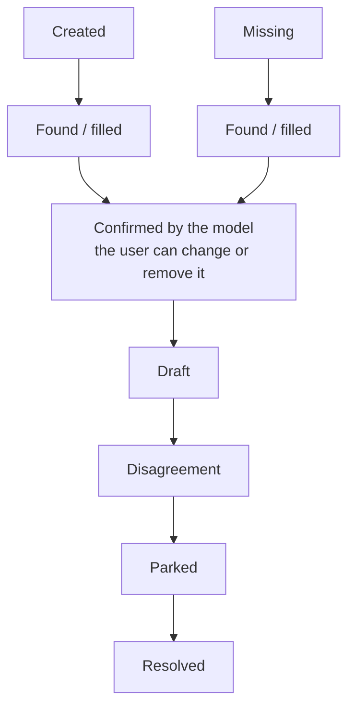
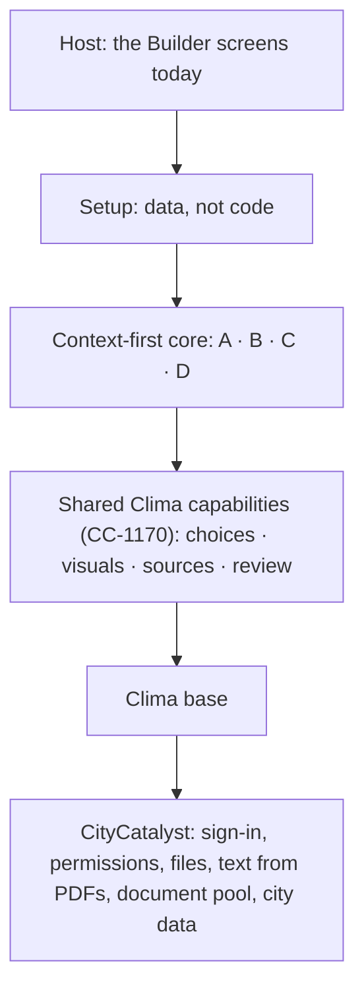
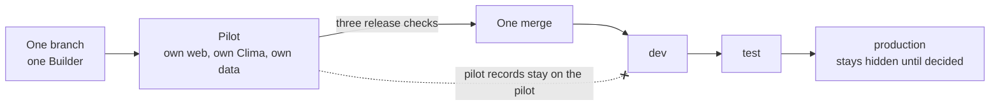

# Context-first core: architecture

| | |
|---|---|
| **Status** | First draft for review |
| **Ticket** | [CC-1296](https://linear.app/openearth/issue/CC-1296) |
| **Owner / reviewer** | Piotr Nowakowski / Joaquin |
| **Review gate** | 24 November 2026 |
| **Shared with the reviewer** | Not yet |
| **Code described** | branch `feature/jvp-agentic-workspace` at `3d54f77c4` |
| **Builds on** | CC-1170 spike ([CC-1170-CNB-Modularization.md](CC-1170-CNB-Modularization.md), [CC-1170-CNB-Module-Map.md](CC-1170-CNB-Module-Map.md); first proposed in [PR #3410](https://github.com/Open-Earth-Foundation/CityCatalyst/pull/3410)), [JVPAgenticFlowMapping.md](https://github.com/Open-Earth-Foundation/CityCatalyst/blob/feature/jvp-agentic-workspace/docs/JVPAgenticFlowMapping.md) (in Polish), [JVPAgenticImplementation.md](https://github.com/Open-Earth-Foundation/CityCatalyst/blob/feature/jvp-agentic-workspace/docs/JVPAgenticImplementation.md) (both on `feature/jvp-agentic-workspace`) |

**How to read this.** Sections 1 to 7 are the review path. Section 7 lists the decisions that need a yes or a no. Sections 8 and 9 are reference for engineers.

**Marks.** **Built** means the code is on the branch and was read. **Partial** means it exists, but narrower than the tickets need. **Missing** means it is not there. **Proposed** marks a choice this document asks the team to confirm. **Decided** marks a team decision of 16 or 18 November.

**Not checked.** The PRD, the prototype and the roadmap could not be opened when this draft was written. Product behaviour here comes from the tickets CC-1296 to CC-1306 and from the JVP mapping. Where this document differs from the PRD, it is a mistake in this draft, unless section 7 lists it. Nothing was run for this draft.

**Words used.**

| Word | Meaning |
|---|---|
| Builder | The Concept Note Builder (CNB). |
| Clima | The Climate Advisor service. |
| The core | The context-first core: the code named `document_workspace`. |
| Document | What the user writes. Today a concept note. |
| File | Something the user uploads. |
| Setup | The points, the file categories and the outline for one document type and one programme. |
| Builder template | What the Builder uses today in place of a setup. It is a funder's template or the note's own. |
| Category | A group of files that the setup asks for. The code calls it a document need. |
| Candidate | A value read from a file that nobody has accepted yet. |
| Command | The one save action that changes a point. |
| Pilot | The separately hosted version decided on 18 November. |

---

## 1. Summary

1. **The core is general, tested on one document type.** It is the `document_workspace` code in Clima, with its screens in the web app. **Decided (23 November):** the core is built general now, for any document type. Testing focuses on one, the concept note. Today the code still fixes the document type to `concept_note` in three places. Earlier checks are in the JVP implementation notes. There is no run with a real grant yet.
2. **Every screen shows the same list.** One request returns the list of points. Every change a person makes to a point is one command, and it is kept in the point's history. The user can save on the point card next to the chat. Clima itself cannot save yet.
3. **Four missing pieces matter most.**
   - Files are not sorted into the categories the document needs (CC-1299).
   - A setup can only be made from a Builder template, and every point's key contains that template's id. Each save of the note's own template gives it a new id, so every point is retired and the answers stay only in the history. The same label in two chapters is two points (CC-1297, CC-1298). **Proposed fix:** keep the template's id when the user edits their own template. Fields that did not change keep their keys and answers. Only fields that were removed are retired.
   - A changed point rewrites the whole chapter, not the passage (CC-1305, CC-1306).
   - Nothing on the server makes the draft come after the points.
4. **The core and CC-1170 share two connecting pieces.** The core uses Builder code directly in four places. CC-1170 planned adapters for two of them: access to files and editing of draft text. **Proposed:** define them once, for both tickets, and build them when a second user of them exists.
5. **Proposed: the new version replaces the Builder through a normal release.** **Decided:** no fork. The pilot is the same code on its own server with its own data. When it passes three release checks, the branch is merged. Users keep the same web addresses. Existing concept notes keep their text, and their points start as missing.

---

## 2. The flow we are building

This section describes the target. Section 3 says which parts exist today.

**Decided:** context first, with the draft as the last step.

1. **Setup.** The user chooses the document type. The setup creates the list of points. Every point starts as missing.
2. **Files.** Each file gets a category from the setup, or "anything else". Each file is read against the points. A value that is found becomes a candidate with its quote and its page.
3. **To do.** The open points are grouped by the kind of work. The user confirms, brings evidence, answers or parks.
4. **Draft.** The text is written from the accepted points. A working draft with marked gaps is possible early. A final export needs more: see section 3, D.

### When a file arrives

**Decided:** a file added while editing the document routes back into the chat, so that its origin is tracked. It still shows in the Context tab. The document is not written right away, so a new file is added to the context but does not start a rewrite of the document.

| Step | What happens | State |
|---|---|---|
| 1 | The browser sends the file to CityCatalyst. CityCatalyst checks access and stores it. A PDF is turned into text. | **Built** |
| 2 | Clima fetches the text and checks that it comes from exactly that file. | **Built** |
| 3 | The file gets a category from the setup, or "anything else". The category does not decide whether the file is read. | **Missing** |
| 4 | Clima reads the file against every point. Each value is stored as a candidate with its quote and, for a PDF, its page. | **Built, to change.** It will be used in a different way. |
| 5 | Every screen shows the new candidates. | **Built** |
| 6 | The chat shows one entry for the file: who added it, from which point or passage, and what was found. | **Missing** |
| 7 | A found value counts without a click. The user sees it and may change or remove it. | **To change.** Today nothing counts until a person says yes. **Decided** (23 November). |

Today a file can be added only in the Context tab. "Add source" on a point card opens that same uploader. Nothing stores which screen, point or conversation a file came from.

---

## 3. The four components

The table shows the target. The lists under it show the state today.

| | **A. Setup and list of points** | **B. Reading, sorting and checking** | **C. To-do list and guiding** | **D. Draft and consistency** |
|---|---|---|---|---|
| **Goal** | Turn the chosen document type into one stable list of facts and decisions. | Turn each file into a category and into candidate answers with a quote and a page. | Give the person a to-do list of the open points, and what they need to close each one. | Write text from accepted points and keep it aligned when a point changes. |
| **Owns** | The setup. The point record. The command. The one list that every screen reads. Rules between points. | The category of each file. Candidates and their evidence. Disagreement between files. | The to-do groups. The guided question. Help to find a file. Park and wait. | Which text depends on which point. Whether the text is up to date. The rule for final export. |
| **Does not** | Read files, write text, or choose a funder. | Hide a value from the user. | Save anything by itself. | Change a point. |
| **Tickets** | CC-1297, CC-1298 | CC-1299, CC-1300, CC-1301 | CC-1302, CC-1303, CC-1304 | CC-1305, CC-1306 |

### A. Setup and list of points

- **Built.** The points are made from the Builder template when the user selects it, again when drafting starts, and when a document is first opened. A copy of the template is kept for the document, with a version. Every change is kept in a history, with who made it.
- **Built.** Every point is plain text, and it stays that way.
- **Partial.** Templates store fields as plain labels, so every point's key is made from the template id, the chapter and the label. The same label in two chapters is two points, each answered on its own. Retiring a point whose field was removed is intended: the point leaves the list and its answer stays in the history. But every save of the note's own template gives the template a new id, so every key changes and every point is retired, even when one word changed. **Proposed fix:** keep the template's id when the user edits their own template. Fields that did not change keep their keys and answers. Only fields that were removed are retired. Changing the funder still starts the points again, which fits a new programme. Later, CC-1297 takes the key from the setup instead of the template.
- **Missing.** A setup that is its own record for a document type. A document type that comes from the setup: today it is fixed to `concept_note` in code. File categories. Rules between points, for example totals that must add up.

### B. Reading, sorting and checking

- **Built.** CityCatalyst stores the file and turns a PDF into text. Clima fetches the text and checks that it comes from exactly that file. It reads each new file against each point. A quote is kept only when it matches the page word for word. Every value waits as a candidate. When the user confirms, the system checks again that the file is still there, still allowed and unchanged.
- **Built.** A file that is already in the city's document pool can be attached without a second upload. A file that is withdrawn or replaced later blocks the final export.
- **Partial.** "Documents that disagree" is worked out when the list is shown. It is not stored. It compares values, not files, and it compares them exactly.
- **Partial.** A file that was attached before the points existed is read only after the template changes, or when the user presses "Sync document points".
- **Missing.** Sorting. Today a file is linked to a category only when it produced a candidate. The user gets no progress or failure signal for reading. City data from CityCatalyst does not create candidates.
- **Cost.** Each file is read once for each point. Ten files and forty points are 400 full reads.

### C. To-do list and guiding

- **Built.** The To do tab is the to-do list: the open points in groups, with a card for each point. A compact form of the same card appears next to the chat, and it can confirm a found value. Parking stores who is waited on and what is needed. A guided question is written on request.
- **Partial.** The to-do groups have the five product names and a sixth, "covered". The browser works them out, so the chat does not know them.
- **Partial.** The question format has six patterns. The screen shows one layout. There are three question formats today: the chat choice question, the older gap question and the point question.
- **Partial.** "Assume" and "does not apply" are offered only when the setup allows them. No Builder template does. CC-1303 asks for them always.
- **Missing.** Compare options, with what each option means. "Help me find it" on a point, and the request note. Saving an answer that the user typed in the chat.

### D. Draft and consistency

- **Built.** The first draft reads the accepted points of each chapter. Later, a changed point starts a background update of the chapters that use it. A chapter that is ready, confirmed or edited by hand is not overwritten: the user gets a proposed change.
- **Built.** Chapter review keeps its existing checks: completeness, consistency and answered gaps. **Decided:** they stay and are retested.
- **Built.** The server decides the final export. It needs every required point accepted, no open disagreement, text that is up to date, every required chapter reviewed and confirmed, and files that are still available. A working export is always possible and lists its caveats.
- **Partial.** The link is from a point to a chapter, and the template declares it. The writer also reads the full text of the files, so a value that nobody confirmed can reach the text.
- **Changed.** For a document with a setup, a new file no longer rechecks the chapters it affects. It creates candidates. This needs a yes, because existing checks stay (decision 8).
- **Missing.** Passages with their own identity. Sources per passage. Rules between points checked by code. A server rule for when the first draft may start. A way from a text edit that changes a fact back to the point. A "keep my text" outcome after the user rejects a proposed change.

---

## 4. The point

### 4.1 What a point holds

| Part | What it is | State |
|---|---|---|
| **Identity** | A key that is unique in the document and does not depend on the text. | **Partial.** Every key contains the template id and the chapter (3, A). |
| **Definition** | Copied from the setup: label, fact or decision, shape of the answer, required or optional, allowed exceptions, unit, chapters. | **Built** |
| **Value** | One accepted value. | **Built** |
| **Source** | For a value from a file: the exact file, the quote and the page. For a person's answer: who, when and why. | **Partial.** All of it is stored. The screens get the quote and the reason, but not who or when. |
| **Status** | Four separate facts. See 4.2. | **Built** |
| **Version** | A number that goes up with every change. | **Built** |
| **History** | Every change, in order, with who made it. | **Partial.** Stored. No screen shows it yet. |

Candidates are stored next to the point. **Decided (23 November):** A value found in a file counts without a click. The user sees it and may change or remove it, but does not have to accept every value by hand. Today nothing counts until a person says yes.

### 4.2 Status: four facts

CC-1298 lists one status per point: found, confirmed, assumed, parked, does not apply, missing. The code keeps four facts, because several can be true at once.

| Fact | Values | Product words |
|---|---|---|
| **Answer** | none, answered, assumed, does not apply | Missing, AI verified, Verified, Assumed, Does not apply |
| **Evidence** | nothing waiting, a candidate waiting, candidates that differ | Found; Documents that disagree |
| **Work** | active, parked, waiting, done | Parked; Waiting on others |
| **Text** | not written, current, stale, updating, to review, failed | Shown on the draft |

**Today.** The server returns the work and the text as their own fields. It merges the answer and the evidence into one status. So when a new file disagrees with a confirmed value, the point stops showing as confirmed. It also stops counting as covered and blocks the final export. Its value stays saved. The To do tab lists a parked point under Waiting, whatever else is true.

**Proposed (decision 1).** Keep answer and evidence apart. A point always shows its answer. If evidence is open, it also shows "Found, to confirm" or "Documents disagree". If it is parked, it also shows who is waited on. "Answered" and "cleared for final export" become two separate counts.

### 4.3 One source of truth for each point

**Target.** Each point has one source of truth: the list of points. Every screen and the chat show it. A change comes from To do, or from the chat once the user confirms it on the card. When a decision is made or context is added, the model checks whether it changes the point. If it does, it proposes the change on the card. Each saved change becomes the new version of the point.

**Today:**

**Reading.** One request returns the whole list: the setup, the points, the categories, the coverage numbers and the checks for export. Overview, Context, To do, the export panel and the card next to the chat all read it. **Built.** Two exceptions: Overview also lists open questions from the older gap list, and the older review-and-export dialog still makes its own check.

**Writing.** A person changes a point with one of eight commands: answer, confirm a candidate, correct, dismiss a candidate, assume, does not apply, park, resume. **Built.**

1. The server checks who is asking and that the document is theirs.
2. If this exact command was already sent, the stored result is returned.
3. If the point changed since the screen read it, the command is refused and the screen reloads.
4. The point, its version and its history are changed together.
5. For an accepted answer, the text update is queued in the same step.

The answer is saved at once. The text follows in the background.

Two things also change points without a command: a change of setup, and the reading of a file. Both are written to the history as system changes.

**Where it is not yet one record.**

| Place | Today | Proposed |
|---|---|---|
| **Chat** | The card next to the chat saves through the same command. Clima's two point tools only read. An answer typed as a chat message does not reach the point. | Clima turns a typed reply into a filled-in card for one point. The user's Save sends the same command. Clima never saves by itself. |
| **Uploads** | A file can be added only in the Context tab. Its origin is not stored. | A file added from any screen takes the same path, and the chat shows one entry for it (**Decided**; see section 2). |
| **Draft** | The first draft reads the accepted points. Later changes reach the text through the background update. | Keep this. The screen always shows whether the text is up to date. |
| **Gaps** | The Builder's older list of gaps still exists. A gap with no matching point is still answered through a chat edit, and that does not update any point. | Gaps stay only as review findings about the text. Missing information is always a point. |
| **To-do groups** | The browser works out the groups. The server returns only three next steps. | The server works out the groups, so the chat and every screen share them. |
| **Updates** | The list is asked for again every 5 seconds. | Enough for the pilot. |

### 4.4 One point, followed through

A fictional point: the requested funding amount, a required point. A point starts in one of two ways. Path a starts from the setup: the document type lists the point. Path b starts from the model: the setup did not list it, but while reading the model sees that the document needs it, and no file has it, so it adds the point as missing. On both paths the value is then found in a file or filled in by the user. The two paths meet when the value is confirmed. File A is a financing plan. Page 7 says EUR 4.2 million. File B is a council resolution. Page 2 says EUR 3.9 million.

| Step | Answer | Evidence | Work | Text | What the user sees |
|---|---|---|---|---|---|
| 1a. The setup creates the point | none | nothing | active | not written | Missing |
| 2a. Found in the files already attached (file A), or filled in by the user | none | value found | active | not written | Found |
| 1b. The model sees the document needs the amount. The setup did not list it and no file has it, so the model adds the point | none | nothing found | active | not written | Missing, needs a file or an answer |
| 2b. Found in a file added later (file A), or filled in by the user | none | value found | active | not written | Found |
| 3. Both paths meet. The model confirms the value; the user can change or remove it | 4.2 million, from A | nothing | done | not written | AI verified |
| 4. The draft is written and the chapter is confirmed | 4.2 million, from A | nothing | done | current | AI verified |
| 5. The owner adds file B while editing | 4.2 million, from A | B differs | done | current | AI verified · Documents disagree |
| 6. The owner parks it for the finance director | 4.2 million, from A | B differs | waiting | current | AI verified · Documents disagree · Waiting |
| 7. The answer arrives and the owner picks B | 3.9 million, from B | nothing | done | to review | Verified · Text change to review |

Where today's code differs: path b does not exist, because the model cannot add a point, and nothing tells the user that reading found nothing; "Help me find it" does not exist either. In step 3 nothing counts until a person confirms it. In steps 5 and 6 the status is "conflict" and the point is not counted as covered. In step 5 the file can only be added in the Context tab, and the chat shows nothing. In step 6 the point is listed under Waiting. In step 7 the whole confirmed chapter gets one proposed change.

### 4.5 Five rules

| Rule | State |
|---|---|
| **The user stays in control.** A value found in a file counts without a click. The user sees it and may change or remove it, but does not have to accept every value by hand. **Decided (23 November): two marks.** A value that counts without a human click is **AI verified**, shown in light green. A value a person confirmed or entered is **Verified**, shown in dark green. So it is always clear where a value came from, how well it was checked, and what comes from AI. | **To change.** Today nothing counts until a person says yes. **Decided** (23 November). |
| **One way to save.** A person changes a point only through the command. | **Built** |
| **Evidence is kept.** New evidence after a confirmation opens a disagreement. It does not change the accepted value. | **Built** |
| **Saving does not wait for the text.** | **Built** |
| **An out-of-date save is refused.** The user reloads and decides again. | **Partial.** The server refuses an old version. But the card takes the new version every 5 seconds and keeps the typed text, so a second click can save that text over a change the user has not seen. |

---

## 5. How the core sits on Clima, and what is reused

### 5.1 Layers

This is the target. Today there is no separate setup layer and no shared capability layer. The core uses Builder code directly, and some Builder code uses the core.

### 5.2 What Clima already gives

The Builder and the Stationary Energy flow already share these: stored conversations, one assistant with tools chosen for the page, a shared base prompt, named model settings, live answers in the browser, signed-in calls to city data, and a trace of each turn. **Built.** The table is in 9.3.

**The limit.** Clima cannot take a new product without programming. It knows three: the general chat, Stationary Energy and the Builder. The core lives inside the Builder. Its web addresses, its chat tools and its storage all belong to a concept note. The document type is fixed to `concept_note` in three places.

**Proposed.** The pilot keeps the Builder screens, addresses and document identity. What changes is the setup: the Builder chooses and pins a setup for each document, and the core runs from it without a funder template. The core itself stays free of rules for the concept note: the Builder is only the first place it is tested. Another product or another address comes later.

### 5.3 What is reused from the Builder

| Reused, with small edits on this branch | Connecting pieces, to build | Replaced by the list of points |
|---|---|---|
| Upload, text from PDFs, the document pool | **Setup adapter.** Turns a Builder template or a standalone setup into one definition. | Gaps as the list of missing information. **Partial:** both lists exist. |
| The file reader with word-for-word quotes | **Host binding.** Gives the core an allowed document, the person and the conversation. | Answering a gap through a chat edit. **Partial:** still used when a gap has no point. |
| The chapter writer | **Source resolver.** Lists and opens allowed files and checks they are unchanged. | Rechecking chapters after a new file. **Built** for documents with a setup. |
| Proposed changes: review and apply | **Draft adapter.** Writes and updates text from the points, and sends protected text for review. | Export after a tick box. **Partial:** the old dialog remains for working exports. |
| Chapter review and confirmation | | |
| Choice questions and visuals in the chat | | |
| Document, conversation and city permissions | | |
| Word and PDF files | | |

There is no adapter interface today. The core imports Builder code in five of its six files and uses some of its private parts. Eight Builder files import the core. This is why the core works for the concept note and for nothing else.

**Direction, outside this scope.** The core stays inside the Builder for now. Over time, part of these tools should move out of the Builder into shared Clima capabilities, as the CC-1170 spike proposes, so that other products can use them. That move is not part of this work. Until then, the four connecting pieces above are the places where the core and the Builder should meet.

### 5.4 How this connects to CC-1170

CC-1170 looked at the same code from the side of the chat tools. It proposed shared homes for five tools. Nothing from the spike has been moved. The core was built next to the five tools.

| CC-1170 capability | Core | What the core needs from it | State |
|---|---|---|---|
| **Sources** | B | Its reader. Point reading already calls it. | Not moved. Reused in place. |
| **Review** | D | Its proposals. Text updates create them. | Not moved. Reused in storage. |
| **Choices** | C | Its behaviour for guided questions. | Not moved. Three question formats now. |
| **Collection (gaps)** | A, C | Nothing. Points replace it. | Superseded. Still in the code beside the points until the gap list is removed. |
| **Visuals** | chat only | Nothing. | Not moved. |
| **Export** | D | The spike left it for later. The core needs it now. | The rule for final export is built in the core. |

**The interconnection.** The spike names two adapters, without code names. Both meet the core:

- **An authorized source-resolution adapter** (spike step 4). It is a starting point for the core's source resolver. The core also needs the files that come through the reading job, and the check that a file is unchanged.
- **A resource apply adapter** for review (spike step 6). It is the review-and-apply part of the core's draft adapter. The core also needs the first draft and the updates.

The spike had no gap adapter. It treated gap collection as a Clima capability, which the points replace (see **Gaps** below).

The core adds two pieces the spike did not have: the setup adapter and the host binding.

**Gaps.** Missing information is always a point. Gaps stay only as review findings about the text. So the spike's shared gap collection, and the gap part of its step 6, are dropped. The spike documents carry the same note.

**Proposed order of work.** **Decided:** moving tools into Clima is lower priority, and hardening continues.

1. **Hardening.** Items 1 to 3 in 9.4 before the pilot.
2. **Setup adapter and host binding.** The only pieces the pilot needs. CC-1297 and the generality check depend on them.
3. **Source resolver and draft adapter.** When a second user needs the same contract: the main Clima chat, or a product that is not the Builder.
4. **One question format.** CC-1303.
5. **Visuals and tools in the main Clima chat.**

The spike documents follow this order. Their migration plan maps each old step to a step here; steps 1 to 3 and 5 of the spike are paused.

### 5.5 Where the data lives

**Today.** Climate Advisor has two databases. The Clima database holds conversations, Stationary Energy and the Builder's runs. The Builder database holds chapters, revisions, edit proposals, gaps and funding data, and is set up outside this repository. The eleven point tables are in the **Builder database**: `document_workspaces`, `document_setup_snapshots`, `document_points`, `document_point_candidates`, `document_point_revisions`, `document_operations`, `document_needs`, `document_point_dependencies`, `document_update_jobs`, `document_exports`, `document_source_readings`. The CityCatalyst database gets one change to the document pool.

**Proposed.** Keep the point tables in the Builder database for the pilot. One transaction saves the point, its history and the queued text update. Applying a reviewed change saves the chapter revision and marks the point current, also in one transaction. Both work only because the point tables share a database with the chapters and revisions. Moving the point tables alone would split them.

**Revisit** when the paused move of capabilities into Clima resumes, or when the generality check passes. The spike's rule then applies to what has proven shared: shared tables in the Clima database with a `clima_` prefix, and the move done by double writing, filling and switching reads, never by renaming in place.

### 5.6 Where the prompts live

**Today.** The core's prompts sit with the Builder: `prompts/cnb/document_point_extraction.md` and `prompts/cnb/document_point_question.md` (keys `document_point_extraction`, `document_point_question`), and `prompts/tools/document_workspace.md`, included by `prompts/cnb/chat.md`.

**Proposed.** Leave them there for the pilot.

**Revisit** when the paused move of capabilities from the Builder and the agentic flows into Clima resumes. Then the prompts of tools that more than one product uses move to the main `prompts/` folder as core prompts, following the spike's prompt proposal (module map, "Proposal: versioning and ownership"). The exact folder is decided then.

---

## 6. Replacing the current Builder without a fork

### 6.1 Facts

1. **The new version is the Builder itself, changed in place.** Same page, same web addresses. There is no copy. The branch adds storage for points, new server functions, and one change to the document pool that other modules also use.
2. **Old and new cannot run on one site together.** No switch chooses between them for a city or a user. The web app has one switch for the whole Builder. Clima has none: its Builder functions and background work always run.
3. **What is replaced where.** dev and test show the Builder. In production the Builder code is deployed but hidden. So the replacement happens on dev and test. Production gets its first visible Builder, and that is a separate decision.
4. **A release changes production even while the Builder is hidden.** The database changes run and the new background work starts.
5. **The web app and Clima are released separately.** Nothing orders them. For some minutes after a merge, one can be new and the other old.
6. **A pilot exists.** The Mikrus test server runs this branch with its own databases. It is filled by hand from a developer's working copy. Its tooling is not on this branch.
7. **Existing concept notes are not converted.** Text, files and chat stay. Points start as missing. The files already attached are not read until the user presses "Sync document points". The final export is refused for text written before this change, and writing the draft again does not clear that. A working export still works.

### 6.2 Proposed path

1. **Pilot.** The branch runs on the pilot. Where it runs is not fixed, and it is not a decision for the 24 November gate. The tests will probably run on dev. The Mikrus test server is the other place. dev is released from `develop`, so testing there means a merge, or a release of the branch by hand, before the checks pass. If that is the choice, the order of steps 1 to 3 has to be looked at again.
2. **Release checks.** The three checks in 6.3 pass.
3. **Merge.** One merge into the shared code.
4. **Cutover, one environment at a time.** Apply the database changes. Release Clima and the web app in an agreed order. Hold the Builder until both pass a short end-to-end check. Then open it again at the same addresses.

| Option | What it means | Verdict |
|---|---|---|
| **Pilot, then merge** | One code line. Separation by server and data. | **Proposed** |
| A switch per city on one site | A gradual rollout. It needs old and new behaviour in one Builder, for requests, background work and exports. | Not proposed. It costs a second behaviour to maintain. |
| A second Builder | Two to maintain. | **Decided:** no. |

### 6.3 What "tested" means: three release checks

| Check | Question | What we show |
|---|---|---|
| **Quality** | Does it sort, read and write correctly? | CC-1301. A real grant for a real city, then a different grant for the same city in a second document. The answer key and the pass marks are agreed before the run. Scores: files in the right category; points found with the right value, quote and page; statements in the draft backed by an accepted point. No value is carried over from the first grant. |
| **Generality** | Is the core free of rules for one document type? | The document type comes from the setup, not from code. The core has no special case for the concept note. Checked in the code and in review. No second document type is built for the check: testing focuses on the concept note. Today the type is fixed to `concept_note` in three places, and the draft starts from a Builder template. |
| **Release** | Is it safe for existing documents? | The database changes are rehearsed on a copy. An existing concept note still opens. Old and new versions are tried together. Repeated and out-of-date saves behave. The chapter checks are retested. Going back is rehearsed. |

Two grants for one city show that reading carries over between grants. Generality is not tested with a second document type. **Decided (23 November):** the core is built general now, for any document type. Testing focuses on one, the concept note.

### 6.4 Existing concept notes

**Proposed.** Keep each note's address, owner, chat, files, text and history. Its points start as missing. A gap that was resolved earlier does not become a confirmed fact.

**Decided (23 November).** There are no production users yet, so existing notes are test data. They must still open. They need not reach a final export: the user starts a new concept note, as the app already tells them.

### 6.5 If the cutover goes wrong

- There is no ready way back. No release job puts an older version back, and an older Clima may refuse to start against the newer database. This is read from the code, not tried.
- Opening a concept note already creates its points, and reading a file creates candidates. So "before anyone saved" is not a clean line.
- **Proposed.** Rehearse on a copy first. If a cutover fails, hide the Builder and repair the new version. Do not undo the database change on real data: that deletes points, history and exports.

### 6.6 What keeps this one Builder

1. One Builder. No second workspace, no second set of addresses, no copied prompts.
2. The pilot and the release use the same database changes.
3. Pilot records and files stay on the pilot. Code, settings and agreed test files are what moves.
4. The cutover has a named owner. The branch takes in `develop` regularly. Today it is 27 changes behind.
5. Each environment switches as one release. No switch per document or per city.
6. The pilot can be rebuilt from the repository, from saved changes only. **Open:** today it cannot.

---

## 7. Decisions needed

### By 24 November

| # | Question | Proposed | What a yes means |
|---|---|---|---|
| 1 | When a new file disagrees with a value, does the user decide, or does the model decide alone? | Open. Proposed: the model only for AI verified values | Example: the point says 4.2 million from file A, and file B says 3.9 million. Option 1: the point keeps its value, shows "Documents disagree" with both files and pages, and the user picks one. Until then it is not cleared for final export. Option 2: the model picks the value by itself and marks it AI verified. Proposed: the model may decide alone only when the value is AI verified, and the user sees what changed. A value a person confirmed (Verified) is never overwritten: the user always decides. |
| 4 | Is every file sorted, even when it answers no point? | Yes | One category per file, or "anything else". The category does not decide whether a file is read. The user may move a file by hand. |
| 5 | Does the document type fix the list of points, or does the model find as many as it can? | Open. Proposed: the middle | Fixed list: the model fills only the points the setup names. Predictable and easy to score against an answer key, but it misses what the list did not foresee. Open extraction: the model takes everything it finds. Nothing is missed, but there is no focus, more noise, and it is hard to test. Proposed middle: the setup names the required points and gives the direction (the purpose of the document, its chapters, the programme's criteria) as a guardrail. The model fills those first and may add extra points, which the user sees and can remove. Either way the setup is its own versioned record, pinned for each document, not a Builder template. |
| 8 | Does a new file recheck chapters? | **Decided:** no | The text is written only at the last stage, so a new file only adds candidates to the context. There is nothing to recheck. |
| 12 | Which city and which two grants are the test case, and who writes the answer key? | Open | Not decided. The Quality check (6.3) cannot run until it is. |
| 13 | Who may change a point? | **Decided:** every contributor | Every contributor to the document, through the same command. "Waiting on others" is a name and a note. |

**Set aside (was 10).** Whether an existing concept note must reach a final export without starting again. There are no production users yet (6.4).

**Set aside (was 11).** Whether real documents of a city may be stored on the Mikrus test server. The tests with real documents will probably run on dev, so the question does not arise now. It returns only if real documents go to that server. The other numbers are kept.

---

## 8. The tickets against this architecture

| Ticket | Core | Built | To build |
|---|---|---|---|
| CC-1297 Setup of points | A | Typed point definitions in code. A copy of the template for each document, with a version. | Setup as its own record. File categories. Keys that do not depend on the template. A document type that comes from the setup. |
| CC-1298 One list of points | A | One list, one read, one command, history, storage between sessions. | The same point across chapters. Answer and evidence as separate fields. A typed chat reply saved to a point. History shown. |
| CC-1299 Sort files | B | Categories with a status, including missing. | A sorting step. "Anything else". A file in a category when it gave no value. |
| CC-1300 Match and confirm | B | Candidates with quote and page. Confirm, correct, dismiss. Disagreement shown. | Disagreement stored with its files. Comparison that understands units and formats. |
| CC-1301 Benchmark | B | The Builder benchmark: extraction, writing, verification, editing. | Scores for sorting and point finding against an answer key. |
| CC-1302 To-do list | C | To do tab. Confirm. Park and resume. | Groups worked out on the server. Evidence linked to the point it was brought for. The same actions from the chat. |
| CC-1303 Guided questions | C | A question on request, with the waiting evidence above it. | Compare options. What each option means. One question format. Exceptions always offered. |
| CC-1304 Help me find it | C | One default guidance sentence for each category. | The helper on a point. The request note. |
| CC-1305 Draft from points | D | The first draft reads the accepted points and records their versions. | Points as the only source of facts. Sources per passage. Marks for assumed and parked points. |
| CC-1306 Rewrite what changed | D | A background update for each changed point. Proposed changes for protected text. Chapter review. | Passage identity. Passage rewrites. Rules between points in code. The retest of the chapter checks. |
| No ticket yet | B | | Reading progress and failure shown to the user. City data as candidates. |
| No ticket yet | Hardening | | The items in 9.4. |

---

## 9. Reference

### 9.1 Code map

`ca/` is `climate-advisor/service/app/`. `ws/` is `app/src/components/ConceptNoteWorkspace/`.

| What | Where |
|---|---|
| Point tables (eleven, in the Builder database) | `ca/models/db/document_workspace.py:27-224` |
| Database change that creates them | `climate-advisor/service/cnb_migrations/versions/20261115_120000_document_points.py` |
| Database change to the document pool | `app/migrations/20261115150000-isolate-private-ingest-documents.cjs` |
| Contracts | `ca/models/document_workspace/contracts.py`; `app/src/util/document-workspace.ts` |
| Service: load, setup, command, list, question, export | `ca/services/document_workspace/service.py:102, 117, 442, 740, 1068, 1120` |
| Point keys and value checks | `ca/services/document_workspace/requirements.py:27, 63, 159` |
| Own template gets a new id on every save | `ca/services/cnb/funder_creation.py:533` |
| Reading files into candidates | `ca/services/document_workspace/extraction.py:36` |
| Queueing the reading | `ca/services/document_workspace/source_sync.py:23, 74` |
| File check at confirm and export | `ca/services/document_workspace/source_access.py:14` |
| Text updates and their loop | `ca/services/document_workspace/jobs.py:179, 581`; started in `ca/main.py:106` |
| Outcome of a reviewed proposal | `ca/persistence/concept_notes/point_reviews.py` |
| Clima routes (five) | `ca/routes/document_workspace.py:62, 75, 89, 113, 131` |
| Chat tools for points (read only) | `ca/tools/document_workspace_tools.py:122, 132`; bound in `ca/services/agent_service.py:451-465` |
| Prompts | `climate-advisor/prompts/cnb/document_point_extraction.md`, `document_point_question.md`; `climate-advisor/prompts/tools/document_workspace.md` |
| Web proxy: session, switches, city access | `app/src/backend/document-workspace-api.ts` |
| Browser queries and the command | `app/src/services/document-workspace-api.ts` |
| One subscription, asked again every 5 seconds | `ws/index.tsx:134-142` |
| Overview and To do panels | `ws/document-workspace-panels.tsx` |
| Point card | `ws/document-point-card.tsx:34`; shown at `ws/document-workspace-panels.tsx:671` and `ws/index.tsx:661` |
| To-do groups, worked out in the browser | `ws/point-state.ts:6-24` |
| Chat opens a point | `ws/use-concept-note-chat.ts:157-170` |
| Final export refused for old text | `ca/services/document_workspace/service.py:956-957`; message in `ca/persistence/concept_notes/source_provenance.py:10-14` |
| Builder switch in dev, test and production | `.github/workflows/web-develop.yml:562`; `web-test.yml:340`; `web-tag.yml:320` |

### 9.2 Product words and code words

| Product | Code |
|---|---|
| Point | `document_points` row; `DocumentWorkspacePoint` |
| Setup | `document_workspaces.setup` and `document_setup_snapshots`; made from `ApplicationContextTemplate` |
| Found | `status: needs_confirmation`, with a `pending` candidate |
| Confirmed | `disposition: answered` |
| Assumed | `disposition: assumption` |
| Does not apply | `disposition: not_applicable` |
| Documents that disagree | `status: conflict`, worked out on read |
| Parked, waiting on others | `task.status: parked`, `waiting` |
| Text up to date | `freshness`, worked out on read |
| Category | `document_needs`; in practice one for each point today |
| Document | `ConceptNoteRun`, identified by `run_id` |

### 9.3 What the Clima base gives

| Base service | What it does |
|---|---|
| Conversations | Stores threads and messages with a signed-in owner |
| Assistant | One agent, with tools chosen in fixed branches for each product |
| Prompts | A shared base prompt plus the prompt of the product |
| Models | Model names in one configuration file |
| Streaming | One event stream to the browser, with tool results |
| CityCatalyst client | Signed-in calls to city data, with token renewal |
| Tracing | One trace for each chat turn. The core's background updates are not traced. |
| Databases | The Clima database and the Builder database. Stationary Energy uses only the first. |

A new product needs edits in two fixed lists (allowed prompts, context keys) and in several branches of the assistant, the context loader and the stream.

### 9.4 Found while mapping the code

These are defects or risks. They are not architecture decisions.

1. **Keys.** Every point's key contains the template id, the chapter and the label. Every save of the note's own template makes a new template id, so every point is retired and the answers stay only in the history. The same label in two chapters is two points. **Proposed fix:** keep the template's id when the user edits their own template. Fields that did not change keep their keys and answers. Only fields that were removed are retired.
2. **Source of a typed answer.** A command that is not a confirmation still stores the candidate id it was sent. The card never sends one, so it needs a hand-made request today. It must be closed before the chat can prepare answers.
3. **Rejected proposal.** Today, when the user rejects a proposed change that came from a point, the update is marked failed and tried again, up to five times. The text stays out of date and the final export stays blocked. **Proposed:** treat it like any other rejected proposal today. That one proposal goes away and is not retried. The point stays confirmed, the chapter keeps its text, and the final export is not blocked by it.
4. **Reviews go out of date too easily.** Any command on any point, and the reading of any file, makes every chapter review out of date.
5. **Copies.** A copied concept note keeps its text. Its points start as missing.
6. **Have it, or answers it.** A file reaches a category only when it produced a candidate.
7. **Reading fails quietly.** After three failed tries the reading stops. Nothing tells the user.
8. **Out-of-date save.** The refusal carries a message, not the current point. Every refusal is shown as "changed in another session". The card also takes a newer version while keeping the typed text, so a second click can save over a change the user has not seen.
9. **Other documents.** The Builder architecture document does not describe points. The Clima architecture document shows one database where there are two. The JVP implementation notes say the Builder "supplies adapters". There is no adapter interface yet.

### 9.5 Inherited from CC-1170

- Two databases with no shared step. The check of the owner and the write of the point are not one step.
- The Builder database is set up outside this repository.
- The web chat route passes on the document id without its own check. Clima then checks the conversation owner, the document owner and that the document belongs to the conversation.
- The spike documents now sit next to this one, but their line numbers point at an older `develop`.

### 9.6 Release details

- The branch has two database changes. One only adds the eleven tables in the Builder database. The other changes the document pool table in the CityCatalyst database: a new column, a fill of existing rows, and a replaced unique index.
- Undoing the first deletes points, history, update jobs and exports. Undoing the second can fail when two people hold the same private file.
- Clima's release uses moving image names (`:dev`, `:test`, `:stable`). Each release runs "upgrade to newest" with the image that is being released.
- A push to a feature branch is not released. The test release can be started by hand on any branch.
- The pilot tooling: an October version is on the remote branch `codex/mikrus-deployment`. The copy in use is local and not tracked. It can release a working copy with changes that are not saved in git.

### 9.7 How this draft was made

A first pass read nine parts of the code and the two CC-1170 documents. An independent consult (Sol 6.2) proposed the shape of the document and later reviewed the draft. Seven checkers then tried to refute every statement about the code: 254 statements, of which 94 were corrected or tightened in this version. Nothing was run: every statement about the code comes from reading it.
