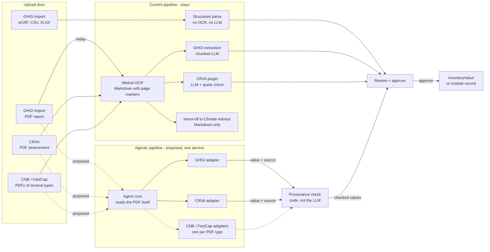
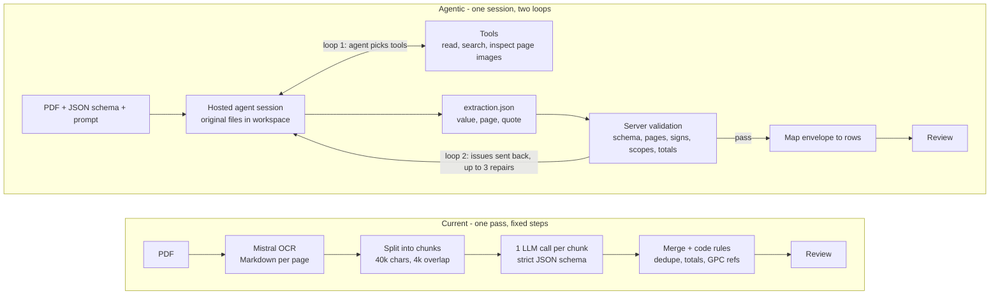
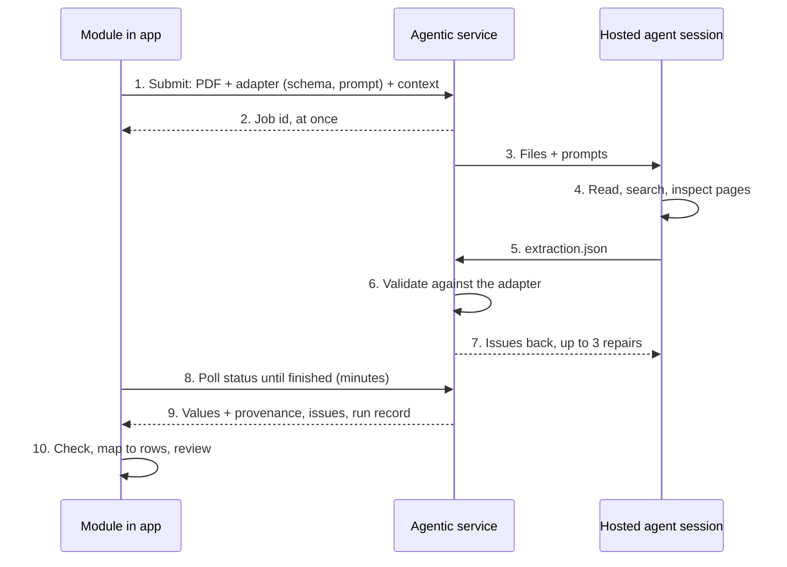

# PDF Extraction Architecture: Current and Agentic Pipelines (Proposal)

**Status:** draft for review (Mirco, Piotr).
**Owner:** David · **Last updated:** 2026-11-25
**Ticket:** [CC-1364](https://linear.app/openearth/issue/CC-1364/document-the-pdf-extraction-architecture-current-vs-agentic-pipeline)
**Companion docs:** [`app/docs/GenericFileIngestionArchitecture.md`](../app/docs/GenericFileIngestionArchitecture.md) ·
[`app/docs/IngestSpineModuleInteraction.md`](../app/docs/IngestSpineModuleInteraction.md) ·
[`NativeInputCatalog.md`](./NativeInputCatalog.md)

> **When to use this file:**
> - Before integrating the agentic extraction pipeline into a module (GHGI, CRVA, CNB, FastCap).
> - When deciding which pipeline an uploaded file should go through.
> - When adding provenance (source evidence) to extracted values.
> - When deciding how the agentic service is built, deployed and called.

## Summary

- The agentic pipeline runs **beside** the current OCR pipeline. It does not replace it.
- Structured inputs (eCRF, CSV, XLSX) keep the current path: their cells are read, not inferred.
- Unstructured PDFs go to **one** agentic service. Each document type gets an **adapter**: a JSON schema and a prompt. This is the same pattern as HIAP: a shared core with adapters for inputs and outputs.
- Every value extracted from a PDF carries its **provenance**: value, unit, document, page and verbatim quote. Code checks the quote and the number against the source before a person sees the value.

Nothing in this document is built yet. The agentic extractor exists as a standalone service in
[PR #3463 "Add a standalone agentic PDF extractor and GHGI benchmarks"](https://github.com/Open-Earth-Foundation/CityCatalyst/pull/3463), which is open and not deployed.

## Routing: where each file goes



The route is chosen at the upload door, from the module and the file type. Both pipelines end in the same review screen, so users approve the same way whichever pipeline produced the rows.

## Current extraction compared with the agentic pipeline

Both take the same PDF and end in the same review. The difference is the middle:

- **Current:** a fixed sequence that runs once. The model sees OCR text only, never the page.
- **Agentic:** one agent session gets the original files and tools, decides how to read them, and its answer is validated by the server and sent back when validation fails.



Loop 1 runs inside one agent turn. Loop 2 is run by the server and stops when the checks pass or the repair limit is reached.

| | Current (built-in) | Agentic (PR #3463) |
| --- | --- | --- |
| What the model reads | OCR Markdown, cut into chunks | The original PDF; it can look at page images, tables and footnotes |
| Who decides the steps | Our code: always OCR, chunk, call, merge | The agent chooses which pages and tools to use |
| Model | `gpt-5.6-luna`, one call per chunk | `gpt-6.1-sol`, medium reasoning, one session |
| Checks after the model | Code rules: merge duplicates, hidden totals, GPC reference and scope, direction quote found or not | Server checks schema, pages, signs, scopes and totals; failures go back to the agent |
| Second attempt | None; the result is final | Up to 3 repair turns in the same session |
| Evidence per value | Source text of the row; the value itself is not checked | Page and quote per value; not yet checked in code |
| Runs where | Inside `app`, in the OCR cron | Separate Python service; submit, then poll; takes minutes |
| Recall · precision | 54% · 82% | 68% · 97%; 86% · 98% with the CC-1311 approve fix |
| Held-out recall | 51% | 62% |
| Cost and time per PDF | Known from the OCR cron | Not measured yet |

Scores come from the CC-1124 PDF benchmark, cases C-015 to C-021 (`docs/ingestion-accuracy-runs/`). The two sides used different models, so the gap is not only the method.

Sources: current flow in `app/src/backend/PdfOcrService.ts` and `app/src/backend/InventoryExtractionService.ts`; agentic flow in `pdf-extraction/README.md` on the PR #3463 branch.

## The agentic service

Proposal: one deployed service that any module calls over HTTP. It knows how to read a PDF with an agent and return values with their source. It knows nothing about inventories, CRVA fields or concept notes: that knowledge arrives as an adapter. This is the HIAP pattern: a shared core with adapters for inputs and outputs.

### Responsibilities

| The service does | The service does not |
| --- | --- |
| Accept a job: one PDF plus one adapter | Choose the route. The module decides at upload |
| Run one agent session on the original file | Store the uploaded file. `app` and S3 own it |
| Validate the answer against the adapter's schema and rules, and ask the agent to repair it | Write module records or run review and approve |
| Return values with page and quote, the issues left, and tokens used | Know users, cities or permissions. Only `app` calls it, with a service token |
| Keep job state so a restart does not lose a running job | Replace the current pipeline for structured files |

### Inputs

| Input | What it is | Who provides it |
| --- | --- | --- |
| PDF | The original uploaded file, not OCR text | Module, from storage |
| Adapter: schema | JSON Schema of the values to extract | Adapter (GHGI, CRVA, ...) |
| Adapter: prompt | Rules of the standard: categories, units, what to keep apart | Adapter |
| Case context | City, year, and other facts of this upload | Module |
| Options | Repair on or off, repair limit, OCR context on or off | Adapter defaults |

### Outputs

| Output | What it is | Who uses it |
| --- | --- | --- |
| Values | Data that matches the adapter's schema | Module maps them to its own rows |
| Provenance | Document, page and quote per value | Provenance check, then the review screen |
| Issues | Fields not found, ambiguous, or still failing validation | Review screen |
| Run record | Status, repair rounds, model, tokens, time | Logs and cost tracking |

### How a job runs



A job takes minutes, so the call is submit and poll, never one blocking request. Steps 1 to 9 exist in the PR #3463 prototype (`POST /v1/extractions`, then `GET /v1/extractions/{id}`). Step 10 is the module's side and is not built.

### Alternatives

| Option | For | Against | Status |
| --- | --- | --- | --- |
| **A. One shared service, one adapter per document type** | One core to improve and operate; a new document type is a schema and a prompt; runs the code the benchmark measured | A new deployment that needs an owner, secrets and a volume | Direction from the 25 Nov 1:1 |
| B. One service per standard (GHGI service, CRVA service) | Each module is independent | The agent core is the same code twice; fixes must be made twice | Discarded in the 1:1 |
| C. Put the agent inside the current pipeline, replacing its LLM step | No new service; one path for users | Changes a pipeline that works for structured data; a job of minutes does not fit the 1-minute OCR cron | Discarded in the 1:1: do not touch the current one |
| D. Host it inside Climate Advisor | No new deployment | Couples two release cycles; its one-worker job state conflicts with replicas | Open |
| E. Rewrite it in TypeScript inside `app` | No service to operate | A rewrite; the benchmark result no longer describes it | Open |

### Decisions to make before building

- **Where adapters live.** In the prototype the caller sends schema and prompt with each job, so adapters would live in each module. The alternative is a registry inside the service, called by adapter name. Caller-owned keeps the service generic; a registry keeps prompts in one place and versioned with the core.
- **Where the provenance check runs.** In the service, as one more validation step that can trigger a repair, or in `app` after the result. In the service it works for every module at once.
- **Job state.** The prototype keeps state in one SQLite file with one worker. Keep that with one replica and a volume, or move to Postgres to allow more than one replica.
- **Failure.** When a job fails or times out: fail the import visibly, or fall back to the current pipeline. A silent fallback hides a quality drop.
- **Rollout.** A feature flag per module, so the current pipeline stays the default until each module switches.
- **Cost limits.** The prototype has no spend limit and does not detect a PDF submitted twice. Measured for CRVA (CC-1307, PR #3443): 20 to 28 minutes and 34 to 44M input tokens per report with 3 runs, against about 5 minutes and 0.6M tokens today. GHGI is not measured.
- **Owner.** Who operates the service and its secrets in dev, test and prod.

## What the code does today

| Input | Path in `develop` | Source evidence today |
| --- | --- | --- |
| GHGI eCRF, CSV, XLSX | `ECRFImportService`, `GhgiIngestPlugin` | Not needed: cells are read, not inferred |
| GHGI PDF | `PdfOcrJob` queue and cron, Mistral OCR, `InventoryExtractionService` | Row text shown in review; `verifyRowProvenance` checks the GPC reference and direction quote, not the value |
| CRVA PDF | `CcraIngestPlugin`: Mistral OCR, LLM, `verifyQuotes` | `{ file, page, quote }` per value; a quote not found on its page drops the value |
| CNB PDF | Concept-note upload, Mistral OCR (`sourceType: concept_note_upload`), Markdown delivered to Climate Advisor by `PdfOcrDeliveryService` | No value extraction in `app`. Climate Advisor analyses sources itself (`climate-advisor/service/app/services/cnb/source_analysis.py`, `tools/concept_note_source_tools.py`) |
| FastCap PDF | Not found in this repository | Unknown, to confirm with Piotr |
| Agentic service | `pdf-extraction/` in PR #3463, not deployed | To be added, see below |

## Provenance record

One record per extracted value, written by the adapter. Proposed shape:

```jsonc
{
  "value": 100000,
  "unit": "t CO2e",
  "source": {
    "document": "munich-ghg-report.pdf",
    "page": 15,
    "quote": "The City of Munich reports 100.000 t CO2e in the year ...",
    "kind": "text"            // text | table | figure | map
  },
  "check": "verified",
  // verified | quote_not_on_page | number_not_in_quote | not_checkable
  "metadata": {              // JSONB, empty when not applicable
    "table_name": null,
    "image_id": null,
    "note": null
  }
}
```

`source` extends the existing `CrvaSourceSchema` (`file`, `page`, `quote`) in `app/src/backend/ingest/plugins/ccra/draft-schema.ts`, so CRVA and GHGI can share one shape. For reference, Urbind stores `quote` with `source_chunk_ids` and no page (`backend/api/models.py` in the Urbind repository).

### The check

The check is a function of the number and the quote, run by code, not by the LLM. It is a fast text search, and it catches values the model did not take from the document.

1. Normalise the page text and the quote: whitespace, ligatures, soft hyphens. `app/src/backend/ingest/plugins/ccra/verify-quotes.ts` already does this for CRVA.
2. The quote must occur on the stated page. If not: `quote_not_on_page`.
3. The number must occur in the quote, with separators normalised, so `100.000` and `100,000` both match `100000`. If not: `number_not_in_quote`.
4. A value read from a figure or a map has no quote to match. It is `not_checkable` and goes to human review with the page and image reference in `metadata`.

With this record the front end can show document, page and quote on hover, and mark the values that failed the check.

## CNB and FastCap

CNB and FastCap are not one document each. A user can upload several PDFs to them, for example a climate action plan and census data. Each PDF type extracts different data, so each would need its own adapter in the same agentic service; it would not be one CNB adapter.

Today CNB shares only the OCR step with GHGI. Moving it to the agentic service means first listing its PDF types and what is extracted from each, and confirming where that extraction lives today (Climate Advisor). FastCap's extraction path is not in this repository.

## Open points

- **Units.** [PR #3463](https://github.com/Open-Earth-Foundation/CityCatalyst/pull/3463) still discusses keeping the printed value and unit and converting in code. The record above assumes the printed value is kept.
- **CNB and FastCap (Piotr).** Which PDF types each one accepts, what is extracted from each, and whether moving them to the agentic service makes sense. CNB source analysis lives in Climate Advisor (`services/cnb/source_analysis.py`, `tools/concept_note_source_tools.py`).
