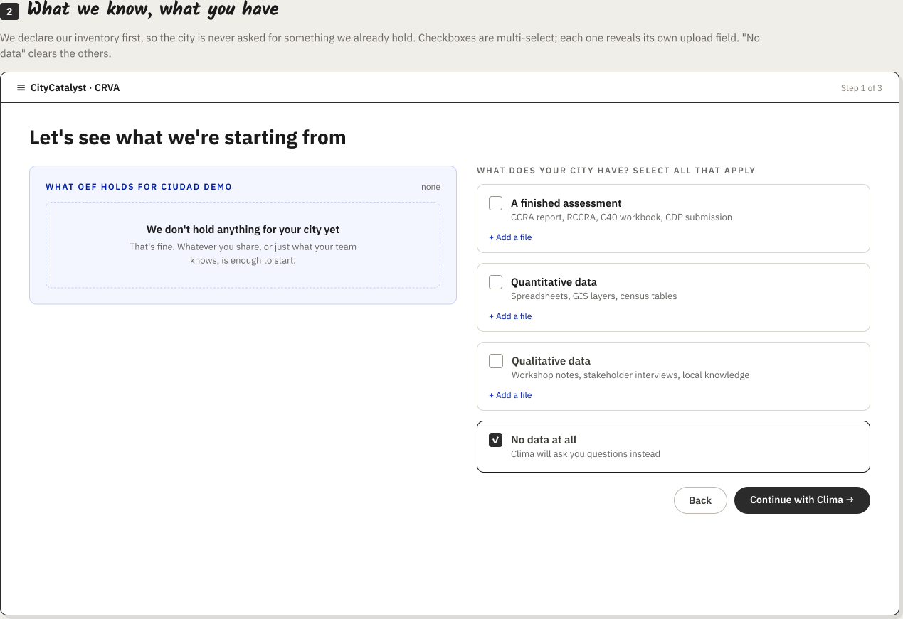
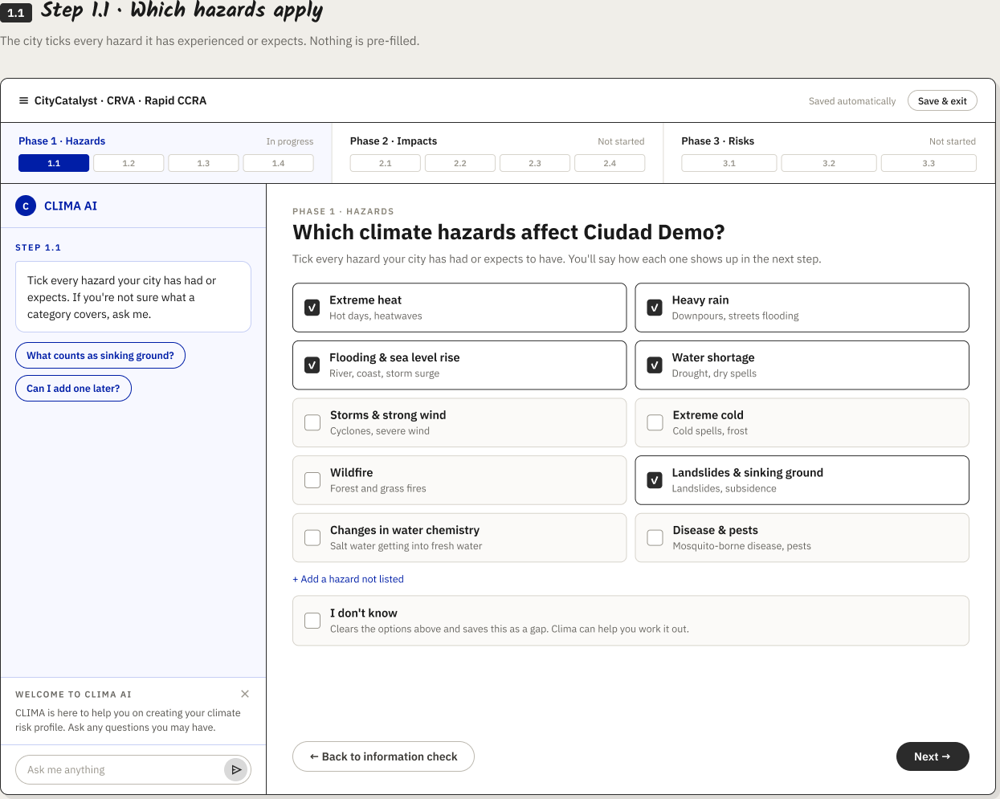
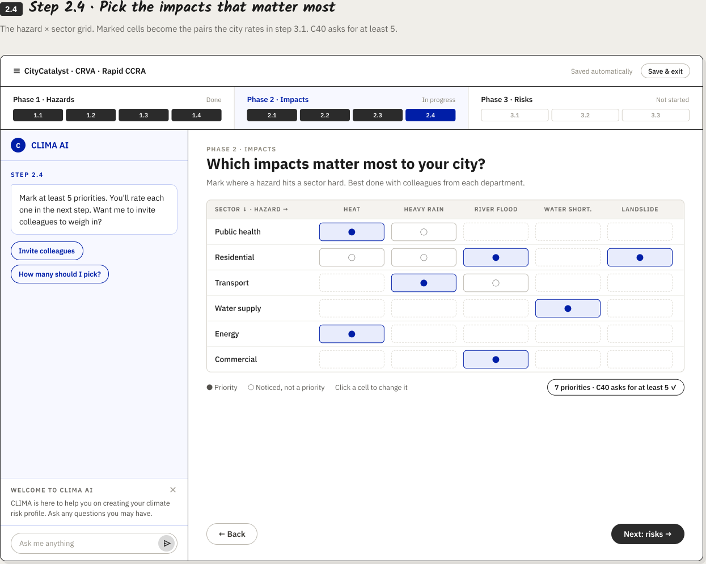
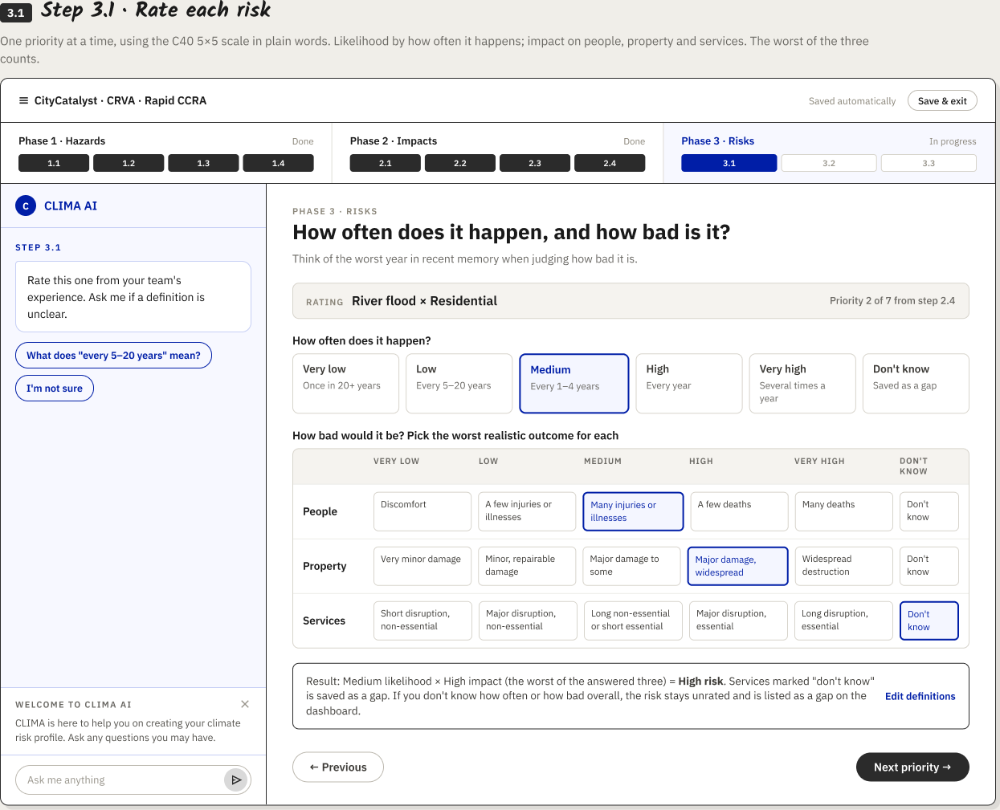
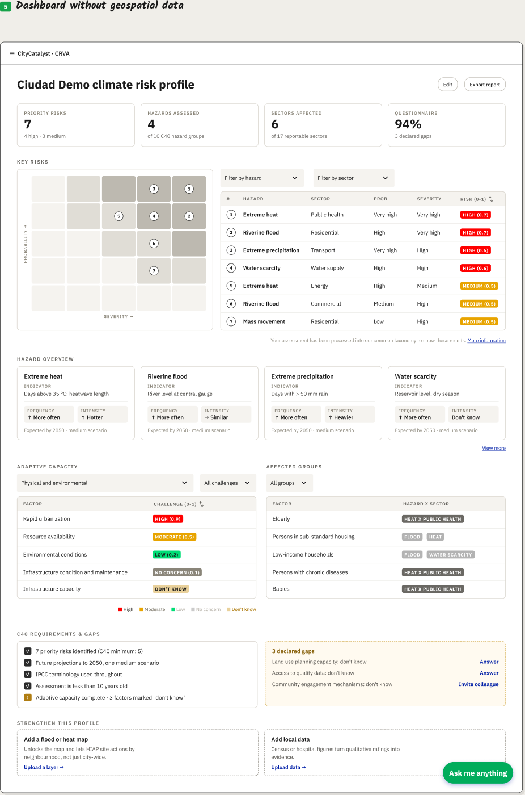

# Rapid CRVA — Agentic Flow Architecture (Proposal)

**Status:** draft — blocked on inputs (see [Blockers](#blockers)).
**Owner:** Tati · **Last updated:** 2026-10-09
**Companion docs:** [`AgenticModuleScope.md`](./AgenticModuleScope.md) ·
[`ConceptNoteBuilderArchitecture.md`](./ConceptNoteBuilderArchitecture.md) ·
[`CCRAModuleArchitecture.md`](./CCRAModuleArchitecture.md) (superseded by this
document for the Rapid CRVA slice only)

> **When to use this file:**
> - Consult before starting any implementation work on Rapid CRVA's chat/run/
>   proposal layer, its data model, or its CNB-reuse plan.
> - Consult when deciding whether Rapid CRVA ships as this agentic flow or as
>   a plain UI wizard — see [N6](#open-decisions) for what that choice does
>   and doesn't change in the schema below.
> - Consult when wiring Clima, Climate Advisor, or CityCatalyst endpoints for
>   Rapid CRVA, to stay consistent with the CNB precedent this proposal reuses.
>
> **Related (external):**
> - Linear CC-931 — "Update CRVA architecture proposal to the agentic flow
>   pattern (Rapid CRVA slice)."
> - Linear CC-986 — "Investigate Concept Note Builder component reusability
>   for CRVA questionnaire UI."
> - CCRA discovery brief, 31 Jul 2026 — the twelve open product/data decisions
>   (D1–D12) referenced under [Open decisions](#open-decisions); not in this
>   repo.
> - Figma "CRVA module," page "City has NO data and OEF has NO data," node
>   `2633:134` — "Brian's prototype," reviewed under
>   [Brian's prototype](#brians-prototype).

On 2026-09-22, CRVA moved from a step-wizard to a unified **agentic flow**,
following the Concept Note Builder (CNB) pattern already shipping for GHGI's
Stationary Energy slice: a loop where the assistant proposes changes and the
user accepts, rejects, or revises them, instead of filling out a linear form.
This document covers the **Rapid CRVA** slice of that rebuild — CC-931 — and
supersedes the wizard-shaped design in `CCRAModuleArchitecture.md` for that
slice only.

CNB itself isn't chat-only: its production workspace is a persistent chat
sidebar beside a tabbed document area, and every LLM-driven edit passes
through an explicit diff/accept/reject/refine layer before it commits (see
[Frontend component reuse](#frontend-component-reuse--cc-986)). Brian's
Figma prototype for the "city has neither" entry path shows the same
sidebar-assistant shape, but no equivalent review layer — selections read as
direct writes. That gap is open as [N5](#open-decisions).

## Scope

**In:** the Rapid CRVA flow (expert-judgment input → hazard-sector matrix →
taxonomy output); the dual-view model (baseline preview + "make it yours"
refinement); chat history and form-state persistence.

**Out:** file ingestion/parsing and merge conflicts (system integration),
country-scale bulk preload (array), geospatial hotspot drawing/upload, and
any DB migrations — this is a design document, not a build order.

**This document assumes the agentic rebuild ships — that's not decided
yet.** Whether Rapid CRVA's MVP is this agentic flow or a plain UI wizard
(no run/proposal layer at all) is an open team decision — see
[N6](#open-decisions) for which parts of the data model below hold either
way, and which don't.

The domain content underneath Rapid CRVA hasn't changed — the 13-hazard C40
Rapid CCRA question set, the 5-receptor × candidate-pathway taxonomy, the 24
adaptive-capacity factors, and the compliance gate are all still valid and
are carried forward from the prior proposal. What changes is the
*interaction and storage model* around them: a wizard collecting answers into
CityCatalyst's own tables, versus a chat-mediated proposal loop writing into
a CA-owned run first, committed into CityCatalyst only on publish.

The hazard count and the receptor/sector axis above don't match what's on
screen in [Brian's prototype](#brians-prototype) (10 hazards, 17 sectors, not
13 and "5-receptor") — see that section for the detail.

## CNB reuse map

Every row below is grounded in the actual CNB code and architecture doc, not
general agentic principles.

| CNB piece | Verdict | File(s) | Reason |
|---|---|---|---|
| Page guard — two-flag AND gate | Reuse | `concept-note-page-guard.ts` | Same shape works verbatim: `requireRapidCrvaPageEnabled()` gated on `CA_SERVICE_INTEGRATION` + a new module flag. Swap the flag name and function, nothing else. |
| Run creation + idempotent replay (idempotency key + request fingerprint, create-or-get) | Reuse | `concept_note_runs.py` — `ConceptNoteRunService` | Domain-agnostic. A Rapid CRVA run needs the same shape (`run_id`, `thread_id`, `user_id`, `city_id`, `status`, `workflow_step`, `context_summary`) minus the funder/programme fields, which don't apply here. |
| "Re-validate city access on every authorized-run fetch" pattern | Reuse | `get_authorized_run()` | No CRVA-specific reason to cache permission differently than CNB does. |
| Row-lock-before-mutate on a per-run JSON blob | Reuse | `accept_initial_upload` / `update_manual_population` | Same concurrency need for a mutable `context_summary`-equivalent blob (which baseline cells are loaded, which are in progress). |
| Edit-proposal lifecycle (`propose / get / apply / reject / refine`, `EditStatus` enum, `idempotency_key`-guarded retries) | Adapt | `concept_note_edits.py` | Reuse the state machine and the routes wholesale. Adapt the payload: CNB's `PlannedTextChange` targets markdown offsets in a chapter; CRVA needs a `PlannedRatingChange` targeting a structured field (severity / frequency / adaptive_capacity / rationale) on a hazard-sector cell instead. |
| Optimistic concurrency via `base_revision` / `expected_revisions` vector | Reuse | `EditApplyRequest` | The "fail closed if the cell changed underneath you" guarantee is exactly what a hazard-sector matrix needs too. |
| Full-snapshot-per-revision + monotonic `revision_number` | Reuse | `ConceptNoteChapterRevision` (`models/db/cnb_workspace.py`) | `ConceptNoteChapterRevision` stores a full `body_markdown` snapshot per `revision_number`, but has **no SHA-256 (or any) fingerprint column**. SHA-256 hashes exist elsewhere in CNB (`markdown_sha256`/`structured_sha256` on uploads, `validation_input_fingerprint` on chapter validations) but not per-revision. A hazard-sector cell can still reuse the full-snapshot + monotonic-number shape directly; a content fingerprint would be new, not reused. |
| Structural change stales pending proposals (`stale_structure`) | Reuse | `save_structure()` | Adding/removing a hazard or sector row should stale-out any in-flight rating proposal the same way adding/removing a chapter does today. |
| Structure API contract (`GET/PUT .../structure`, `expected_fingerprint`) | Adapt | `concept-note-structure-api.ts`, `StructureState` | Same GET/PUT + fingerprint contract, but `StructureChapter` (title/description/order) doesn't fit a matrix cell — needs a CRVA-specific `MatrixState` shape (rows of hazard × sector, not an ordered chapter list). |
| Chat threads + messages (durable conversation state) | Reuse | Existing `chat/*` + CA thread storage | Already shared infrastructure across every agentic module — no CRVA-specific work. |
| Internal capability route `POST /api/v1/internal/ca/capabilities/ccra/summary` | Adapt | Already scaffolded (`ConceptNoteBuilderArchitecture.md` route list) | Today it's read-only, feeding *CNB's own* context bundle. Promote/extend it into Rapid CRVA's own always-on baseline loader instead of building a second one from scratch. |
| Externally-operated reference corpus (`funders`, `funding_opportunities` — validated by ID, never edited by a run) | Adapt | `CNB_DATABASE_URL` reference tables | Same shape fits an OEF baseline hazard/severity dataset per city or region — see the open question on where it should actually live, under [Data ownership](#data-ownership). |
| 6-step wizard UI + `crva_rapid_*` CityCatalyst tables | Retire | `CCRAModuleArchitecture.md` (prior proposal, not yet built) | Superseded by chat + dual-view. The step *content* (13 hazards, 5 receptors, 24 capacity factors, C40 gate) is still valid domain material — it's just delivered as chat-editable baseline cells now, not a linear form. |

### Frontend component reuse — CC-986

The table above only covers backend/data-model reuse; this closes the gap
against Linear CC-986. Checked directly against the frontend code, not
inferred.

| CNB piece | Verdict | File(s) | Reason |
|---|---|---|---|
| `WorkflowPanel` / `PanelHeading` / `Overline` / `ScopeItem` / `CheckItem` | Reuse | `ConceptNoteWiringHarness/concept-note-wiring-ui.tsx` | Generic layout/presentational primitives — a styled card container, a numbered step-badge header, and three plain label/value/status rows. Checked prop-by-prop: none take a chapter/markdown/concept-note-typed argument, so these five need zero prop changes, only relocating out of the harness file. **Caveat:** they live in a file the codebase itself labels a local wiring/test harness, not the production CNB workspace — "reuse `WorkflowPanel`" means lifting a dev-harness component into production use, not reusing something already proven at scale. Worth raising with Piotr. |
| `Field` form primitive | Reuse | `app/src/components/ui/field.tsx` | A thin wrapper over Chakra's `Field.Root/Label/HelperText/ErrorText`, used site-wide, zero CNB-specific coupling. Clean fit for hazard-sector rating fields (severity/frequency/adaptive_capacity/rationale). |
| Multi-step form state management | Adapt | `use-concept-note-wiring.ts`, `use-guided-review.ts` | Not a clean "server `workflow_step` drives the UI" story — it's hybrid. The backend run does persist `workflow_step` (`concept_note_runs.py`), but `use-guided-review.ts`'s step navigation is local React `useState` over a client-side stage enum (`running · missing_information · conflicts_logic · decision · export`), synced via RTK Query polling, not read directly off the server field. This hook drives the separate "Review and export" modal, not the main workspace (see the workspace-shell row below). The [Conceptual data model](#conceptual-data-model) above assumes cleaner server-driven state than what's actually shipped — Rapid CRVA's dual-view step tracking should plan for the same hybrid pattern, not a purer one. |
| Status/progress tracking | Adapt | `GuidedReviewStepper`, `DraftingProgressCard` (`ConceptNoteWorkspace/`) | Both are real, shipped production components — a left-rail numbered stepper and a `role="progressbar"` completion card with per-item check/spinner/pending icons. Both hardcode CNB-specific data shapes and i18n keys, not just labels — see the [abstraction detail table](#component-level-abstraction-detail) below for exactly what has to change. `GuidedReviewStepper` is mounted inside `export-dialog.tsx`'s "Review and export" modal, not the primary workspace chrome — see the workspace-shell row below for what actually is primary. |
| File upload inside a workflow step | Adapt | `concept-note-upload-panel.tsx`, `concept-note-scope-screen.tsx` | Rendered as a sibling panel inside the same step grid, driven by a choose/drop handler + upload mutation + status polling. Rapid CRVA's MVP scope defers file ingestion entirely (per the original Technical Reference document), so this is lower priority than the other rows, but the wiring pattern is there if/when upload is pulled into scope. |
| Primary workspace shell | New | `ConceptNoteWorkspace/index.tsx`, `chat-panel.tsx` | The production workspace's primary chrome is a two-pane `Grid` — a persistent ~31%-width chat sidebar (`ConceptNoteChatPanel`) beside a `Tabs.Root` with three tabs (`draft`/`structure`/`context`). It is neither "chat-only" nor stepper-driven — it's sidebar-assistant + tabbed-document, structurally closer to [Brian's prototype](#brians-prototype)'s sidebar-assistant + stepped-wizard shape than [Scope](#scope)'s "wizard vs. chat-mediated loop" framing suggests. See [N5](#open-decisions). |
| Proposal review UI (diff + accept/reject/refine) | Adapt | `edit-diff.tsx`, `edit-proposal-card.tsx`, `document-review.tsx` | The dual-view model's accept/reject/refine mechanic already has a concrete, shipped UI counterpart. `edit-diff.tsx` renders inline accept/reject controls directly inside the markdown-rendered chapter text (`data-testid="concept-note-inline-accept/reject"`). `edit-proposal-card.tsx`'s `EditProposalCard` is a floating toolbar with per-change prev/next navigation, "Accept all/remaining," "Reject all/remaining," and a refine textarea+submit — wired into the workspace via `DocumentReviewToolbar` in `document-review.tsx`, mounted beside, not inside, the chat panel. This is the component family CRVA's `rating-proposals/{id}/apply|reject|refine` endpoints need a UI counterpart for. |

### Component-level abstraction detail

"Reuse" and "Adapt" in the table above collapse real differences in how much
work each piece needs — this breaks that down component by component, read
directly from the source.

| Piece | Coupling found | Abstraction needed |
|---|---|---|
| `WorkflowPanel, PanelHeading, Overline, ScopeItem, CheckItem` | None — props are already plain strings/nodes/booleans, no imported CNB types | **None.** Relocate out of the test-harness directory into a shared location (e.g. `components/ui/`); no prop or logic changes required. |
| `StatusBadge` | `status` prop is typed `ConceptNoteUploadStatus \| null`; `uploadStatusStyles` is a fixed map keyed to `idle/queued/processing/ready/failed` | Widen `status` to a plain `string`, and accept the style map as a prop instead of importing the CNB-specific one — so CRVA can key it to its own proposal states (`processing/proposed/applied/rejected/...`, matching `EditStatus`-equivalent states from the backend reuse map). |
| `GuidedReviewStepper` (`guided-review-navigation.tsx`) | The step list is a literal hardcoded array (`missing_information, conflicts_logic, decision`) with labels pulled from the `"concept-notes"` i18n namespace; imports the `ReviewStage` type directly from `use-guided-review.ts` | Turn the steps array into a prop (`{key, labelKey}[]`), drop the `ReviewStage` import, and accept an i18n namespace or pre-resolved labels as a prop. It already takes `currentStepIndex` generically — this is the only real blocker. |
| `DraftingProgressCard` | Typed directly against `ConceptNoteDraftState` — reads `draft.chapters`, `chapter_id`, `total_chapters`, `completed_chapters`, `current_chapter_id`; strings come from CNB-specific i18n keys (`drafting-card-title`, etc.) and CNB-flavored `data-testid`s | Replace the chapters shape with a generic `items: {id, title, done}[]` plus `total`/`completed` props, and accept the i18n namespace/keys as props instead of hardcoding `"concept-notes"`. |
| `useGuidedReview` (hook, not a component) | Deepest coupling found anywhere in this audit — calls `api.useValidateConceptNoteChapterMutation()` directly, walks `draft.chapters`, and imports concept-note-only helpers from `./chapter-validation` and `./concept-note-export` | Not a prop tweak. The reusable *pattern* — a stage state machine that walks items, validates/reviews each one, and gates export/publish on a completion threshold — needs to become a parameterized hook: generic item list in, an injectable validate/apply mutation and export-gate condition in, `stage` state machine out. Effectively a new hook built on the same shape, not something imported as-is. |

Net read for CC-986's acceptance criteria: most of what the ticket asks
about *is* reusable, but "reuse CNB's components" undersells two things
worth saying plainly to Piotr — the two headline layout components live in
test-harness code, not the production workspace, and the state-management
story to copy is the messier, hybrid local-state-plus-polling one that's
actually shipped, not the cleaner server-driven one this document's data
model assumes elsewhere. Of the nine pieces audited: five need zero code
changes (relocate only), three need targeted prop/type genericization, and
one (`useGuidedReview`) needs to be rebuilt as a parameterized hook rather
than imported.

## State management: the CNB problem, and CRVA's fix

Surfaced by the `useGuidedReview` audit above. Not a retrofit of CNB — CNB
ships as-is and is out of scope here — this is the design rule for CRVA's
own, new code.

**The problem in CNB:**

- The backend run row does persist a lifecycle field — `concept_note_runs.py`'s
  `workflow_step` — that reads like the intended source of truth for "what
  step is this run on."
- But the actual review screen doesn't use it. `use-guided-review.ts` keeps
  a second, separate copy: `const [stage, setStage] = useState<ReviewStage>("running")`,
  a client-only enum that only exists in this hook.
- `stage` is advanced imperatively — `setStage(...)` calls scattered across
  validation callbacks and user-action handlers, not computed from data.
- It's kept roughly in sync with the server only by polling (RTK Query
  refetching), never by being derived from what the server returns — so
  local `stage` and server state can disagree (stale tab, concurrent edit,
  a retry that lands late).
- Net effect: two sources of truth for the same concept, and every
  `setStage` call site is a place a future change can introduce drift.
  There's no single place to audit for "is the step state correct."

**CRVA's approach:**

- No separate stage `useState` at all. CRVA's step/stage is a **derived**
  value — computed fresh on every render from data already sitting in the
  RTK Query cache (the hazard-sector matrix + pending `crva_rating_proposals`),
  not stored anywhere of its own.
- One source of truth: whatever the cache currently holds. Polling still
  runs for freshness — that part of CNB's pattern is fine and reused as-is
  — but polling only ever feeds the derivation function, never writes to a
  separate stage variable.
- `deriveStage(matrix, proposals)` is one pure function: given this
  matrix/proposal shape, return the stage. Unit-testable in isolation, and
  the single place to read or change stage logic — not N scattered
  `setStage` call sites.
- This removes the entire class of drift bugs CNB's model is exposed to.
  The cost is upfront: someone has to design `deriveStage`'s actual mapping
  rules before any of this ships — that's new design work, not something
  copied from CNB.

Shape of the fix:

```ts
// CNB — today (use-guided-review.ts)
const [stage, setStage] = useState<ReviewStage>("running");
// ...later, in a validation callback:
setStage("conflicts_logic"); // imperative, one of several call sites

// CRVA — proposed
const stage = useMemo(
  () => deriveStage(matrix, proposals),
  [matrix, proposals],
); // derived, one definition, no setState
```

This is scoped narrowly on purpose: it's a rule for the one new hook CRVA
needs to build (the `useGuidedReview`-equivalent driving the dual-view
proposal loop), not a request to change anything in shipped CNB code.
`deriveStage`'s actual rules — which combination of matrix completeness and
proposal status maps to which stage — aren't designed yet; that's open
work, not a decision this document makes.

## Data ownership

CityCatalyst Postgres vs. the Climate Advisor (CA) database, per entity.

**A conflict worth flagging before building anything:** `AgenticModuleScope.md`'s
general rule states *"CA owns conversation state"* — which reads as
including chat threads/messages. But `ConceptNoteBuilderArchitecture.md`'s
concrete, shipped implementation puts chat threads + messages in
**CityCatalyst** Postgres, not CA. The table below follows the shipped
implementation (precedent over principle), but this discrepancy should be
resolved explicitly — see [N1](#open-decisions).

| Entity | Lives in | Why |
|---|---|---|
| Chat thread + messages | CityCatalyst Postgres | Matches CNB's shipped implementation (see conflict note above) |
| Run state (`run_id`, `status`, `workflow_step`, `context_summary`) | Climate Advisor DB | Pre-commit workflow state; mirrors `concept_note_runs` exactly |
| Context bundle (OEF baseline snapshot + city profile, loaded at run start) | Climate Advisor DB | Mirrors `concept_note_context_bundles` — a point-in-time snapshot, not the live source of truth |
| Rating proposals + changes (LLM-proposed edits, pending review) | Climate Advisor DB | Mirrors `concept_note_edits` — staged and reviewable, not committed |
| Rating revision history (every accepted change, pre-publish) | Climate Advisor DB — **Open** | Mirrors the chapter-revision pattern, but see [N3](#open-decisions): CNB keeps this in an externally-operated reference-adjacent DB, which may not fit CRVA's shape |
| OEF baseline hazard/severity reference dataset | **Open** | Two candidate homes with equal precedent — see [N2](#open-decisions) |
| Published risk profile (committed hazard-sector assessments, final severity/frequency/adaptive_capacity, provenance, status) | CityCatalyst Postgres | Committed product data — matches "CC owns committed product data," and mirrors the old `crva_assessments`/`crva_risk_scores` shape, now populated by a commit step instead of direct wizard writes |
| Review/accept-reject decisions (which proposal, which changes, who approved) | Climate Advisor DB pre-commit, folded into published-profile provenance post-commit | Mirrors "review decisions" for CA-mediated draft workflows |

Per CNB's explicit rule, any join between the CA-owned run/proposal tables
and the CC-owned published profile is an **application-level join by ID,
never a physical foreign key** — the two databases don't reference each
other directly.

## Conceptual data model

Entities and relations, not SQL — CA-owned entities first, then the
CC-owned committed profile they feed on publish.

**`crva_runs`** — New · CA-owned

| Field | Description |
|---|---|
| `run_id` | PK |
| `thread_id` | CityCatalyst-owned chat thread reference — no local foreign key |
| `user_id, city_id` | Scope of the run |
| `status, workflow_step` | Lifecycle state |
| `context_summary` | JSON — which baseline cells are loaded, which are in progress |
| `idempotency_key, request_fingerprint` | Safe-replay pair, identical mechanism to CNB |

**`crva_context_bundle`** — New · CA-owned

| Field | Description |
|---|---|
| `run_id` | PK + FK → `crva_runs`, 1:1 |
| `context_bundle` | JSON — OEF baseline snapshot for this city + city profile at run start |

**`crva_rating_proposals`** — New · CA-owned

| Field | Description |
|---|---|
| `proposal_id` | PK |
| `run_id` | FK → `crva_runs` |
| `instruction` | The chat instruction that produced this proposal |
| `status` | `processing · clarification_required · proposed · applied · partially_applied · rejected · failed · stale` — identical enum to CNB's `EditStatus` |
| `base_revisions` | JSON — per-cell revision vector this proposal was computed against |

**`crva_rating_changes`** — New · CA-owned

| Field | Description |
|---|---|
| `change_id` | PK |
| `proposal_id` | FK → `crva_rating_proposals` |
| `hazard, sector` | The hazard-sector matrix cell this change targets |
| `field` | `severity · frequency · adaptive_capacity · rationale` |
| `before, after` | The proposed change to that field |
| `kind` | `baseline_override · expert_judgment · user_edit` — the provenance taxonomy, decided per change |
| `group_id` | Groups related occurrences, same mechanism as CNB text edits |

**`crva_rating_revisions`** — New · ownership open, see [N3](#open-decisions)

| Field | Description |
|---|---|
| `revision_id` | PK |
| `hazard, sector` | The cell this revision belongs to |
| `revision_number` | Monotonic per cell, unique `(hazard, sector, revision_number)` |
| `author_type` | `agent · user · system` |
| `body` | Full snapshot of the cell (severity + frequency + adaptive_capacity + rationale + confidence) — not a diff, same as CNB's chapter revisions |

**`crva_profile`** — Committed · CityCatalyst-owned

| Field | Description |
|---|---|
| `id, city_id` | Identifier + owning city |
| `scope` | Spatial/organizational scope of the assessment |
| `time_horizons, emission_scenarios, reporting_targets` | Profile-level framing fields the wizard-era schema didn't need — new for the agentic redesign |
| `status, published_at, author_id` | Lifecycle, matching the old `crva_assessments` shape |

**`crva_hazard_sector_assessments`** — Committed · CityCatalyst-owned

| Field | Description |
|---|---|
| `assessment_id` | PK |
| `profile_id` | FK → `crva_profile` |
| `hazard, sector` | The matrix cell |
| `severity, frequency, adaptive_capacity` | Final committed values |
| `provenance` | `oef_baseline · expert_judgment · user_edit` — carried forward from `crva_rating_changes.kind` at commit time |
| `confidence, rationale` | Carried forward from the accepted change |
| `source_change_id` | Application-level reference back to the CA `change_id` that produced this row — no physical FK across databases |

Relations: `crva_runs` 1—1 `crva_context_bundle`; 1—N `crva_rating_proposals`;
each proposal 1—N `crva_rating_changes`. An accepted change appends a
`crva_rating_revisions` row and, on publish, rolls into a
`crva_hazard_sector_assessments` row under a `crva_profile`.

## Dual-view model

Where the baseline comes from, what "make it yours" does to it, and how
refinements are stored without overwriting it.

1. **Baseline load** — at run start, the (extended) `ccra/summary`
   capability loads an OEF baseline snapshot for the city into
   `crva_context_bundle`. Every hazard-sector cell starts pre-filled with a
   provisional severity/frequency/adaptive_capacity rating, provenance
   `oef_baseline`.
2. **"Make it yours"** — the user chats a change instruction (e.g. "coastal
   flooding is worse than that, we've had three events in two years"). The
   LLM turns this into one or more `crva_rating_changes` under a new
   `crva_rating_proposal`, each tagged `expert_judgment` (LLM-inferred) or
   `user_edit` (typed exact override), with a rationale and confidence.
3. **Refine without overwriting** — proposals never mutate the baseline
   snapshot in `crva_context_bundle`; it stays visible as the diff target,
   the same way CNB's `PlannedTextChange` keeps a before/after pair instead
   of mutating chapter text directly.
4. **Accept** — applying a proposal appends a full-snapshot
   `crva_rating_revisions` row for each changed cell. Reject discards the
   proposal with no revision written. Refine creates a new, separately
   reviewable proposal chained to the one it replaces — identical semantics
   to CNB's `refines_proposal_id`.
5. **Publish** — the run's current matrix commits into
   `crva_hazard_sector_assessments` rows under a published `crva_profile`,
   each cell keeping its provenance — so a dashboard can show, e.g., "3
   cells still OEF baseline, 9 refined by expert judgment, 2 manually
   overridden," the same rollup idea as the old schema's
   `confidence_summary`/`gaps_summary`.

**Per-proposal review loop:** a proposal is created from a chat instruction
(status `proposed`, nothing written to the committed profile yet), and
resolves one of three ways — **Accept** (appends a revision per cell),
**Reject** (discarded, no revision written), or **Refine** (a new proposal,
chained via `refines_proposal_id`).

**Empty-form entry point:** a city with no OEF baseline coverage (e.g. the
reference dataset doesn't reach that country yet) starts every cell unset,
provenance `user_edit`-only. Mechanically identical flow — there's just no
diff target to preview against.

## Brian's prototype

Resolves the AC-05/AC-08 blocker referenced in [Blockers](#blockers). Figma
"CRVA module," page "City has NO data and OEF has NO data," node `2633:134`.

**Headline finding:** none of this prototype's 15 screens show an
accept/reject/refine proposal moment. The screens cover the **"city has
neither" entry path** (the triage step below ends in "Clima will ask you
questions instead") and what they show instead is a **direct-manipulation
form wizard** — checkboxes, click-to-toggle grids, button matrices — with
"Clima AI" as an assistive side panel.

CNB itself is sidebar-chat + tabbed document, not chat-only (see
[Frontend component reuse](#frontend-component-reuse--cc-986)) —
structurally close to this prototype's sidebar-assistant + stepped-wizard
shape. The real gap is that CNB's document pane always routes LLM-driven
edits through an explicit diff/accept/reject/refine layer (`edit-diff.tsx`,
`edit-proposal-card.tsx`) before anything commits, and this prototype's 15
screens show no equivalent — ticking a box or filling a matrix cell reads as
a direct write, with Clima limited to assistive Q&A rather than proposing
values. Restated as [N5](#open-decisions) rather than assumed away in either
direction.

The page's one section is mislabeled in Figma: it reads "...OEF has
*data*," but the correct label is "City has NO data and OEF has **NO**
data," matching the page title and the triage screen's content (the OEF
panel says *"We don't hold anything for your city yet"*).

### Screen inventory

In on-canvas order: an unscreenshotted "Journey navigator" intro frame
(every flow starts there, per its own caption), then the five screens
below. Between the triage step and the dashboard sits the full 11-step C40
Rapid CCRA questionnaire (Phase 1 hazards 1.1–1.4, Phase 2 impacts 2.1–2.4,
Phase 3 risks 3.1–3.3) as one horizontal stepper — two of its steps are
shown here, the rest follow the same pattern.

**Triage · before the questionnaire**



Declares existing data first (multi-select, each option reveals its own
upload field) so the city is never asked for something OEF already holds.
"No data at all" clears the others and routes into the questionnaire below.

**Step 1.1 · hazard selection**



Phase/sub-step stepper across the top (Phase 1/2/3, each with its own
1.1–3.3 chips, each chip tracking Not started/In progress/Done). Checkbox
grid for hazards. "I don't know" clears the grid and is kept, not
discarded.

**Step 2.4 · impact matrix**



The hazard × sector matrix is a click-to-toggle grid (priority /
noticed-not-priority / blank per cell), not a chat output — this is what
feeds Step 3.1's per-cell rating queue.

**Step 3.1 · risk rating**



One hazard × sector pair at a time. Likelihood is six buttons (five
ratings + Don't know); severity is picked per dimension
(People/Property/Services) from a 5×6 button matrix. Risk = worst of the
three severities × likelihood, computed inline, not typed.

**Dashboard · no geospatial data**



Summary tiles, sortable risk table + matrix, adaptive-capacity table by
category, affected-groups table, a C40 compliance checklist, a
declared-gaps list with per-gap "Answer"/"Invite colleague" actions, and
upsell cards toward the geospatial and data-first paths.

### What this confirms

- The three-entry-path design holds — this prototype is specifically the
  "has neither" branch, reached by unchecking everything else at triage,
  matching `entry_state`'s role in the merged `crva_assessments` table.
- 24 adaptive-capacity factors: the dashboard's category breakdown (5
  Physical & Environmental + 7 Socio-economic + 8 Governmental + 4
  Services) sums to 24, matching Scope's figure exactly.
- The compliance gate is real and on-screen: "C40 requirements & gaps"
  checks priority-risk count (≥5), projection horizon, IPCC terminology,
  assessment age, and adaptive-capacity completeness — this is the old
  Technical Reference doc's Step 6 gate, now confirmed as the dashboard's
  own panel rather than a separate wizard step.

### What this narrows or adds

- **Hazard count:** both the on-screen checkbox grid and the C40 framework
  text embedded in the same Figma file list **10** hazard categories, not
  the 13 Scope cites. Flagged, not corrected — Scope's "13" may come from
  the discovery brief (still inaccessible, see [D3](#open-decisions))
  splitting categories the prototype merges.
- **Sector/receptor axis:** Scope's "5-receptor × candidate-pathway
  taxonomy" doesn't match what's on screen — the dashboard badges "6 of 17
  reportable sectors," and the embedded C40 text lists all 17 by name
  (Transport, Energy, ICT, Water supply & sanitation, Waste management,
  Public health, Law & order, Emergency services, Land use planning,
  Education, Food & agriculture, Environment/biodiversity/forestry,
  Commercial, Industrial, Tourism, Residential, Society/community &
  culture). Whether "5-receptor" refers to something else entirely (e.g. a
  people/assets/services-style grouping) or is stale is now N5's sibling
  question, not resolved here.
- **Declared gaps as a first-class list, not just an absence:** every "I
  don't know"/"Don't know" is kept (not discarded) and surfaces on the
  dashboard as a countable, individually actionable item — "Answer" (go
  fix it) or "Invite colleague" (delegate it). Nothing in
  [Conceptual data model](#conceptual-data-model) currently models a gap
  as an assignable entity; this is new input for that section, not yet
  incorporated into it.
- **Clima AI's actual shape, in this path:** a persistent left-rail panel
  with per-step canned hint text, one or two canned quick-question
  buttons, and a free-text "ask me anything" box — closer to a
  scoped-down version of the existing ChatBot component than to CNB's
  full proposal-generating chat thread. Worth checking against `useChat`/
  `useSSEStream` before assuming it needs new infrastructure.
- **Cross-path upsell:** the dashboard's "Add a flood or heat map" and
  "Add local data" cards are the concrete mechanism by which a city that
  started on this path can graduate into the geospatial/data-first paths
  later — not modeled anywhere else in this document.

## Endpoints

Modeled directly on CNB's shipped route shapes. Screen-by-screen mapping to
Brian's prototype is unblocked — see [Brian's prototype](#brians-prototype)
— but that prototype doesn't show these routes' UI counterpart (no
proposal/apply/reject surface), so the mapping itself is still open; see
[N5](#open-decisions).

### CityCatalyst (`/api/v1/...`)

| Method | Path | Purpose | Confirmation required? |
|---|---|---|---|
| POST | `city/{city}/crva/runs` | Start a run | No |
| GET | `city/{city}/crva/runs` | List runs for this city | No |
| GET | `city/{city}/crva/runs/{run_id}` | Read one run | No |
| POST | `city/{city}/crva/runs/{run_id}/messages` | Send a chat message | No — the proposal it produces is the confirmation point |
| GET | `city/{city}/crva/runs/{run_id}/matrix` | Read the hazard-sector matrix | No |
| PUT | `city/{city}/crva/runs/{run_id}/matrix` | Direct structural edit (add/remove a hazard or sector row), `expected_fingerprint`-guarded | **Yes** — direct write, no LLM in the loop |
| GET | `city/{city}/crva/runs/{run_id}/rating-proposals` | List proposals | No |
| POST | `city/{city}/crva/runs/{run_id}/rating-proposals` | Create a proposal (202) | No |
| POST | `.../rating-proposals/{id}/apply` | Accept | **Yes** — this is the accept step |
| POST | `.../rating-proposals/{id}/reject` | Reject | No — discarding, not committing |
| POST | `.../rating-proposals/{id}/refine` | Ask for a revised proposal (202) | No |
| POST | `city/{city}/crva/runs/{run_id}/publish` | Commit the run's matrix into a published `crva_profile` | **Yes** — highest-stakes step, mirrors the old Step 6 C40 compliance gate |
| GET | `city/{city}/crva/profile` | Read the published, committed profile (replaces the old `.../crva/assessment`) | No |
| POST | `internal/ca/capabilities/ccra/summary` | Already scaffolded — extend as Rapid CRVA's baseline/context loader | n/a — internal |

### Climate Advisor (`/v1/...`)

| Method | Path | Purpose |
|---|---|---|
| POST | `crva/runs/start` | Mirrors `concept-notes/start` |
| GET | `crva/runs?user_id=&city_id=` | List, same ordering convention as CNB (`updated_at DESC, created_at DESC, run_id DESC`) |
| GET | `crva/runs/{run_id}` | Read one run, re-validating city access every call |
| GET / PUT | `crva/runs/{run_id}/matrix` | Same fingerprint-guarded contract as CNB's structure route |
| GET / POST | `crva/runs/{run_id}/rating-proposals[/{id}/apply\|reject\|refine]` | Same shape as `concept_note_edits` routes |

## Future scenarios

What extends cleanly, and what the ticket's own open question ("what does
array mean exactly?") means for the design either way.

**System integration — extends cleanly.** Once file/report ingestion
exists, add a new provenance value (`report_informed`) and a new
context-bundle source (parsed report excerpts feeding the baseline
alongside or instead of the OEF dataset). Nothing in the Rapid MVP schema
blocks this — `kind`/`provenance` is already an open enum and
`context_bundle` is already a JSON blob built for exactly this kind of
extension.

**Array / bulk — meaning unresolved.** If "array" means bulk-seeding many
cities' OEF baselines at once, that's an operation on the reference
dataset, not on `crva_runs` — doesn't block per-city Rapid CRVA at all. If
it means one run spanning multiple cities, that breaks the
`city_id NOT NULL` / single-city assumption baked into every table above —
a real redesign, not an extension. This is the ticket's own open question,
restated as [N4](#open-decisions) rather than guessed at.

## Open decisions

D1–D12 status, plus new decisions surfaced by this review.

**Carried forward from the prior proposal — still open:**

- **D2** — comparability scope across cities/methods.
- **D3** — the full hazard set.
- **D4** — vulnerability depth beyond the age-share proxy.
- **D7** — confidence/provenance policy.
- **D11** — methodological base.
- **D12** — final risk-arithmetic choice.

**D1, D5, D6, D8, D9, D10** aren't defined in any file available in this
session — the full twelve live in the 31 Jul 2026 CCRA discovery brief,
which isn't in the repo. Full D1–D12 reconciliation is pending access to
that brief.

**New, from this review:**

- **N1** — `AgenticModuleScope.md`'s general CA/CC split rule conflicts
  with CNB's shipped implementation on where chat threads/messages live
  (see [Data ownership](#data-ownership)). *Owner: needs assignment.*
- **N2** — Where does the OEF baseline reference dataset live: a
  CNB-style externally-operated DB, or Global API (CRVA's existing
  reference source for the deferred data-first path)? *Owner: needs
  assignment.*
- **N3** — Do committed hazard-sector revisions live in CityCatalyst
  (matching "CC owns version history") or Climate Advisor (matching
  CNB's own chapter-revisions table)? *Owner: needs assignment.*
- **N4** — What does "array workflow" mean: bulk-seed the reference
  baseline, or one run spanning multiple cities? *Owner: ticket author.*
- **N5** — Not "forms vs. chat" — CNB's real workspace is sidebar-chat +
  tabbed document already, same shape as Brian's prototype's
  sidebar-assistant + stepped-wizard (see the workspace-shell row in
  [Frontend component reuse](#frontend-component-reuse--cc-986)). The
  actual gap: CNB routes every LLM-driven edit through an explicit
  diff/accept/reject/refine layer before it commits; none of the
  prototype's 15 "has neither" screens show an equivalent — selections
  read as direct writes, Clima as Q&A-only. Three ways to reconcile, none
  chosen: (a) each form action silently creates and auto-accepts a
  proposal under the hood, so the review step exists in the data model
  but never surfaces in this path's UI; (b) the proposal lifecycle only
  applies to the "has baseline, make it yours" path, and "has neither"
  stays a plain wizard writing straight into CityCatalyst tables, with
  Clima never proposing — only answering; (c) the prototype is a low-fi
  pass that hasn't drawn the review moment yet, and one belongs here to
  stay consistent with CNB's own pattern. *Owner: needs assignment —
  likely resolved in the still-unheld technical review (AC-08).*
- **N6** — One level above N5: whether Rapid CRVA ships as the agentic
  flow this document describes at all, or as a plain UI wizard (no
  run/proposal layer, no Clima-authored changes) — the team's choice, not
  yet made. The [committed layer](#conceptual-data-model)
  (`crva_profile`, `crva_hazard_sector_assessments`) is paradigm-agnostic
  and holds either way. The CA-owned pre-commit layer (`crva_runs`,
  `crva_context_bundle`, `crva_rating_proposals`, `crva_rating_changes`,
  `crva_rating_revisions`) is shaped around LLM-mediated review —
  `crva_rating_proposals.instruction` is a chat instruction, its status
  enum describes an LLM reasoning step — and doesn't fall out naturally
  from a form click. Two ways a wizard-MVP decision plays out, not yet
  chosen between: if the wizard is a stepping stone to agentic later,
  keep the proposal tables and have every form action create-and-auto-apply
  a proposal (`kind: user_edit`, no accept/reject UI) — precedented by
  the existing `PUT .../matrix` route already bypassing proposals for
  direct, non-LLM structural writes; if the wizard is the permanent plan,
  the CA-owned layer is unnecessary cost, and form answers should write
  straight into a lightweight CC-owned draft table instead, closer to
  the retired `crva_rapid_*` shape. *Owner: needs assignment — blocks
  starting either build.*

## Blockers

Restated from CC-931's own "Open questions (resolve before starting)" —
this document is a draft until these clear.

- **Brian's prototype** — resolved: reviewed in
  [Brian's prototype](#brians-prototype). What's still open is whether its
  forms-first UI should change the proposal-loop design or vice versa
  (N5) — the screens themselves no longer block progress, but that
  reconciliation does.
- **Sign-off owner** — who signs off on this proposal is unresolved per
  the ticket.
- **Discovery-brief access** — needed to complete the full D1–D12
  accounting.
- **Technical review** — requires a session with Piotr, Carlos and Milan,
  not yet held.
- **Frontend reuse sign-off** — CC-986 tracks this specifically: the
  meeting with Piotr to confirm the
  [frontend component reuse map](#frontend-component-reuse--cc-986)
  hasn't happened yet, so that table's verdicts (especially moving
  `WorkflowPanel`/`PanelHeading` out of test-harness code) aren't signed
  off.

---

Source: Linear CC-931 "Update CRVA architecture proposal to the agentic
flow pattern (Rapid CRVA slice)." Grounded in
`docs/ConceptNoteBuilderArchitecture.md`, `docs/AgenticModuleScope.md`,
`climate-advisor/service/app/models/db/concept_note.py`,
`climate-advisor/service/app/services/concept_note_runs.py`,
`climate-advisor/service/app/routes/concept_note_edits.py`. Domain content
(hazard set, receptor taxonomy, capacity factors, C40 gate) carried
forward from `docs/CCRAModuleArchitecture.md`. Screens in
[Brian's prototype](#brians-prototype) from Figma "CRVA module" (file
`Mn2Bw2MVFDYedoiuozE5J1`, node `2633:134`).
