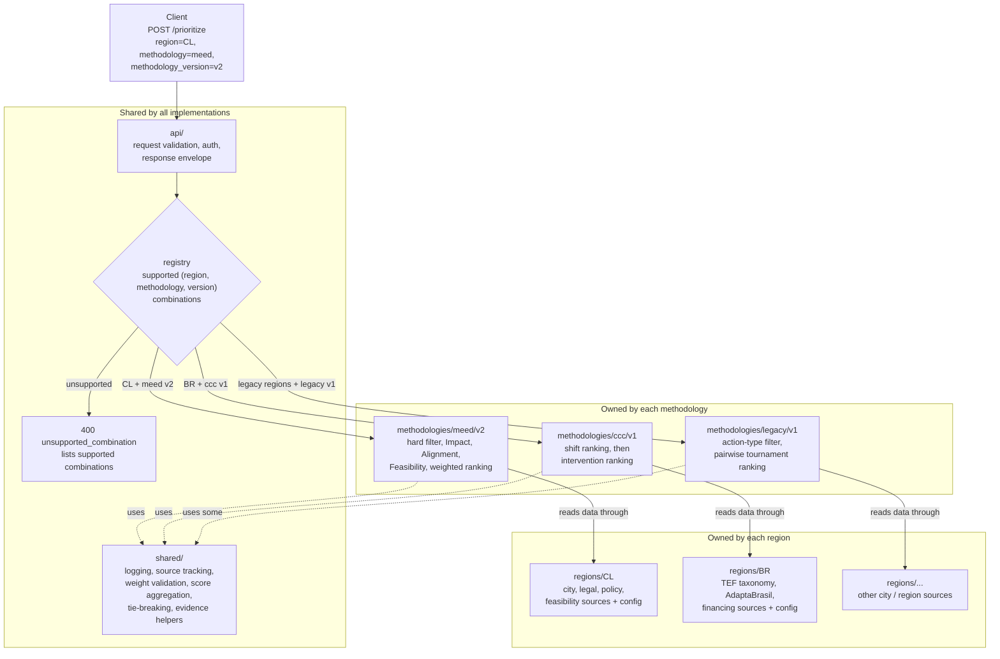

# CC-720 — Modular HIAP architecture RFC

- Status: Revised draft for team review
- Date: 2026-10-14 (revised after PR review)
- Linear: [CC-720 — Investigate modular HIAP module setup](https://linear.app/openearth/issue/CC-720/investigate-modular-hiap-module-setup)
- Scope: architecture investigation and documentation only
- Product code changed by this RFC: no

## Executive summary

Legacy HIAP, HIAP-MEED, and the planned Brazil v3 variant share a broad product goal, but they do not currently share interchangeable runtime contracts. They differ in API shape, ranking semantics, task lifecycle, data sources, LLM workflows, dependency sets, resource profiles, deployment configuration, and failure domains.

The recommended end state is one HIAP microservice with shared functions, separate methodology implementations, and region-specific data sources. A canonical prioritization endpoint should accept explicit `region`, `methodology`, and `methodology_version` fields, look the combination up in a registry of supported combinations, and dispatch to the registered implementation. Unsupported combinations return a clear error. Region-specific compatibility routes may exist during migration, but they should not create separate long-term services.

Migration should be incremental. Keep the existing services running, stand up the unified service alongside them, compare outputs with fixtures and regression tests, migrate consumers gradually, and retire the old services only after parity and operational gates pass. Separate deployments are a transitional safety boundary, not the final architecture.

### Proposed service overview

The diagram shows how one request reaches `/prioritize` and how the registry selects one implementation. Sharing the endpoint does not mean sharing formulas or step order: each methodology owns its own calculation steps, and it calls shared functions only where they fit.



Ownership summary:

| Part | Owner | Examples |
|---|---|---|
| Endpoint, request envelope, registry, error handling | Shared (`api/`) | `/prioritize`, unsupported-combination error, response metadata |
| Reusable functions | Shared (`shared/`) | logging, source tracking, weight validation, score aggregation, tie-breaking |
| Input/output models, calculation steps, formulas, step order | Each methodology (`methodologies/`) | MEED I/F/A pipeline; two-level shift/intervention ranking |
| Data models, source connections, configuration, test datasets | Each region (`regions/`) | Chile legal and policy sources; Brazil TEF taxonomy and AdaptaBrasil |

This RFC answers CC-720 using the current source tree and a team discussion. It treats `hiap-meed/docs/methodology-variants-and-migration.md` as prior art. That document remains unchanged because it is a draft and contains stale as-built counts and an Anthropic/OpenAI labeling mismatch.

## Investigation scope

The comparison considered:

- service entrypoints and public HTTP routes;
- request and response models;
- internal domain models and ranking units;
- orchestration and task lifecycle;
- filtering, scoring, ranking, and tie-breaking;
- upstream data clients, mock/API/S3 selection, and provenance;
- LLM call sites, prompts, structured outputs, and model configuration;
- plan-creation workflows and vector-store dependencies;
- Dockerfiles and Python dependency graphs;
- Kubernetes Deployments, Services, resources, probes, secrets, and environment variables;
- GitHub Actions build, test, image, and deployment workflows;
- existing methodology documentation and recent repository history.

## Stakeholder direction

The discussion clarified the target architecture. All HIAP variants share a fundamental product surface, including prioritizing climate actions and creating plans, while country implementations may use different inputs, formulas, outputs, and orchestration. The goal is one HIAP microservice to reduce repeated package maintenance and infrastructure overhead.

The preferred routing shape is one shared endpoint with separate selection fields instead of a single country/variant flag:

- `region` identifies the geographic area the request applies to. It is not limited to a country, so it can also represent a sub-national area or a group of countries.
- `methodology` identifies how the prioritization is calculated.
- `methodology_version` identifies the version of that methodology, for example `v2` or `v3`.

One region may support several methodologies, and one methodology may serve several regions. For example:

```json
{
  "region": "CL",
  "methodology": "meed",
  "methodology_version": "v2",
  "city": { "...": "..." }
}
```

The service explicitly registers each supported `(region, methodology, methodology_version)` combination. A request for any other combination fails with a clear error, for example HTTP 400 with code `unsupported_combination` and the list of supported combinations. The service never falls back silently to a different region, methodology, or version.

Methodology identifiers in this RFC are placeholders: `meed` (Chile MEED+), `ccc` (Brazil City Climate Compass), and `legacy` (current legacy HIAP). Final names are an open decision.

Per-region endpoint paths remain a possible compatibility or migration surface, but are not the preferred long-term contract.

This direction does not require a big-bang migration. Existing services can remain live while the unified service is built beside them, with fixtures and regression tests comparing current outputs against adapter-based outputs before traffic moves.

## Current state

### Legacy `hiap`

`hiap/app/main.py` mounts three feature areas in one FastAPI process:

- `/prioritizer`;
- `/plan-creator`;
- `/plan-creator-legacy`.

The prioritizer API provides asynchronous single-city and bulk starts, progress polling, result polling, explanation generation, explanation translation, and task diagnostics. Requests use camelCase Pydantic models. The city request contains population plus five emissions categories. Results contain separate mitigation and adaptation ranked-action lists.

`hiap/app/prioritizer/tasks.py` converts typed request data into dictionaries, fetches city context and CCRA data, filters actions by action type, ranks mitigation and adaptation actions separately, and stores progress/results in in-memory `task_storage`. The normal ranking path uses `tournament_ranking` with the `ml_compare` comparator. Bulk work uses a process pool; single work and explanation/translation flows use background threads.

The current and legacy plan creators are separate LangGraph graphs. They contain multiple LLM agent nodes for actions, sub-actions, municipalities, goals, MER, adaptation, mitigation, SDGs, and translation. The legacy graph also contains a combine node. Agent modules instantiate `ChatOpenAI` with environment-selected models.

### `hiap-meed`

`hiap-meed` has a more explicit modular boundary:

```text
API -> orchestrator -> scoring blocks -> injected data clients -> upstream sources
```

`app/modules/prioritizer/orchestrator.py` runs a request-scoped pipeline that fetches city data, actions, legal assessments, policy scores, mitigation-feasibility scores, and financial-feasibility scores. It then validates weights, records an input snapshot, applies hard filtering, computes Impact, Alignment, and Feasibility, performs weighted ranking, and optionally generates/translates explanations.

The service uses typed internal models for city data, actions, block results, hard-filter results, scored actions, evidence, and response metadata. The current ranking unit is `Action`.

The data layer exposes separate clients for city, action pathways, legal, policy, mitigation-feasibility, and financial-feasibility data. Most support mock/API selection. Legal data supports S3/mock with a deprecated API guard. Clients are injected through FastAPI dependencies.

The service also has a separate output-plan report path. It validates a supplied prioritization snapshot, enriches source data, generates isolated English chapters concurrently, translates the completed report, and returns structured localized chapters. This path belongs to the service boundary, not the deterministic scoring kernel.

## Contract comparison

| Dimension | Legacy `hiap` | `hiap-meed` | Consequence |
|---|---|---|---|
| Public API | Async `/prioritizer/v1/*`; camelCase DTOs | Typed `/v1/*`; synchronous route handlers with injected clients | Keep HTTP DTOs variant-owned and versioned |
| City input | Population and five sector emissions in request payload | Normalized city/emissions context and source metadata | Map both into an internal domain contract |
| Ranking unit | Raw action dictionaries | Typed `Action` model | Use a rankable-item protocol; do not force identical DTOs |
| Ranking method | Pairwise ML comparator plus tournament/quick-select | Deterministic pillar scores plus weighted sum | Preserve behavior until characterization tests measure differences |
| Filtering | Action-type filtering and request-specific behavior | Legal and confirmed-exclusion hard filter with evidence | Share filter contracts, not assumptions about policy |
| Data access | Global API helpers, city context, CCRA, action catalog, S3/vector artifacts | Six injected clients with mock/API/S3 variants | Adapters own normalization, source policy, and provenance |
| LLM workflows | Per-action explanations plus two LangGraph plan creators | Exclusion resolution, explanations, translations, reports | Keep LLM orchestration outside deterministic kernel |
| State | In-memory task storage and background workers | Request-scoped artifacts and stateless report snapshots | Keep state/lifecycle service-specific |
| Dependencies | LangChain, LangGraph, Chroma, XGBoost, scikit-learn, OpenAI | FastAPI, typed services, OpenAI, MLflow, S3 | A single image would couple unrelated runtime surfaces |
| Deployment | `citycatalyst-hiap` image and Deployment | `citycatalyst-hiap-meed` image and Deployment | Independent rollout is an existing boundary |

## Answers to CC-720

### Can one service expose standardized APIs?

Yes at the internal contract level, with adapters translating each public API into the shared domain model. No as an immediate single-process migration target. The current services have too many independent runtime concerns to merge safely before contract and behavior compatibility are proven.

Standardized contracts should cover rankable items, score vectors, scoring policies, filter decisions, ranking results, evidence, provenance, and run metadata. Public DTOs, route paths, async behavior, and task storage should remain service-specific.

### What should adapters look like?

**Legacy adapter:** translate camelCase requests, raw action dictionaries, city context, CCRA, action types, and legacy ranking behavior. Keep `tournament_ranking` and `ml_compare` behind a legacy strategy until output differences are measured.

**MEED adapter:** translate typed `Action`, city context, six data-client results, legal evidence, policy scores, feasibility components, and request artifacts. MEED is the best first consumer because its scoring and client boundaries already exist.

**Brazil v3 adapter:** remain proposed until methodology and data contracts are approved. It will likely need transition-element taxonomy, shift/intervention ranking, adaptation risk inputs, financing feasibility, policy exclusions, and partner-owned parameters.

### What data and configuration differences complicate unification?

The main differences are:

- legacy camelCase/raw dictionary payloads versus MEED typed snake_case internal models;
- legacy city-context/CCRA helpers versus MEED injected clients;
- legacy action-type filtering versus MEED legal and confirmed-exclusion filtering;
- legacy pairwise/tournament ranking versus MEED I/F/A weighted scoring;
- legacy in-memory async task state versus MEED request artifacts and stateless report snapshots;
- legacy vector-store startup and LangGraph dependencies versus MEED MLflow, S3 legal data, and report concurrency controls;
- different LLM role configuration and prompt/orchestration boundaries;
- future Brazil taxonomy, regional data, and partner-owned methodology inputs.

These differences support an adapter boundary. They do not support copying one variant's DTOs or runtime assumptions into every other variant.

### What are infrastructure and deployment implications?

Current Kubernetes and CI configuration separates the services. This is the migration bridge, not the desired final topology:

- different GHCR images;
- different Deployment and Service names;
- different build contexts and workflows;
- different secrets and environment variables;
- different resource requests and limits;
- different startup, probe, data-source, MLflow, and vector-store behavior.

Legacy production uses materially larger resource limits than MEED. MEED has additional MLflow, S3 legal-data, report-concurrency, upstream retry, and source-selection configuration. A final single Deployment will require deliberate consolidation of secrets, resource sizing, scaling, rollout, observability, startup behavior, and rollback. These concerns explain why the unified service should be introduced beside the current services and validated before cutover.

### Which deployment option is best?

| Option | Assessment |
|---|---|
| One HIAP microservice with methodology implementations and regional data sources | Recommended final target. One canonical endpoint receives explicit `region`, `methodology`, and `methodology_version` fields and dispatches to the registered implementation. |
| Side-by-side unified service and existing Deployments | Recommended migration topology. Keeps current services available for comparison and rollback while consumers move gradually. |
| Shared internal library/package with separate long-term services | Useful intermediate extraction strategy, but not the desired final operating model if it preserves one microservice per country. Start inside the monorepo and use it to build the unified service. |

### What is the smallest shared core?

The smallest defensible core contains:

- `CityContext` and emissions/activity context;
- `RankableItem` with stable identity, display metadata, type, and provenance;
- `ScoreVector` for named pillar/component scores;
- `ScoringPolicy` for weights, ranking levels, top-N, and missing-data policy;
- `FilterDecision` with eligibility, reason, and evidence;
- `RankingResult` with ordered identities, rank semantics, scores, and evidence;
- `RunMetadata` with source versions, configuration, timing, and reproducibility data;
- deterministic weight validation, score aggregation, tie-breaking, evidence, and provenance helpers.

The core must support action, transition-element outcome, shift, intervention, and future adaptation items. It must not own HTTP routes, S3 keys, upstream URLs, partner taxonomy, prompts, LLM selection, task storage, or region-specific policy.

### Proposed folder structure

```text
hiap/                                  # unified service (final name open)
  app/
    main.py                            # FastAPI app, mounts api/ routers
    registry.py                        # supported (region, methodology, version) combinations
    api/                               # endpoints and request handling
      prioritize.py                    # POST /prioritize, dispatch via registry
      plan.py                          # plan-creation endpoints
      errors.py                        # unsupported_combination and other API errors
      models.py                        # shared request/response envelope
    shared/                            # functions used across implementations
      logging.py
      source_tracking.py               # provenance, source versions, run metadata
      scoring/                         # weight validation, aggregation, tie-breaking
      contracts.py                     # RankableItem, ScoreVector, FilterDecision, RankingResult
      llm/                             # shared LLM client and explanation/translation helpers
    methodologies/                     # one folder per methodology, one subfolder per version
      meed/
        v2/
          models.py                    # methodology input/output models
          steps/                       # hard_filter, impact, alignment, feasibility, final_scoring
          pipeline.py                  # step order for this methodology version
          config_schema.py             # parameters a region must or may provide
          tests/
      ccc/
        v1/
          models.py
          steps/                       # shift ranking, intervention ranking, financing feasibility
          pipeline.py
          config_schema.py
          tests/
      legacy/
        v1/
          models.py
          steps/                       # action-type filter, tournament ranking, ml_compare
          pipeline.py
          tests/
    regions/                           # one folder per region
      CL/
        models.py                      # regional data models
        sources.py                     # source connections (city, legal, policy, feasibility)
        config.yaml                    # regional configuration and methodology parameters
        README.md                      # sources, owners, and regional notes
        tests/
          fixtures/                    # small test datasets
      BR/
        models.py
        sources.py                     # TEF taxonomy, AdaptaBrasil, financing
        config.yaml
        README.md
        tests/
          fixtures/
  tests/
    conformance/                       # each registered combination against shared contracts
    regression/                        # characterization fixtures versus current services
```

Rules:

- `api/` depends on `registry.py`, never on a specific methodology or region.
- A methodology depends on `shared/` and on a region data interface that it declares. It does not import a specific region.
- A region provides data and configuration. It does not contain formulas or step order.
- `registry.py` is the only place that connects regions to methodology versions.

### Registry example: Chile selects MEED v2

```python
# app/registry.py
from app.methodologies.meed.v2.pipeline import MeedV2Pipeline
from app.methodologies.ccc.v1.pipeline import CccV1Pipeline
from app.regions.CL.sources import ChileSources
from app.regions.BR.sources import BrazilSources
from app.regions.config import load_region_config

SUPPORTED = {
    ("CL", "meed", "v2"): lambda: MeedV2Pipeline(
        sources=ChileSources(),
        config=load_region_config("CL", methodology="meed", version="v2"),
    ),
    ("BR", "ccc", "v1"): lambda: CccV1Pipeline(
        sources=BrazilSources(),
        config=load_region_config("BR", methodology="ccc", version="v1"),
    ),
}


def resolve(region: str, methodology: str, version: str):
    factory = SUPPORTED.get((region, methodology, version))
    if factory is None:
        raise UnsupportedCombinationError(
            region, methodology, version, supported=sorted(SUPPORTED)
        )
    return factory()
```

```yaml
# app/regions/CL/config.yaml
region: CL
methodologies:
  meed:
    v2:
      weights: { impact: 0.4, alignment: 0.3, feasibility: 0.3 }  # illustrative values
      top_n: 20
      legal_source: s3
      policy_source: api
```

If another region adopts MEED v2, it adds its own `regions/<code>/` folder and one registry entry. The MEED v2 implementation is not copied. Regional differences stay in that region's configuration and sources. A real difference in formulas or step order becomes a new methodology version, not a region-specific branch inside MEED.

### What is the migration path?

1. Freeze representative legacy and MEED characterization fixtures.
2. Define shared contracts and conformance tests without changing public APIs.
3. Extract or wrap the MEED deterministic kernel behind the contracts.
4. Stand up the unified service beside the current services with explicit `region` + `methodology` + `methodology_version` routing and a registry of supported combinations.
5. Add legacy and MEED adapters while preserving their current ranking semantics.
6. Add explicit one-level and two-level ranking primitives.
7. Prototype Brazil v3 as a new methodology registered for region `BR` with offline/shadow evaluation.
8. Migrate consumers gradually and retire old services only after parity, operational, and rollback gates pass.

### What are the main trade-offs?

One service reduces repeated package maintenance and infrastructure duplication, which is the main stakeholder benefit. It also increases the shared failure domain and couples resource, rollout, and dependency management. Methodology implementations, regional data sources, explicit registry-based routing, source/version metadata, per-region configuration, fixtures, canarying, and rollback paths are required to control that risk.

Separate deployments retain infrastructure duplication but provide the safe migration bridge and rollback boundary. They should not become the permanent default if the goal is one service to maintain.

### What does this mean for regions and divergent methodologies?

Regional and partner-owned data should enter through adapters with explicit source versions, provenance, configuration, and ownership. The kernel should model ranking and scoring mechanics, not decide which country taxonomy, risk index, financing model, or policy source is authoritative.

The exact Chile and Brazil pillar attachment rules remain open. Chile may rank outcomes at one level; Brazil may rank shifts and interventions at two levels. The shared orchestration contract must support both without pretending that their scores have identical meaning. Methodology-specific formulas and step order remain valid inside each methodology implementation; regional differences stay in regional configuration and sources.

## Validation and rollback gates

Before any implementation changes production behavior:

1. **Contract gate:** adapters serialize/deserialize without losing identity, provenance, or required evidence.
2. **Behavior gate:** legacy and MEED outputs stay within an agreed difference budget, or every difference has an intentional explanation.
3. **Data gate:** mock/live adapters agree on normalized shapes, missing-data behavior, source metadata, and error classification.
4. **Operational gate:** independent services pass health, startup, load, concurrency, and observability checks.
5. **Canary gate:** new package/adapter versions run in shadow or canary mode first.
6. **Rollback gate:** previous image, package version, route, and configuration can be restored without mutating source data.

## Rough impact

These ranges are planning guidance, not an implementation estimate.

| Area | Impact | Main work |
|---|---|---|
| Shared contracts/kernel | Medium | Package, protocols, result types, evidence, provenance, and conformance fixtures |
| MEED integration | Medium | Map existing typed models, scoring blocks, clients, and artifacts |
| Legacy integration | Medium-high | Normalize raw/camelCase data, preserve async/task behavior, and isolate ranking strategy |
| Brazil v3 | High/uncertain | Define taxonomy, sources, multi-level ranking, adaptation, and financing semantics |
| Unified service with methodology implementations and regional sources | Medium-high | Registry-based routing, methodology and region wiring, contract compatibility, and unified operational controls |
| Side-by-side migration deployments | Low-medium | New service rollout, CI/package wiring, fixtures, traffic migration, and rollback support |
| Single long-term service plus retired old deployments | Medium after migration | Decommission images, Deployments, workflows, secrets, and compatibility routes only after migration gates |

## Open decisions

- Who owns the canonical OEF methodology-kernel specification?
- Which `RankableItem` fields are mandatory, and which remain adapter metadata?
- Should legacy plan creation consume the shared package or remain a separate workflow?
- What are approved sources and owners for Chile outcomes and Brazil shifts/interventions?
- What ranking difference budget is acceptable during shadow migration?
- Should the first shared package remain monorepo-internal or be independently versioned?
- Which operational metrics and migration gates authorize retiring the old country deployments?
- Should compatibility endpoint paths be retained permanently or only during migration?
- What are the final identifiers for regions (ISO codes or an OEF region catalog) and methodologies?
- Which HTTP status and error schema should unsupported combinations use?

## Source map

- Legacy entrypoint: `hiap/app/main.py`
- Legacy API: `hiap/app/prioritizer/api.py`
- Legacy prioritization worker: `hiap/app/prioritizer/tasks.py`
- Legacy ranking helpers: `hiap/app/prioritizer/utils/tournament.py`, `ml_comparator.py`
- Legacy plan creators: `hiap/app/plan_creator_bundle/`
- MEED API: `hiap-meed/app/modules/prioritizer/api.py`
- MEED internal models: `hiap-meed/app/modules/prioritizer/internal_models.py`
- MEED orchestrator: `hiap-meed/app/modules/prioritizer/orchestrator.py`
- MEED scoring: `hiap-meed/app/modules/prioritizer/blocks/`, `scoring_config.py`
- MEED data clients: `hiap-meed/app/services/data_clients.py`
- MEED LLM configuration: `hiap-meed/llm_config.yaml`, `app/config/llm_settings.py`
- MEED service architecture: `hiap-meed/docs/service-architecture.md`
- Prior art: `hiap-meed/docs/methodology-variants-and-migration.md`
- Stakeholder direction: Mirco 1:1, 2026-09-10; transcript supplied in CC-720 work context
- Deployments: `hiap/k8s/`, `hiap-meed/k8s/`
- CI workflows: `.github/workflows/hiap-*.yml`, `.github/workflows/hiap-meed-*.yml`
