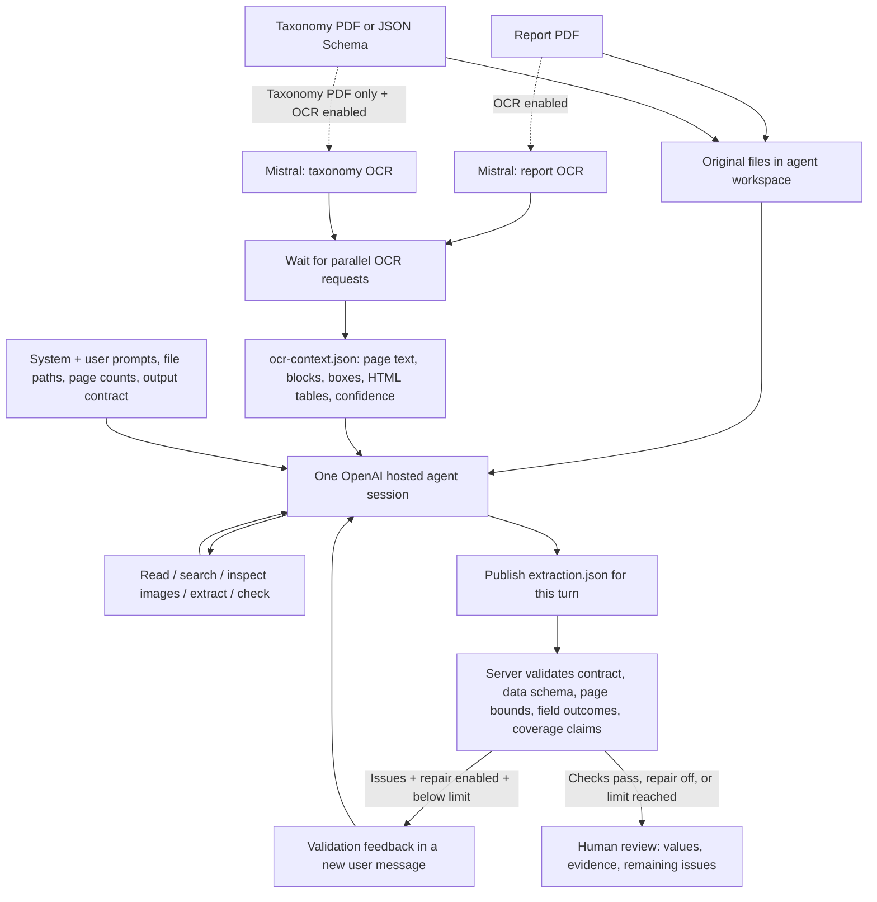

# Document lab

A small, standalone PDF extraction demo with a browser frontend. It has no
CityCatalyst dependencies, external database, frontend build, or application integration.
You can copy this directory into a separate project.

## Experiment review

The completed study is ready for review as an experiment. Start with:

| Question | Documentation |
| --- | --- |
| How does it compare with the recorded old benchmark? | [Results and interpretation](benchmarks/ORIGINAL_PDF_RESULTS.md) · [Per-report comparable table](benchmarks/BENCHMARK_TABLE.md) |
| How does the process work? | [Pipeline diagram](#how-the-pipeline-works) · [Validation and repair](#validation-repair-and-debugging) · [Benchmark method](benchmarks/README.md) |
| What should improve next? | [Prioritized next steps](NEXT_STEPS.md) |
| What is broken or limited? | [Known bugs, fixed bugs and experiment limitations](KNOWN_ISSUES.md) |

Code, prompts, schemas, offline reporting tools and public result tables belong
in the branch. Credentials, PDFs, Product keys, full traces and local run state
remain ignored. Reproducing historical outputs requires those private artifacts;
a fresh checkout alone does not contain them. This is a standalone experiment,
with no CityCatalyst application integration.

Upload a report PDF, then define what to extract using either:

- **Taxonomy PDF:** a second document explaining fields, categories, units, and rules.
- **JSON Schema:** paste or upload a Draft 2020-12 schema with a root `type: object`.

An OpenAI-hosted Codex agent investigates the files using its built-in execution
tools. The page shows job status, candidate values, supporting quotes, physical PDF
pages, missing or ambiguous fields, and downloadable JSON. Optional automatic
repair sends validation feedback back to the same session. A local SQLite journal
keeps repair decisions and candidate results across API-server restarts.

## How the pipeline works

The frontend's **How to** section explains this flow with a visual diagram.
The same architecture is shown here in Mermaid:



If both PDFs are supplied, their Mistral OCR requests run **in parallel with each
other**. The server waits for both before creating the OpenAI session. With JSON
Schema, only the report PDF needs OCR. OpenAI extraction does not run concurrently
with this preprocessing. When OCR is off, the original files go straight to the
agent workspace.

The agent receives the original report, the definition file, your prompts, file
paths, page counts, and the required result schema. When enabled, OCR adds a
separate structured context file. The agent reads these files as needed; the full
OCR response is not pasted into the initial prompt. Original PDFs and OCR are
available side by side, so it can find a table in OCR text and inspect the original
page to check headers, units, or footnotes. It chooses its tools; OCR does not force
a separate extraction route. Bounding boxes remain in OCR context; final result
evidence currently contains page numbers and quotes, without box highlights.

## Validation, repair, and debugging

**Automatically repair issues** is off by default. This still uses an agent tool
loop within the first turn; off means that server validation flags issues without
starting another agent turn. Enable it and choose **1–5 repair turns** (default 3)
to add a second loop controlled by the server:

1. Wait for the root agent turn to complete and read that turn's result artifact.
2. Check the JSON/result contract, user data schema, page bounds, field accounting,
   and reported page coverage. Flag ambiguous, unreadable, and unsearched fields.
3. If issues remain and repairs are enabled, send the concrete errors to the same
   hosted session. The agent retains its conversation and workspace, revisits the
   source, and publishes a complete replacement candidate for the new turn.
4. Validate again. Stop when checks pass or the repair limit is reached. Keep
   remaining issues and the latest candidate visible. If the output is unreadable,
   return `result: null` with the validation issues rather than inventing a result.

A field explicitly marked `not_found_after_search` does not itself trigger repair.
For the versioned GHGI demo schema, source-only semantic checks also flag
inconsistent removal signs, unsupported scope assignments, gross/net inclusion
conflicts and discrepancies beyond the source's declared rounding tolerance.
These checks never read Product answer keys.
Missing values can still conflict with a strict user schema; such errors remain
visible even after repairs. The repair prompt forbids invented values, quotes,
coverage, and schema changes. Automated checks do **not** prove factual accuracy,
quote accuracy, or correct taxonomy interpretation; source review remains required.

Each checked turn is retained under `repair.rounds`, including its candidate,
structured issues, resolved/new/persisting issue groups, changed data paths,
turn ID and reported usage. Final `repair_still_needed` and
`remaining_issue_count` make repair exhaustion explicit. A resolved issue group
is a validator outcome, not independent proof that its source fact is correct.

**Agent activity** shows current state, turn IDs, repair counts, timestamped server
decisions, validation feedback, public agent messages, commands, tool output, exit
codes, durations, and reported session usage. The UI polls about every 3 seconds;
this is not a token-by-token stream. It shows the latest 100 upstream items and
shortens long text. It does not expose private reasoning. **Download debug JSON**
saves that bounded activity snapshot and controller history; it can contain report
text. It is not a full transcript or a billing estimate. See the OpenAI session
logs for additional records. If activity retrieval fails, controller progress
continues and the page displays the error.
The benchmark runner requests `/activity?full=true` to page all public items;
text is still shortened, and private reasoning is excluded.
Its client reconnects interrupted read-only polling using the same saved job ID
and records retries in `poll-retries.jsonl`. It does not repeat an uncertain
extraction submission. The frozen experiment records any client-only harness
amendments separately from its extraction configuration.

The server runs the loop independently of browser polling. Keep the API server
running; closing the browser does not stop extraction/repair. SQLite defaults to
`.data/jobs.sqlite3` under this directory; override with `EXTRACTION_STATE_PATH`.
Run **one API worker per state file**. Persist the state directory when using
Docker. Restarting with the same state file resumes active controllers. Losing
that file loses local repair history/settings; older hosted session IDs can still
be inspected but are not automatically enrolled into a new repair loop.

The exact submitted JSON Schema is also saved under `.data/input-schemas/`
(or `input-schemas/` beside the configured state file). This is needed because
OpenAI does not allow downloading Files API inputs with purpose `user_data`.
Keep that cache with the journal across restarts; input-file cleanup also removes
its local schema snapshot. Expected benchmark answers are never stored there.

Repair intent, exact feedback, and a stable idempotency key (a request ID used to
avoid duplicate follow-up messages) are committed before submission. An uncertain
repair send can be reconciled using that same key/body;
ordinary first-job submission is never automatically repeated. Cancel records stop
intent locally before requesting remote cancellation, and prevents later repairs.
Provider failures pause/retry inspection; an explicit unrecoverable repair rejection
stops as `repair_error`, preserving the prior candidate and debug history.
Each extra turn can add OpenAI model/compute charges. This is a demo with bounded
repair attempts, not a total token, runtime, or cost budget.

## Run the local demo

For ready-to-load GHGI PDFs, schemas, Product keys, and repeatable comparison
commands, see [the benchmark setup](benchmarks/README.md). The frontend has a
**Try a benchmark** picker; expected answers are checked only after extraction.
An [offline comparison](benchmarks/README.md#metrics-and-old-baseline)
also scores saved city outputs against the recorded CityCatalyst benchmark with
the upstream PDF scorer, without new API calls.

Install Python 3.12 or later. In **Command Prompt (`cmd.exe`)**:

```cmd
cd /d C:\Users\mirco\Projects\CityCatalyst\pdf-extraction
run-demo.cmd
```

The script creates a `.venv`, installs dependencies, creates `.env` if missing, and
starts the server. Open [the demo](http://127.0.0.1:8080). **Preview example** shows
clearly labelled sample output without making an API call. The interface works
before you configure an OpenAI key; real extraction stays disabled.

To enable real extraction, stop the server with Ctrl+C, edit `.env`, and restart:

```cmd
notepad .env
run-demo.cmd
```

Set `OPENAI_API_KEY` to your OpenAI project key. The project needs Agents API access,
the configured model, `api.agents.read`, `api.agents.write`, `api.responses.write`,
and Files API permissions for input creation, reading, and deletion. The default
model is `gpt-6.1-sol`; `EXTRACTION_MODEL` can select another compatible model.
Model inference and hosted compute use your API billing. Your OpenAI key stays
on the server and is never sent to the browser or agent workspace.

The demo explicitly requests **medium reasoning effort**. Set
`EXTRACTION_REASONING_EFFORT` to `low`, `medium`, `high`, `xhigh`, or `max` in `.env`
and restart to change it for new extraction jobs. Higher effort can spend more
time and reasoning tokens; compare actual extraction quality before increasing it.
The active model and effort are available at `/v1/config`. Existing hosted sessions
keep their original settings.

Local mode requires no separate service token and only accepts loopback clients,
local Host headers, and same-origin browser requests. If you set the optional
`EXTRACTION_API_KEY` (at least 32 characters), the page asks for that access token.
The token stays in page memory. It is separate from your OpenAI key.

## Try the browser workflow

1. Upload a report PDF (unencrypted, up to 45 MiB), optionally adding a label.
2. Choose **JSON Schema** or **Taxonomy PDF** and supply the definition.
3. Click **Extract data**. The agent may take several minutes for a long report.
4. Review the fields, warnings, and quotes. Page links open the locally uploaded
   report. Download the JSON when ready.

Copy the job ID to resume polling after a disconnect. The most recent accepted ID
is also retained in this tab's session storage. A resumed job has no attached local
PDF preview, so its page buttons remain disabled. Replacing the report clears the
previous evidence view to prevent references from pointing to another document.

An extraction is never labelled as verified ground truth. Review the source before
using its values. The built-in example output is illustrative and is never returned
as if it came from an uploaded PDF.

## Edit the extraction prompts

The **Guide the extraction** card has two editable prompts:

- **System prompt:** the shared procedure, matching rules, and verification guidance.
  It is sent as the Agents API's `agent.instructions` for the new session.
- **User prompt:** guidance for the current report, sent as user message text. For
  example: "Extract 2023 values only. Prefer city-wide totals. Flag estimates and
  keep residential electricity separate from total electricity consumption."

The system editor starts with the actual default from `extractor/prompts/extract.md`;
the user editor starts with `extractor/prompts/user.md`. Expand **System prompt ·
agent instructions** to edit the full procedure. **Save in this browser** stores
both editors locally so they survive reloads. **Reset defaults** clears that saved
copy and restores the server defaults. These actions do not change the server's
prompt files or existing jobs. Edit the Markdown files to change shared defaults.

Each job receives its own prompt snapshot. The app appends the required result-file
contract from `prompts/contract.md` to the system instructions, and provides document
paths and schemas separately. Result validation still applies. Each prompt is
limited to 64 KiB of UTF-8 text. Do not save credentials in prompts.

## JSON Schema example

```json
{
  "type": "object",
  "properties": {
    "reporting_year": {
      "type": ["integer", "null"],
      "description": "Year of the reported observations"
    },
    "electricity_mwh": {
      "type": ["number", "null"],
      "description": "Annual electricity consumption in MWh within city boundaries"
    }
  },
  "required": ["reporting_year", "electricity_mwh"],
  "additionalProperties": false
}
```

Use descriptions to explain units, scope, and matching rules. Nullable types allow
missing values to be represented honestly. Nested objects, arrays, and local `$ref`
references are supported. External references are rejected; validation never
downloads URLs from a submitted schema. The schema limit is 256 KiB.

In JSON mode, `result.data` contains typed values in your requested shape. The
separate `result.fields` array holds outcomes and evidence using JSON Pointer
paths such as `/electricity_mwh` or `/years/0/consumption`. Each populated value
requires evidence; each explicit null still needs a field outcome. Missing data
that violates the target schema is returned with `validation.data_schema: failed`
and error details, rather than made up to satisfy validation.

In PDF mode, `result.taxonomy` contains fields interpreted from the definition,
and `result.fields` accounts for each field ID. Review this interpretation before
comparing results across reports; a versioned canonical taxonomy is a later step.

Outcomes are `found`, `ambiguous`, `not_found_after_search`, `unreadable`, and
`not_searched`. Evidence records preserve original value strings, units, years,
and geography. `pdf_page` is the one-based physical page, while `printed_page`
is the label printed on that page. The two numbers can differ.

The server checks result structure, field accounting, and page bounds. JSON mode
also validates `data` against your schema. These checks cannot independently prove
that quotes, values, mappings, or page-review claims are accurate. Format annotations
such as `format: date` are not separately enforced by this demo.

## Call the same backend from your code

The frontend uses these ordinary HTTP endpoints:

| Method and path | Purpose |
| --- | --- |
| `GET /v1/benchmarks` | List installed/missing test PDFs and answer-key readiness |
| `GET /v1/benchmarks/{id}` | Load a test schema and extraction guidance, without answers |
| `GET /v1/benchmarks/{id}/pdf` | Download an installed test PDF under normal API authentication |
| `POST /v1/extractions` | Submit multipart inputs; receive a durable job ID |
| `GET /v1/extractions/{id}` | Poll agent/validation/repair state and controller history |
| `GET /v1/extractions/{id}/activity` | Read bounded public messages/tool records plus controller history |
| `GET /v1/extractions/{id}/result` | Retrieve the final candidate and unresolved validation/repair issues |
| `POST /v1/extractions/{id}/cancel` | Request cancellation; poll to confirm it stopped |
| `DELETE /v1/extractions/{id}` | Remove a stopped session and request input-file cleanup |

Upload fields are `city_pdf` (report PDF, name kept for API compatibility), optional
`city` (report label), and exactly one of `taxonomy_pdf` or `data_schema` (JSON text).
Optional `system_prompt` and `user_prompt` form fields override the defaults for
one job. Omit them to use the server's default prompt files.
Optional `auto_repair=true` enables feedback turns; `max_repairs` is an integer
from 1 to 5 (default 3). Both are also available in the frontend and Python client.
Optional `benchmark_case` binds a submission to an installed case's exact PDF
bytes. Its completed result includes independent checks under `benchmark`;
expected answers are never sent to the agent or used as repair feedback.
For example, in local mode:

```cmd
curl -X POST http://127.0.0.1:8080/v1/extractions -F "city_pdf=@C:\reports\report.pdf;type=application/pdf" -F "data_schema=<C:\reports\schema.json"
curl -X POST http://127.0.0.1:8080/v1/extractions -F "city_pdf=@C:\reports\report.pdf;type=application/pdf" -F "data_schema=<C:\reports\schema.json" -F "auto_repair=true" -F "max_repairs=2"
```

The Python client supports both modes:

```cmd
.venv\Scripts\python.exe -m examples.extract --city "Example City" --city-pdf C:\reports\report.pdf --schema C:\reports\schema.json
.venv\Scripts\python.exe -m examples.extract --city "Example City" --city-pdf C:\reports\report.pdf --taxonomy-pdf C:\reports\taxonomy.pdf
.venv\Scripts\python.exe -m examples.extract --city "Example City" --city-pdf C:\reports\report.pdf --schema C:\reports\schema.json --auto-repair --max-repairs 2
```

Add `--system-prompt-file C:\reports\system.md` and/or
`--user-prompt-file C:\reports\request.md` to use your own UTF-8 prompt files from
the Python client. In ordinary HTTP calls, submit text fields such as
`-F "user_prompt=Extract 2023 data only and flag estimates."`.

For token-protected servers, set `EXTRACTION_API_KEY` for the client and use an
`Authorization: Bearer <service-token>` header in your own HTTP code. OpenAPI is
available at `/openapi.json` under the same access rules as the job API.

Jobs live in OpenAI sessions and survive a frontend or API-server restart. Keep
the ID and use the same OpenAI project and local state file. For controller-managed
jobs, `completed` means validation/repair has ended, including when issues remain.
It does not establish data correctness. Additional active states are `validating`,
`repairing`, and `cancellation_requested`; `repair_error` requires attention.
Results may fail validation. `needs_input` and `failed` need
inspection in your OpenAI project logs; this demo has no continuation/approval UI.

Do not automatically repeat submission after a timeout: the job may already exist.
This demo does not implement submission deduplication, spend limits, or automatic
retention cleanup. Cancel jobs you no longer need. After saving results, delete
stopped jobs through the API. If deletion returns `input_files_pending_cleanup`,
retain those IDs for administrative cleanup through the OpenAI Files API.

## Optional Mistral OCR

The **Use Mistral OCR** switch is off by default. To enable it, add this to `.env`
and restart the demo:

```ini
MISTRAL_API_KEY=your-mistral-key
MISTRAL_OCR_MODEL=mistral-ocr-4-1
```

When selected, the server sends the uploaded report and, when provided, taxonomy
PDF to Mistral's OCR API before starting the OpenAI job, in parallel when both PDFs
are supplied. Mistral returns page text,
HTML tables, structural blocks, and confidence information. This adds Mistral API
charges and processing time. The key stays in the server; it is never passed to
OpenAI or the agent workspace. When the switch is off, Mistral is not called.

The server keeps the original PDFs and uploads an additional `ocr-context.json`
through OpenAI's Files API. It mounts that file at `/workspace/ocr-context.json`
in the hosted agent environment and includes its path in the runtime user context.
The file identifies each original PDF, maps zero-based OCR indices to one-based
physical PDF pages, retains separate table contents, and lists missing OCR pages.
The agent can search this file, read relevant sections, and return to the original
PDF for ambiguous numbers, units, or footnotes. The full OCR text is not inserted
into the initial prompt. The required instructions explain how to use it even
when the editable extraction prompt is changed.

This is optional source context: the agent can work from the PDF without it.
Use the switch to compare results on the same report and schema. OCR output may
contain errors; its presence does not establish source accuracy. The result JSON
records the chosen OCR provider and requested model under `preprocessing`.

From code, add `use_mistral_ocr=true` to the multipart request, or add
`--mistral-ocr` to the Python client. If selected OCR fails, the server reports the
failure before starting an OpenAI extraction; it does not silently change modes or
automatically retry a paid request. OCR runs before a job ID is returned, so the
browser's cancellation control is available only after this preparation finishes.
Keep the submission page open. A disconnected or timed-out request can still incur
OCR charges. Allow up to 600 seconds for submission in external clients/gateways.
The demo limits each OCR response and the combined context to 20 MiB. Job deletion
also requests deletion of the OCR context file from OpenAI storage.

## What reads the PDF?

This path uses the **Agents API with a hosted workspace**. The agent has PDF text
extraction packages, Poppler page rendering, and its available image capabilities.
Tesseract with English, Spanish, and Portuguese data is available as an optional
fallback for scans. It is not a claim about OpenAI's internal OCR engine. The
prompt requires the agent to report unavailable visual inspection or OCR limits.
The Mistral switch controls additional preprocessing, not whether the agent may
use its available local PDF or OCR tools.

Native PDF input in the **Responses API** is a separate route: OpenAI supplies
extracted text and page images automatically. Merely placing a PDF in an Agents
API workspace does not mean every page is already in the model's visual context.

## Docker and checks

Docker is optional. Set `OPENAI_API_KEY` and a strong `EXTRACTION_API_KEY` in `.env`
for container use, since the container may see a non-loopback client address:

```cmd
docker build -t document-lab .
docker run --rm --env-file .env -e EXTRACTION_STATE_PATH=/state/jobs.sqlite3 -v document-lab-state:/state -p 127.0.0.1:8080:8080 document-lab
```

Benchmark PDFs and private keys are excluded from the image. To use prepared
local cases inside Docker, also mount
`-v "%CD%\benchmarks\.local:/service/benchmarks/.local:ro"` from this directory.

For checks, from this directory:

```cmd
.venv\Scripts\python.exe -m pip install -r requirements-dev.txt
.venv\Scripts\python.exe -m pytest tests -q
.venv\Scripts\python.exe -m black --check extractor examples tests
```

Tests mock OpenAI calls. Browser checks cover both upload modes, result views,
download, evidence reset, and mobile layout with mocked job responses. These do not
verify live API compatibility or extraction quality on real reports. Run a paid
end-to-end check with representative PDFs before relying on the output.

The app is contained in `extractor/`: `api.py` serves the frontend and API,
`provider.py` manages hosted sessions/files/artifacts, `jobs.py` persists and runs
the bounded validation/repair controller, `ocr.py` handles optional
Mistral preprocessing, `prompting.py` loads editable
prompts, `schema.py` validates user
schemas, `models.py` defines result contracts, and `prompts/extract.md` defines the
agent's procedure. `static/` needs no JavaScript build. Runtime network access in
the agent environment is disabled; packages are prepared before the agent starts.

Official references: [Agents API](https://developers.openai.com/api/docs/guides/agents-api/overview),
[hosted environments](https://developers.openai.com/api/docs/guides/agents-api/environments/openai-hosted),
[files and artifacts](https://developers.openai.com/api/docs/guides/agents-api/environments/files),
and [native PDF inputs](https://developers.openai.com/api/docs/guides/file-inputs).
Mistral references: [OCR processor](https://docs.mistral.ai/studio/document-processing/basic_ocr)
and [OCR API](https://docs.mistral.ai/api/endpoint/ocr).
