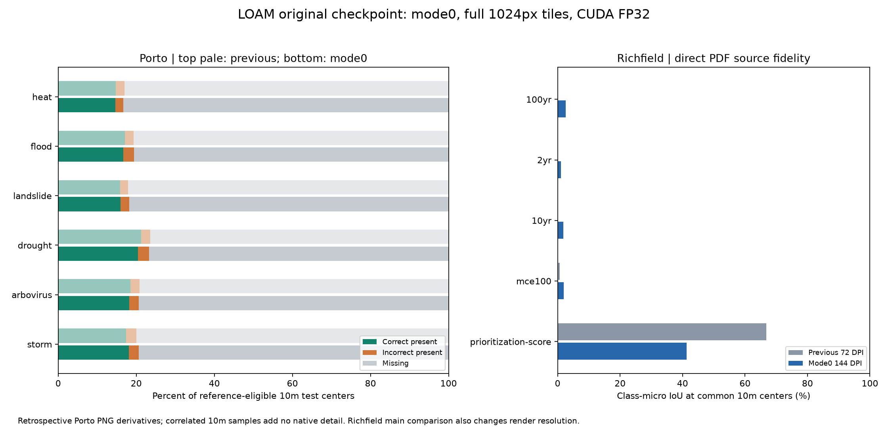

# LOAM mode0 quality rerun — 2026-11-01

**Completed all 11 requested layers and all five 72 DPI controls.** The pinned official paper checkpoint ran in CUDA float32 with canonical 1024×1024 tiles. No shortened strips, mixed precision, mode downgrade, retraining, or reference-based prediction tuning was used.

**Porto six-hazard macro exact-and-present on the unchanged 10m test locations: 17.47% → 17.33% (-0.15 percentage points). Macro missing: 80.21% → 80.21%.** Full per-hazard and pooled counts follow. Improvements and regressions are not a claim of decision-ready hazard reconstruction.
**The highest-accuracy supported mode did not deliver an overall quality upgrade on these maps.** Richfield prioritization common10m class-micro IoU changed from 66.80% to 41.34% (-25.46pp). Inundation overlap became nonzero but remains low, with substantial source-background false positives. This conclusion preserves the negative result; no settings were retuned to the reference.

## Execution identity and actual interface

- Read-only upstream `../loam/upstream`, commit `8176ace4f1d5af56baa8d3bd8481c7ed8cccf048`; unchanged before/after SHA-256 checks for source and prior aids. No old trial files, repository files, or checkpoint were edited.
- Original paper checkpoint `../loam/checkpoint_epoch14.pth`, SHA-256 `3ad85414a951ece88bf9a14daaf74b5b98ea6333695b45e410ce519262b32f73`. Original LOAM architecture (31,061,202 parameters), mask values `[0,1]`, strict load reports all keys matched.
- The pinned upstream README explicitly defines **0 as highest accuracy / lowest efficiency** and 6 as highest efficiency. `metadata_preprocessing.py` enables recoloring at modes ≤1 and step5 / text matching at mode0. Actual mode0 output channels were generated; this was not a flag-only rerun of old bitmaps.
- Actual upstream bitmap worker mapping: `[v7, v4v, c0_x, c1_x, crop_blackregion, overall_boundary_candidate, rc_v0]`. The stock worker creates every 1024-square tile, applies OpenCV grayscale conversion, binarizes channels 0/1/4, and pads bottom/right with zeros. `BasicDataset.preprocess(scale=1)` performs normalization. The original network receives 32 color and 9 map metadata values; output uses the original same-size bilinear interpolation and two-class argmax.
- All full figures/pages are tiled from origin (0,0), stride1024, batch1. No crop-dependent context reduction or overlap. CPU float32 softmax probabilities are saved losslessly. Overlapping accepted classes use highest foreground probability; exact ties select lower legend index; no accepted class is unknown255. This arbitration is unchanged from the prior trial.
- Manual source-derived bounds and legend aids are retained: ten native Porto legend swatches and Richfield sidebar source symbols. Richfield144DPI uses whole 2448×1584 pages and geometrically scaled source legend coordinates. Automatic map-area segmentation/GDAL polygon-output integration is bypassed with explicit source bounds; its eagerly imported area generator is fail-closed. Source-only preprocessing and network inference never import the evaluation reference PNGs or recovered in-map vectors.
- Original preprocessing algorithm and upstream source are unmodified. A serial Pool shim deep-copies each job’s arguments to preserve process isolation, and the upstream CPU-count override is disabled. All mode0 stages, including recoloring and dynamic thresholds, execute. Manual swatches contain little/no text; an empty text-match candidate list is an upstream data outcome, not a skipped mode0 stage.

## Environment and resources

- New isolated `.venv`: Python3.11.15, PyTorch2.5.1+cu124 / torchvision0.20.1+cu124, NumPy1.26.4 and upstream OpenCV4.6.0.66. Prior `.venv` is untouched. This is a compatibility adaptation from the original Python3.9/PyTorch1.13 environment, validated by strict load and completed inference; it is not a byte-identical paper environment.
- NVIDIA RTX4070Ti, 12,282MiB total. Initial observation: 10,467MiB free GPU and 3,663,964KiB free physical host RAM. No host configuration changes, process killing, paid calls, contacts, training, commits, or PRs.
- Full FP32, TF32 disabled, CUDA/cuDNN defaults with benchmarking disabled; deterministic-algorithm enforcement was not enabled, and bitwise cross-device reproducibility is not claimed. Observed peak GPU allocation 2092.9MiB; reserved 2686.0MiB. The full canonical probe passed (see `evidence/canonical-cuda-probe.json`). No VRAM fallback was needed.
- Serial preprocessing was still memory-heavy: sampled own-process-tree peak 8669.4MiB; lowest sampled free host RAM 48.3MiB. Paging/other host load can affect timing; serial workers did not guarantee a4GiB resident cap. Every stage completed without suppressing an allocation failure. Metrics are quality measurements, not resource-efficiency rankings.
- Atomic exclusive `../gpu.lock` acquired per inference process and removed in `finally`; validation confirms this run owns no remaining lock. Other owners are never removed. Sampled memory peaks are observations, not guarantees against shorter spikes.

## Frozen scoring contract and limits

Configuration frozen at 2026-11-01T09:22:45.159127+00:00, SHA-256 `5156bff19034c5d68e997f68b2601e5c3684eb4adc9d20fd68849d1568e31696`. No prediction settings changed after scoring. Extra72DPI controls were predeclared. Evaluation is a separate process.

The existing `benchmark_10m_all.py` (SHA-256 `0971db0d66b165c6de551461e2dc95af1e44ced0e151a7465e890cb257ac7a15`) is imported unchanged for `reference_grid`, `sample`, `scores`, and `save_grid`. Porto remains EPSG:31982, originE462000/N6692000, shape4200×3800, 10m centers. Reference is the native reference pixel containing the center; valid means value!=255. Prediction sampling, municipal domain, literal risk thresholds .2/.4/.6/.8 and existing physical3km SHA256 test blocks are unchanged. **No250m averaging.** Every previous LOAM grid matches the saved TIFF pixel-for-pixel; all integer counts and confusion matrices match exactly, and new eligible counts match exactly. The initial evaluator stopped on last-bit MAE/bias float differences (~7e-18 for flood); these are retained in `prior_float_rounding_differences` and checked with rtol1e-13/atol1e-15. No contract or prediction changed; `logs/evaluate-first.log` preserves that failed exact-float assertion.

Porto references are same-author indexed PNG derivatives; original TIFF provenance is not authenticated. Native source pixels are roughly30m, so repeated10m samples add no information or independent observations. This is retrospective, not blind evaluation. Missing predictions, incorrect-present predictions, and predictions unsupported by a reference value are separate. Unsupported reference does not establish a false positive. MAE/bias are on common valid locations only; exact-all counts missing as unsuccessful.

Richfield evaluation calls `richfield.source_shapes` directly on the source PDF, including both f/fs fills, clipping, winding rules and draw order, with the embedded GeoPDF transform. It compares against pre-label/stroke source geometry, not independent flood truth. Native-resolution pixel-center metrics, continuous page-area metrics and common10m-center metrics remain separate. Source-background false positives are known absence of this PDF layer, not the Porto concept of an unsupported reference. No fitted alignment or reference-derived prediction masks.

## Porto: same10m test centers

| Hazard | Eligible | Previous exact-all % | Mode0 exact-all % | Δ pp | Previous missing % | Mode0 missing % | Incorrect present | Unsupported ref / predicted |
|---|---:|---:|---:|---:|---:|---:|---:|---:|
| heat | 314,267 | 14.78 | 14.62 | -0.15 | 82.99 | 83.36 | 6,343 | 39,234 / 91,530 |
| flood | 120,694 | 17.07 | 16.63 | -0.43 | 80.64 | 80.60 | 3,334 | 59,544 / 82,953 |
| landslide | 311,623 | 15.84 | 15.96 | +0.12 | 82.13 | 81.81 | 6,942 | 41,066 / 97,746 |
| drought | 313,452 | 21.22 | 20.46 | -0.76 | 76.44 | 76.77 | 8,689 | 41,101 / 113,921 |
| arbovirus | 314,294 | 18.54 | 18.16 | -0.39 | 79.14 | 79.37 | 7,764 | 39,582 / 104,407 |
| storm | 314,294 | 17.41 | 18.13 | +0.72 | 79.93 | 79.37 | 7,863 | 39,877 / 104,716 |

Six-hazard **macro** exact-all 17.4749% → 17.3266%; missing 80.2099% → 80.2147%; common-only MAE 0.048211 → 0.049059; high-risk recall 0.0000% → 0.0027%.

**Pooled previous**: 295,891/1,688,624 exact-and-present (17.5226%); 1,353,599 missing; 39,134 incorrect-present; 30,968/365,993 predictions without reference support. These are pooled counts, not the macro average.

**Pooled mode0**: 293,934/1,688,624 exact-and-present (17.4067%); 1,353,755 missing; 40,935 incorrect-present; 260,404/595,273 predictions without reference support. These are pooled counts, not the macro average.

## Richfield: direct PDF geometry, same10m centers

| Layer | Previous72DPI micro-IoU % | Mode0 144DPI micro-IoU % | Δ pp | Mode0 precision % | Mode0 recall % | Mode0 continuous-area micro-IoU % |
|---|---:|---:|---:|---:|---:|---:|
| inundation-100yr | 0.00 | 2.63 | +2.63 | 7.69 | 3.84 | 2.54 |
| inundation-2yr | 0.00 | 1.05 | +1.05 | 1.62 | 2.91 | 1.05 |
| inundation-10yr | 0.00 | 1.89 | +1.89 | 4.41 | 3.19 | 1.88 |
| inundation-mce100 | 0.74 | 1.94 | +1.20 | 6.39 | 2.71 | 1.90 |
| prioritization-score | 66.80 | 41.34 | -25.46 | 43.97 | 87.36 | 41.45 |

Primary Richfield comparison changes both render resolution and mode/tile context. It cannot assign all improvement to mode0. Below, the72DPI control uses byte-identical previous source TIFF/legend/bounds files. Each row uses the same72DPI source pixel centers; there is no cross-resolution averaging.

| Layer | Previous mode6/strips72DPI micro-IoU % | Mode0/full1024 at72DPI micro-IoU % | Δ pp | Primary mode0 at144DPI native-center micro-IoU % (different resolution) |
|---|---:|---:|---:|---:|
| inundation-100yr | 0.00 | 2.09 | +2.09 | 2.52 |
| inundation-2yr | 0.00 | 0.55 | +0.55 | 1.04 |
| inundation-10yr | 0.00 | 1.39 | +1.39 | 1.86 |
| inundation-mce100 | 0.77 | 3.96 | +3.18 | 1.91 |
| prioritization-score | 66.93 | 33.65 | -33.29 | 41.54 |

## Runtime and preserved artifacts

| Layer | Preprocessing s | Inference stage s | Full tiles | Accepted raw pixels |
|---|---:|---:|---:|---:|
| porto-heat | 29.32 | 18.20 | 40 | 47,986 |
| porto-flood | 25.30 | 20.22 | 40 | 46,116 |
| richfield-inundation-100yr | 16.59 | 7.19 | 6 | 139,666 |
| porto-landslide | 35.59 | 23.57 | 40 | 48,383 |
| porto-drought | 31.14 | 23.62 | 40 | 55,396 |
| porto-arbovirus | 31.09 | 20.29 | 40 | 52,131 |
| porto-storm | 32.10 | 22.39 | 40 | 50,285 |
| richfield-inundation-2yr | 16.26 | 6.08 | 6 | 220,850 |
| richfield-inundation-10yr | 16.34 | 6.08 | 6 | 125,341 |
| richfield-inundation-mce100 | 19.45 | 6.07 | 6 | 147,587 |
| richfield-prioritization-score | 29.67 | 13.16 | 24 | 554,310 |
| richfield-inundation-100yr-72dpi-control | 3.75 | 4.06 | 2 | 49,464 |
| richfield-inundation-2yr-72dpi-control | 3.67 | 4.05 | 2 | 59,787 |
| richfield-inundation-10yr-72dpi-control | 3.74 | 5.08 | 2 | 48,545 |
| richfield-inundation-mce100-72dpi-control | 3.86 | 4.06 | 2 | 50,478 |
| richfield-prioritization-score-72dpi-control | 6.56 | 6.07 | 8 | 155,908 |

Preprocessing column uses the wrapper internal timer; inference column uses scheduler process wall time, including startup/postprocessing. Initial heat preprocessing and the one-tile canonical probe were outside the scheduler. `run-status.json` preserves per-stage sampled memory, exact commands and timestamps. No aborted or partial outputs are counted as completed.

- `metrics.json`: all/test Porto confusion/counts, per-class Richfield pixel/grid/continuous scores, separate macro and pooled Porto results,72DPI controls.
- `predictions/<layer>/`: full `labels.png`, per-class binary masks and float32 probability arrays, overlap counts, per-class bitmap hashes and completion records.
- `evaluation/porto/<hazard>/{previous,mode0}-10m.tif`:12 georeferenced10m TIFFs. `evaluation/richfield/<layer>/{source,previous72,mode0}-10m.tif`:30 TIFFs including controls; EPSG:26915, unchanged GeoPDF source transform.
- `inputs/`: full native Porto /144DPI Richfield sources, scaled legend samples and bounds; exact72DPI controls. `intermediate/` and `bitmaps/`: complete mode0 metadata and actual normalized-input source tiles.
- [Interactive aligned overlays](overlay.html), focused and full PNGs in `evidence/`, and `evidence/alignment.json`. The focus crops were inherited source-only geographical/page locations, not selected to maximize scores. Previous masks are nearest-neighbor enlarged only for display.
- `validation.json`: 16 complete runs, 42 georeferenced10m TIFFs, unchanged frozen config, strict loads, full shapes, finite probabilities, exact accepted-winner arbitration, unchanged old source hashes, released own GPU lock. `artifact-hashes.json`, `read-only-input-hashes.json`, `requirements-lock.txt`, `logs/`, adapter diffs, `commands.ps1` preserve reproduction evidence.

## Scope boundary

This execution assignment reran LOAM. DIGMAPPER was not executed or counted as LOAM success; its separate existing trial remains outside this directory. No claim is made about new DIGMAPPER availability or accuracy by this LOAM run. The model was trained for geological polygon extraction; these flood/risk maps are a different domain. All quality statements above are measured on the specified existing sources and evaluation definitions.
